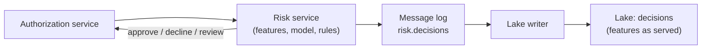
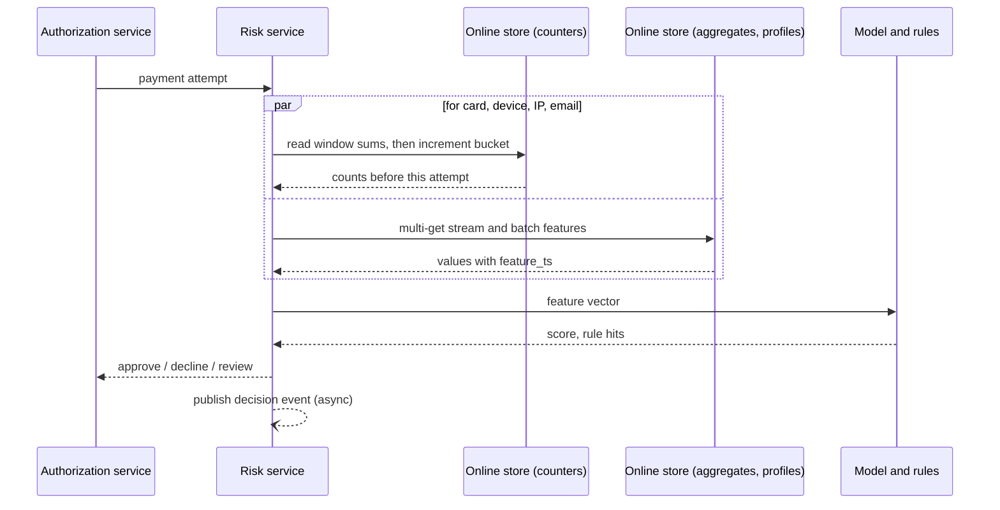
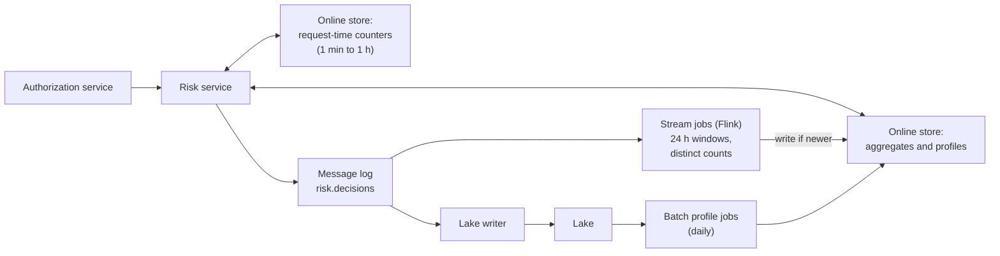
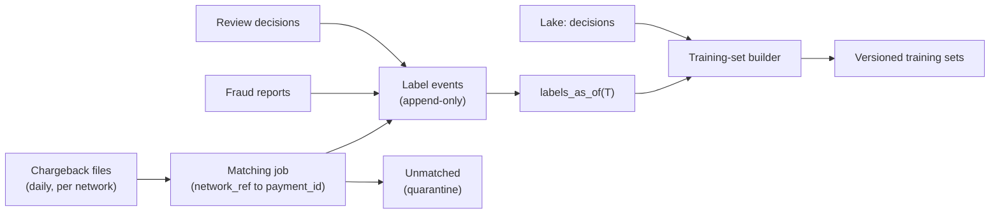
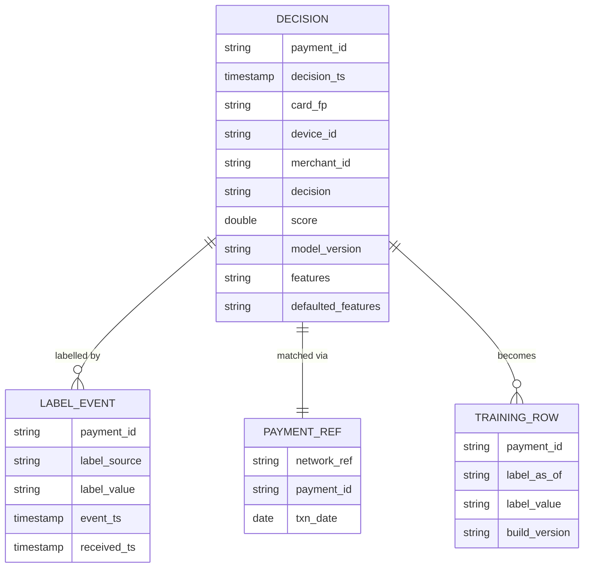
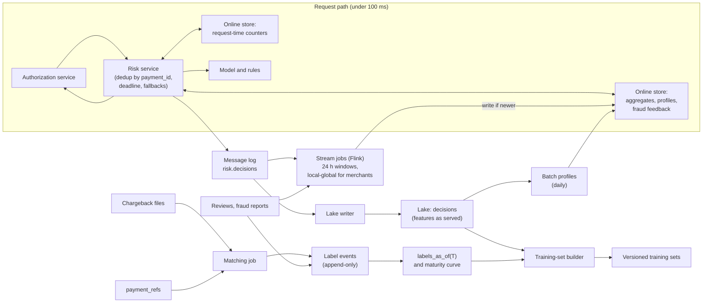

# Design a Real-Time Payment Fraud Detection Pipeline

A card payment waits while your system decides whether it is fraud, and the decision has to be made in well under a tenth of a second. Whether that decision was right, you may not learn for two or three months. This breakdown is about the data system that sits between those two clocks: computing fresh features in milliseconds, keeping per-card state in a stream, and turning labels that arrive weeks late into training data. The fraud model itself is below the line.

## Understanding the Problem

The prompt:

> "We are a payment processor. Merchants send us card payments, and for each one we decide in real time whether to approve it, decline it or send it for review. Design the data pipeline behind that decision: the features the fraud model uses, and the data it learns from."

A few payment terms first. An **authorization** is the request "may this card pay $42 at this merchant?"; the answer has to come back while the customer waits at checkout. The card's **issuer** is the bank that issued it. When a cardholder tells their bank "I didn't make this payment", the bank reverses it and takes the money back from the merchant. That reversal is a **chargeback**, and for this system it is the main **label** (the outcome a model learns to predict): a payment that got a fraud chargeback was fraud.

Fraud models lean on **velocity features**: counts and sums over a recent window per entity, such as "payment attempts on this card in the last 10 minutes" or "distinct cards used from this device in the last hour". An **entity** is the thing a feature describes, identified by a key: a card, a device, an IP address, an email, a merchant. Velocity features catch the most common attack. In **card testing**, a fraudster with a list of stolen card numbers runs a script that tries hundreds of small payments from one device, to find which cards still work. Each card is tried once, so per-card features look normal; the device and IP counts explode.

The central tension has three parts:

1. **Millisecond features for a synchronous decision.** The payment is blocked until you answer. The features must be computed and read inside a budget of about 25 ms (the model takes about 30 of the 100 ms total, leaving the rest for network hops and rules), and they must include the attempt the same device made 200 ms ago.
2. **Stateful streaming.** Velocity features are state: per-key counters and sets kept over sliding windows, across hundreds of millions of keys, that must survive crashes and replays without counting a payment twice.
3. **Delayed feedback labels.** In this breakdown's assumptions, a chargeback arrives 30 to 120 days after the payment (real deadlines vary by network, issuer and dispute type). Today's fraud looks legitimate in today's data, and the payments you declined never get a label at all.

This builds on the [Feature Store](../05-breakdowns-core/08-feature-store.md) breakdown, which defines online and offline stores, point-in-time joins and training-serving skew. Read that first if those terms are new. Here you reuse that platform and add what is specific to fraud: features computed inside the request, and labels that mature slowly.

Say the framing in one sentence: "The model is someone else's problem. Mine is making sure it sees the right numbers in 25 ms, and learns from labels that show up months later."

## Requirements

*About 7 minutes.* Ask about the decision budget, the attacks, and where labels come from:

> **You:** "How long does the fraud check get inside the authorization?"
> **Interviewer:** "The whole risk decision has 100 ms at p99. The model takes about 30 of that."
> **You:** "If a script makes 50 attempts from one device in 10 seconds, should attempt number 3 already see the first two?"
> **Interviewer:** "Yes. Card testing is our biggest loss line. Seconds of lag means dozens of attempts get through."
> **You:** "Where do fraud labels come from, and how late?"
> **Interviewer:** "Chargebacks, mostly. They come in daily files from the card networks, up to about four months after the payment; most arrive in 30 to 60 days. We also have manual review decisions and cardholder fraud reports, which are faster."

Each answer becomes a design driver: a feature budget, read-your-own-writes freshness for some features, and a label pipeline that waits months.

### Functional requirements

1. **Compute features for every payment attempt** at decision time: per-entity velocity features over short windows (1 minute to 1 hour), longer aggregates (24 hours), and long-term profiles (90 days), for cards, devices, IPs, emails and merchants.
2. **Record every decision**: the payment, the exact feature values the model saw, the score, the decision and the model version.
3. **Collect labels** from chargebacks, manual reviews and fraud reports, and match each one to its payment.
4. **Build training sets** that pair what the model saw with labels as they were known at a chosen time.

**Below the line (out of scope):** the model and its training, the rules engine's logic, the review team's tooling, payment routing and settlement, and storing card numbers. The payments system hands you a **card fingerprint** (a stable token derived from the card number), never the number itself, which helps keep this pipeline out of the strictest card-data compliance scope (confirm with your compliance team).

### Non-functional requirements

- **Scale:** 200 million payment attempts a day; peaks of 5x average on sale days. About 300 million cards, 2 million merchants.
- **Decision latency:** feature assembly p99 under 25 ms; the full risk decision p99 under 100 ms.
- **Freshness:** short-window velocity features include every earlier attempt, even one a few milliseconds earlier. 24-hour aggregates lag by under 5 seconds (p99). Profiles are rebuilt daily by 06:00. A confirmed fraud (from review or a report) reaches the online features within 1 minute.
- **Correctness:** a retried or replayed payment never counts twice in any velocity feature.
- **Availability:** a payment always gets a decision. If features are slow or missing, the decision degrades; it never errors.
- **Labels:** a chargeback is matched to its payment within 24 hours of its file arriving, for at least 99.5% of chargebacks.

> [!TIP]
> Ask for freshness per feature, not per system. "The device count must include the attempt 200 ms ago, the 90-day profile can be a day old" is what splits the design into three paths.

## Sources & Volume

*About 4 minutes.* Sources:

- **Payment attempts**, from the authorization service, synchronously: the risk service is called in the request path.
- **Authorization outcomes** (approved, declined by the issuer), as events on the message log.
- **Label sources**: chargeback files from the networks (daily batch), manual review decisions (events, hours later), cardholder fraud reports via issuers (days later).
- **Reference data**: merchant records, BIN tables (the card's issuing bank and country, looked up from its first digits), IP geolocation.

The numbers, from [Key DE Numbers](../02-core-concepts/10-key-de-numbers.md):

1. **Rate.** "200 million a day is about 2,300 attempts a second. Sale-day peaks at 5x are about 12,000. I'll size for 15,000."
2. **Event size and log volume.** "An attempt is about 1.5 KB. The decision record carries about 400 feature values plus metadata, around 4 KB. At peak that's 15,000 × 5.5 KB, about 80 MB/s into the message log. That is a small cluster, about 8 partitions at 10 MB/s each; I'll take 48 so the stream job can run 48-way parallel."
3. **Lake.** "Decisions are about 200 million × 4 KB = 800 GB a day raw, about 160 GB as Parquet. Two years, which training needs because labels take four months, is about 117 TB: roughly $2,700 a month on object storage. That's cheap, so I log every decision with its full features and don't sample."
4. **Online operations.** "Each attempt updates and reads short-window counters for about 4 entities (card, device, IP, email), and reads about 13 precomputed feature values across entities. At 15,000 a second, that's about 60,000 counter updates and 200,000 reads a second, all inside a 25 ms budget."
5. **Labels.** "If about 0.1% of approved payments are fraud, that's around 200,000 fraud labels a day once they've all arrived, spread over four months. A tiny stream; the hard part is time, not volume."

What the numbers imply:

> "Volume is modest: 80 MB/s and 160 GB a day. This is a latency and correctness problem. The hard parts are the 25 ms read path and the four-month label delay."

## High-Level Design

*About 14 minutes.* The data flow in numbered hops:

1. The authorization service calls the **risk service** with the payment.
2. The risk service **assembles features**: some computed right now, some read from the online store.
3. The model and rules score it; the risk service returns a decision.
4. The risk service **logs the decision** with every feature value to the message log.
5. **Stream jobs** turn payments into longer-window aggregates and write them to the online store.
6. **Batch jobs** build long-term profiles and training sets in the lake.
7. **Labels** arrive over months, are matched to decisions, and feed training (and, when fast, the online features).

### 1. Logging every decision

Start with the record everything else depends on. The risk service publishes a decision event for every attempt: `payment_id`, the entity keys, amount and merchant, the full feature vector, the score, the decision, the model and rule versions, and which features were missing or defaulted.

Why log features instead of recomputing them later? Because several of them come from a counter that only existed for an hour, and because the [Feature Store](../05-breakdowns-core/08-feature-store.md) lesson's **log and wait** is the cleanest way to avoid **training-serving skew** (any difference between what the model saw in training and in production): log what the model saw now, join labels when they arrive. At 160 GB a day there is no reason to sample.

### 2. Velocity features in milliseconds

This is the central decision. Take the card-testing attack: one device, 300 attempts in 60 seconds, each with a different card. You want the device's `attempts_1m` to read 1, 2, 3, ... as they come in.

#### Bad Solution: Count from the payments database per request

At decision time, run `SELECT COUNT(*) FROM payments WHERE device_id = ? AND ts > now() - interval '1 hour'` against the transactional database, one query per feature.

It is exact and always fresh. It also costs a range scan per feature per entity: about 15 features × 4 entities × 15,000 attempts a second is 900,000 range queries a second against the database that records payments. A hot device or IP turns into a lock-contended index range, and p99 goes from milliseconds to hundreds of milliseconds exactly during an attack. Analytical queries do not belong in the authorization's request path.

#### Good Solution: A stream job computes velocity features into the online store

Every attempt goes onto the message log. A [Flink](../04-technology-deep-dives/08-flink.md) job keyed by device (and separately by card, IP, email) keeps sliding-window counts in **keyed state** (per-key memory the job keeps for each device or card) and writes the latest values to the online store. The risk service reads them by key in about a millisecond.

The read is fast and the database is out of the path. Where it falls short is the race. The attempt reaches the stream job only after the risk service has decided and published it: a replicated Kafka write (5 to 50 ms at p99), processing, then a write to the online store. End to end that is typically a few hundred milliseconds to a couple of seconds, and tens of seconds when the job is catching up after a restart. At 5 attempts a second, a 3-second lag lets the first 15 attempts through with `attempts_1m = 0`. The lag hides exactly the burst you are trying to catch.

#### Great Solution: Three freshness tiers, with short windows counted inside the request

Split features by how fresh they must be, and compute each tier where that freshness is cheap:

| Tier | Examples | Computed | Freshness |
|---|---|---|---|
| **Request-time counters** | attempts and amount per card, device, IP, email over 1 min, 10 min, 1 h | In the online store, atomically, during the request | Includes every earlier attempt |
| **Streaming aggregates** | distinct cards per device 24 h, distinct merchants per card 24 h, merchant decline rate 1 h | Flink, written to the online store | Seconds behind |
| **Batch profiles** | card's usual countries and amounts over 90 days, merchant risk tier | Daily batch, materialized to the online store | Up to a day old |

The request-time counters work like this. For each entity, the online store (an in-memory key-value store such as Redis) holds one small hash per key, with one field per 10-second bucket for the last hour (count and amount; empty buckets are not stored). The risk service runs one atomic server-side script per entity that **reads the current window sums, then increments the current bucket**, and returns the values from before the increment. So the feature means "attempts *before* this one", in training and in serving alike. Four entities are four scripts on up to four shards, sent in parallel: a millisecond or two.

Why not do everything this way? Because only simple sums and counts are cheap to keep per bucket. A distinct count over 24 hours needs a set per key, and longer windows need more buckets; those belong in a stream job, where a few seconds of lag doesn't matter. Nobody's 24-hour distinct-merchant count changes meaningfully in two seconds.

In the request path, **event time and processing time are the same moment**: the payment is happening as you count it. No watermark, no late events. The stream tier is where those problems live, and it only carries features that tolerate them ([Late-Arriving Data](../02-core-concepts/08-late-arriving-data.md)).

The stream and batch tiers are exactly the feature store's streaming and batch feature views, with its **write-if-newer** rule (overwrite a value only if the incoming `feature_ts` is newer). The request-time counters are the one part a general feature store does not give you.

> [!WARNING]
> Don't say "Flink, so it's real time" and stop. The interviewer is waiting to ask whether attempt 3 sees attempts 1 and 2. A pipeline that runs after the decision can never include the decision just before it.

### 3. Labels that arrive months later

A payment on 1 March gets its chargeback on 14 April. Assume the label arrival curve (measure it; this is typical in shape): about 50% of eventual fraud chargebacks within 30 days, 85% within 60, 95% within 90, 99% within 120.

#### Bad Solution: Label everything with what you know today

Every night, mark each payment fraud if it has a chargeback so far, legitimate otherwise, and train on the last 90 days.

Payments from last week have almost none of their chargebacks yet, so nearly all of last week's fraud is labelled legitimate. Worse, the newest attack patterns are the most mislabelled, because they are the most recent. The model learns that this month's fraud is fine.

#### Good Solution: Train only on mature payments

Use only payments older than 90 days, whose labels are about 95% complete. This **label maturity** cutoff (the age after which a payment's label is considered settled) is the fraud version of the [label window](02-video-recommendations.md) in video recommendations, which is 24 hours there and about three months here.

The labels are right. But the model is always trained on fraud from three to six months ago, while fraudsters change tactics in weeks. And a training set built today and rebuilt next month gives different labels for the same rows, so nobody can reproduce last month's model.

#### Great Solution: An append-only label log, read as of any time

Store labels as **events**, never as an updated flag:

| `payment_id` | `label_source` | `label_value` | `event_ts` | `received_ts` |
|---|---|---|---|---|
| p_881 | `review` | fraud | 1 Mar 14:20 | 1 Mar 16:05 |
| p_881 | `chargeback` | fraud | 9 Apr | 14 Apr 02:00 |
| p_902 | `chargeback` | fraud | 2 Apr | 3 Apr 02:00 |
| p_902 | `chargeback_reversal` | not_fraud | 20 Apr | 22 Apr 02:00 |

Then derive labels **as of** a time: "for each payment, the latest label event with `received_ts` at or before T". That one rule gives you three things:

- **Reproducible training sets.** A set built "as of 1 June" gives the same labels next year, because later events are filtered out. Version it, the way video recommendations versions label partitions.
- **Honest evaluation.** To test a new model the way it would have run in March, use labels as of March plus 60 days, and the maturity curve tells you how incomplete they are.
- **Use of recent data.** Faster sources (review decisions in hours, fraud reports in days) label part of last month's fraud early. The modeling team can train on recent payments with source-aware labels and correct for the known maturity curve. How they correct is modeling; publishing the curve as a table, per payment age and merchant category, is your job.

Matching chargebacks to payments is a batch join. A chargeback file carries the card network's reference for the original transaction, not your `payment_id`, so the authorization flow stores that reference on the payment. Chargeback files also carry the original transaction date, so the daily matching job joins about 200,000 chargebacks against only the `network_ref → payment_id` partitions for the transaction dates the file names, instead of scanning four months of payments. Unmatched chargebacks go to a quarantine table and a daily count.

### 4. Feeding confirmed fraud back into features

Fast labels are worth more than training rows. If a reviewer confirms at 14:20 that card `c_77` was used fraudulently, the device and email behind it should look risky on the very next attempt, not after the next retrain. So label events also flow into the stream job, which maintains features such as `device_confirmed_fraud_90d` and `email_linked_fraud_cards_30d` in the online store, within the 1-minute freshness target.

This creates a trap. In serving, the device looked risky only *after* 14:20. If a training row for a payment at 13:00 that day gets `device_confirmed_fraud_90d = 1`, the model has learned from the future. This is **data leakage**, and these features need `available_ts` (when the value became readable online, not when the fraud happened) exactly as the [Feature Store](../05-breakdowns-core/08-feature-store.md) point-in-time join uses it. Logging features at decision time sidesteps this for training rows that already exist; backfills of new label-derived features must use `received_ts`, never `event_ts`.

## Data Model

*About 5 minutes.* Four structures matter: the decision record, the label events, the counter layout, and the training rows.

**`lake.decisions`.** Grain: one row per scored attempt. Partitioned by day of `decision_ts`. Features are stored as typed columns grouped by feature view (so a training job reads only the views it needs), plus a `defaulted_features` list and a `degraded` flag. A retried request with the same `payment_id` is not a new row (see deep dive 1).

**`lake.label_events`.** Grain: one row per label event. Append-only, partitioned by day of `received_ts`, so the nightly as-of build reads only new partitions. Small: a few hundred thousand rows a day.

**`lake.payment_refs`.** The chargeback lookup: `network_ref`, `payment_id`, `txn_date`, partitioned by `txn_date` and kept 18 months.

**Online store keys.**

| Key | Value | Expiry |
|---|---|---|
| `cnt:device:d_5521` | hash of 10-second buckets: count, amount | 1 hour after last write |
| `agg:card_24h:c_77` | `{distinct_merchants_24h: 3, amount_24h: 210.0, feature_ts}` | 2 days |
| `prof:card:c_77` | `{usual_countries, p90_amount_90d, ..., feature_ts}` | 3 days |

Size it: request-time counters only keep an hour, so even at peak (about 54 million attempts in an hour, four entities each, a few hundred bytes per key) they stay at about 60 GB or less. Profiles for 300 million cards plus devices, IPs and merchants are about 300 GB. With one replica each, about 750 GB of memory on 16 nodes. Throughput, not memory, picks the node count: about 260,000 operations a second, and scripts cost more than plain reads, so 8 primary shards with a replica each.

**Training rows.** Built by the training-set builder: one row per decision, the logged features, the label as of a stated time, the label source, the payment's age at that time, and the build version.

## Pipeline Design

*About 5 minutes.* The high-level design already chose a mode for each path:

| Path | Mode | Behavior |
|---|---|---|
| Request-time counters | Synchronous, in the request | Atomic read-then-increment; dedup by `payment_id` |
| Decision logging | Streaming | Async publish with a local buffer; lake writer commits every 5 minutes |
| Streaming aggregates | Streaming (Flink, event time) | 1-minute checkpoints; writes absolute values with `feature_ts` |
| Label-to-feature feedback | Streaming | Review and report events update entity risk features within 1 minute |
| Batch profiles | Batch, daily | Built from `lake.decisions` and payments; materialized by 06:00 |
| Chargeback matching | Batch, daily | Runs when each network's file lands, not on a clock |
| Label as-of and training sets | Batch, daily and on request | Versioned outputs |

**Sizing the stream job.** At 15,000 attempts a second, keyed four ways (card, device, IP, email) plus merchant, the job does about 75,000 keyed updates a second. With RocksDB-backed state at 5,000 to 20,000 events a second per core, that is roughly 4 to 15 cores. Run parallelism 48 to match the partitions and to catch up quickly after a restart. State, mostly the 24-hour distinct sets: about 150 million active keys × 200 bytes ≈ 30 GB, well under 1 GB per subtask. Use state TTL so a card that stops paying drops out. See [Flink](../04-technology-deep-dives/08-flink.md).

**The decision log must be complete.** The risk service replies to the payment before its decision event is acknowledged by the message log, so a crash could lose the event. That costs a training row, not a payment, so buffer locally, retry, and measure: the daily count of decisions in the lake is reconciled against authorizations in the payments system.

**Failure behavior.**

- **Stream job down:** streaming aggregates go stale; the risk service sees `feature_ts` and treats values older than 60 seconds as missing. Request-time counters keep working.
- **Counter shard down:** its replica takes over. In-memory stores usually replicate asynchronously, so the last second of increments can be lost: a slight undercount, acceptable.
- **Batch profile job fails:** yesterday's profiles stay; past their expiry they become missing and use defaults.
- **Chargeback file late or malformed:** labels are delayed a day, which a four-month process barely notices. Alert on a missing file, not on the delay.

## Potential Deep Dives

*About 12 minutes.* Lead with the first if the interviewer doesn't steer: it is the stateful-streaming part of the tension. How to run deep dives is in [Deep Dives](../01-the-framework/08-deep-dives.md).

### 1. "The stream job crashes and replays two minutes. A merchant's client retries a payment. Does anything get counted twice?"

Two separate duplicate sources, two fixes.

#### Bad Solution: Increment counters in the online store from the stream job

The stream job sends "add 1 to card `c_77`'s 24-hour count" for each event. After a crash, Flink restores its state from the last **checkpoint** (its periodic consistent snapshot of state and Kafka offsets) and reprocesses the events since then. The online store already received those increments, so each replayed event is counted again. A legitimate customer's count jumps from 3 to 6 and they get declined.

#### Good Solution: Write absolute values, with write-if-newer

Keep the window computation inside Flink, whose keyed state is restored exactly once from the checkpoint, and write the *result* to the online store: "card `c_77`: `distinct_merchants_24h = 3`, as of `feature_ts` 14:03:20". Replaying produces the same values for the same event times, and the write-if-newer rule ignores anything older than what is stored. The write is **idempotent** (applying it twice changes nothing). This needs event-time logic throughout; processing-time timers give different results on replay.

That fixes the stream tier. It does nothing for the request-time counters, where the duplicate comes from the client.

#### Great Solution: Also make the request path idempotent on `payment_id`

Clients retry when a response times out, with the same `payment_id`. Before touching any counter, the risk service does an atomic set-if-absent of `decision:{payment_id}` with a 24-hour expiry. If it already exists, it returns the stored decision without scoring or incrementing again. The same key means the decision log gets one row per payment, and the lake writer drops any duplicate `payment_id` in its commit as a backstop ([Deduplication at Scale](../02-core-concepts/09-deduplication-at-scale.md)).

Then cover the cold start. If a counter shard loses its data entirely, its keys restart from zero, which looks like "no recent activity" during exactly the hour a fraudster might hit. Rebuild it: a small job replays the last hour of `risk.decisions` into the counter store before the shard takes traffic. The decision log is the source of truth for the counters too.

### 2. "On a sale day, online store p99 jumps to 80 ms. Do you approve or decline?"

A payment must always get an answer, so the question is what the answer is when part of the data is missing. This is **fail open versus fail closed** (let the request through unchecked, or block it).

#### Bad Solution: Wait for every feature

The feature fetch takes 80 ms, the model 30, and the risk decision misses its 100 ms budget. The authorization service times out and applies its own default, which nobody on your team chose.

#### Good Solution: A hard deadline, with defaults

Give the feature fetch a hard deadline at the 25 ms budget. Features that haven't arrived get defined defaults, and the decision proceeds. Payments keep flowing.

But a default of 0 for `device_attempts_1m` is exactly the value a fraudster wants. Failing open on everything during an outage hands attackers a free window, and they time attacks to sale-day load.

#### Great Solution: Degrade by tier, decide by risk, and record it

- **Fall back one tier.** If request-time counters time out, use the streaming aggregates' 1-hour counts, seconds stale. If those are missing, use the profile. Each fallback is a worse feature, not a missing one.
- **Fail open or closed by stakes.** With degraded features, low-amount payments from long-standing cards are approved; high-amount payments or new devices get **step-up authentication** (the cardholder confirms in their bank's app) or review instead of a blind approval. The thresholds are policy the risk team owns; the data system supplies the `degraded` signal.
- **Protect the store.** Put the hedged reads and hard deadlines from the [Feature Store](../05-breakdowns-core/08-feature-store.md) lesson on these reads, and shed the merchant-level reads first (deep dive 3); they matter least per payment.
- **Record it.** Every decision logs `defaulted_features` and `degraded = true`. Training can exclude or flag those rows, and monitoring alerts on the default rate before anyone notices losses.

### 3. "One merchant runs a flash sale at 3,000 payments a second. What breaks?"

A **hot key** is a key that receives far more traffic than others, so whoever owns it becomes the bottleneck ([Surge Pricing](../05-breakdowns-core/10-surge-pricing.md) checks each stage in turn). Go through each place the merchant ID is a key:

- **Request-time counters.** You deliberately don't keep merchant counters there. Card, device, IP and email see a few attempts a second at most, and their burst is the fraud signal. A merchant's decline rate doesn't change meaningfully in a second, so it lives in the stream tier.
- **Stream job.** Keyed by merchant, one subtask would receive 3,000 events a second plus its other keys. Use **local-global aggregation**: each subtask pre-aggregates partial counts per merchant for a second, then the owning subtask merges a few dozen partials instead of 3,000 events ([URL Shortener Analytics](../05-breakdowns-core/02-url-shortener-analytics.md)).
- **Online reads.** 3,000 reads a second of one key land on one shard. Cache merchant features in the risk service's memory with a 1-second expiry: a few reads a second per instance, and the value is seconds stale, which is fine.

Then name the legitimate hot key that bites in fraud: **shared IP addresses**. A mobile carrier puts thousands of phones behind one public IP, so its `ip_attempts_1m` is huge for innocent reasons. Use a reference list of known carrier and corporate ranges to switch those IPs to a coarser feature (or none), or the model learns to decline everyone on one network.

### 4. "You only get chargebacks for payments you approved. Isn't the training data biased?"

Yes. A declined payment never reaches the cardholder's statement, so it never gets a chargeback, and you never learn whether the decline was right. Each model trains only on what its predecessor let through. This is the same **feedback loop** as in [Video Recommendations](02-video-recommendations.md) deep dive 4, and the same rule applies: correcting it is modeling, below the line, but the data platform must record what the correction needs.

- **Log every decision, including declines,** with score, rule hits and the threshold in force. Already done.
- **Support a holdout.** A tiny, risk-capped slice (say 0.1% of payments scoring just above the decline threshold, under a small amount cap) is approved anyway, and the decision records `policy = holdout` with its selection probability. Those payments get real labels, and the modeling team can estimate how many good customers the model is declining.
- **Keep review outcomes.** Payments sent to manual review get a human label within hours, whether approved or declined.

> [!WARNING]
> Don't answer this with a modeling technique name. The interviewer is checking whether you know what to log. Without the holdout flag and its probability, no later correction is possible.

## Monitoring & SLAs

*About 4 minutes.* Four SLAs, each tied to a requirement. [Monitoring and SLAs](../01-the-framework/09-monitoring-and-slas.md) covers presentation; [Monitoring and Alerting](../02-core-concepts/06-monitoring-and-alerting.md) covers alert design.

| SLA | Target | Measured by |
|---|---|---|
| **Decision latency** | Feature assembly p99 < 25 ms; risk decision p99 < 100 ms | The risk service's own timings, per tier |
| **Feature freshness** | Streaming aggregates < 5 s behind (p99); profiles by 06:00; fraud feedback < 1 min | Age of `feature_ts` on served values; job finish times |
| **Decision log completeness** | ≥ 99.99% of authorizations have a decision row within 1 hour | Daily reconciliation against the payments system |
| **Label matching** | ≥ 99.5% of chargebacks matched within 24 h of file arrival | Matched versus quarantined counts per file |

Behind them:

- **Default and degraded rate** per feature view. A jump from 0.1% to 5% is a broken pipeline even if latency looks fine.
- **Decision mix**: approval, decline and review rates per hour against the same hour last week. A broken feature often shows up first as a decline spike, and declining good customers costs money too.
- **Stream consumer lag** and checkpoint duration, which predict freshness breaches.
- **Label arrival curve**, recomputed weekly. If 30-day chargeback coverage drops from 50% to 35%, a network's files are going missing, or a new attack is maturing slowly.

The trap specific to this system: **fraud features fail toward approval.** A missing counter reads as zero, zero looks innocent, and nothing errors. The default rate is the alarm for that.

## Final Design

Follow one attack through it. At 14:03:00 a script starts testing cards from device `d_5521`. On attempt 1, the counter script returns `device_attempts_1m = 0`; the model approves a $1 charge. On attempt 4, 0.6 seconds later, it returns `device_attempts_1m = 3`, all $1 charges on a device the profiles have never seen; the model declines. The decisions are logged with those exact values. Flink updates the device's 24-hour distinct-card count within seconds. At 14:20 a reviewer confirms one of the cards as stolen; within a minute every card seen on `d_5521` carries a linked-fraud feature. Six weeks later the chargeback for attempt 1 arrives, is matched through `payment_refs`, and becomes a label event. The next training set built as of that date pairs it with the features the model actually saw at 14:03:00.

## What's Expected at Each Level

### Mid-level

You produce the right shape: a risk service in the request path, a stream job for velocity features, an online store, a lake of payments, and a job that joins chargebacks to payments. You know the warehouse cannot serve the request path and that chargebacks are late. With prompting, you see that a stream job lags behind a burst and that joining today's labels to recent payments mislabels fraud. Bar for this problem: velocity features from Flink in a key-value store, a latency budget, and training only on matured payments.

### Senior

You drive and split features by freshness unprompted, putting short-window counters in the request path with read-then-increment semantics. You log features at decision time instead of recomputing them. You make both duplicate sources idempotent: absolute writes with write-if-newer for the stream, `payment_id` dedup for retries. You store labels as append-only events with `received_ts` and build reproducible as-of training sets, and you catch the leakage risk in fraud-feedback features. Your degradation plan is tiered, and you monitor the default rate.

### Staff+

You treat the system as the contract between payments, risk operations and modeling. You raise the declined-payment feedback loop and specify the holdout, its risk cap and its logging, and you discuss who owns that budget. You weigh the cost of a declined good customer against fraud losses when choosing fail-open thresholds, and you ask how decisions are explained to merchants and regulators, which means rule hits and feature values must be queryable per payment for years. You plan multi-region serving, where request-time counters are per region and an attacker spreading across regions is caught only by the stream tier.

## Related Lessons

- Framework: [The Delivery Framework](../01-the-framework/02-delivery-framework.md), [Requirements Gathering](../01-the-framework/03-requirements-gathering.md), [Sources and Volume](../01-the-framework/04-sources-and-volume.md), [Pipeline Design](../01-the-framework/07-pipeline-design.md), [Deep Dives](../01-the-framework/08-deep-dives.md), [Monitoring and SLAs](../01-the-framework/09-monitoring-and-slas.md)
- Concepts: [Key DE Numbers](../02-core-concepts/10-key-de-numbers.md), [Late-Arriving Data](../02-core-concepts/08-late-arriving-data.md), [Deduplication at Scale](../02-core-concepts/09-deduplication-at-scale.md), [Monitoring and Alerting](../02-core-concepts/06-monitoring-and-alerting.md)
- Technology: [Flink](../04-technology-deep-dives/08-flink.md), [Kafka](../04-technology-deep-dives/02-kafka.md)
- Breakdowns: [Feature Store](../05-breakdowns-core/08-feature-store.md) (online and offline stores, point-in-time joins, skew), [Video Recommendations](02-video-recommendations.md) (label windows, feedback loops), [Surge Pricing](../05-breakdowns-core/10-surge-pricing.md) (hot keys), [URL Shortener Analytics](../05-breakdowns-core/02-url-shortener-analytics.md) (local-global aggregation)
- Previous breakdown: [Video Recommendations](02-video-recommendations.md). Next: [Social Media Analytics](04-social-media-analytics.md)
