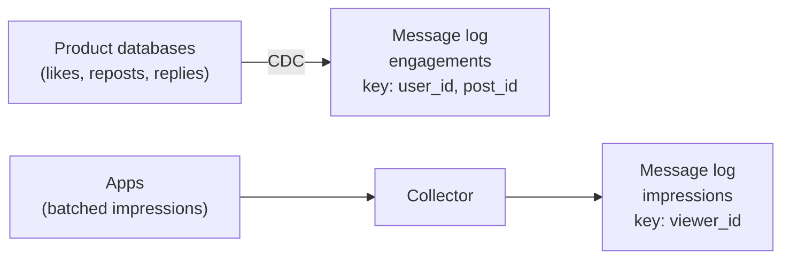
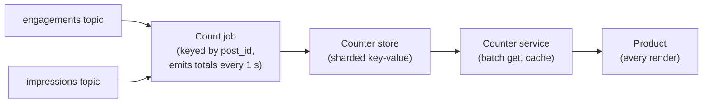
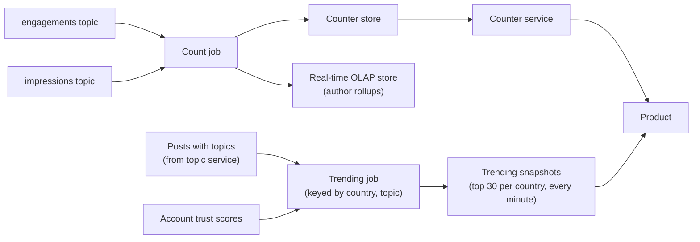
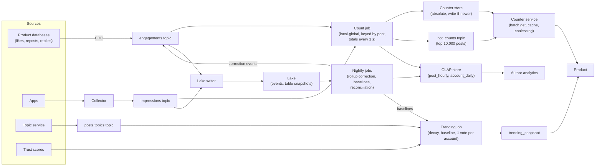

# Design Twitter/X-Style Engagement Analytics

This breakdown follows the same seven steps as every other ([The Delivery Framework](../01-the-framework/02-delivery-framework.md)). It is about counting in a world where a few posts get most of the attention. "Twitter/X-style" is only the prompt's framing; nothing here describes how any real company built its system.

## Understanding the Problem

The prompt:

> "We run a social network where people post short messages and others like, reply to, repost and view them. Design the data system behind the engagement numbers: the counts shown under every post, the analytics page authors see, and the trending topics list."

An **engagement** is any action a user takes on a post: a like, reply, repost, quote or bookmark. A **view** here is an **impression**: one post shown on one user's screen. Every post shows four numbers under it (likes, reposts, replies, views), and those numbers are read every time the post is drawn on anyone's screen.

You have counted clicks in [URL Shortener Analytics](../05-breakdowns-core/02-url-shortener-analytics.md) and served fresh aggregates in [Real-Time Dashboard](../05-breakdowns-core/04-real-time-dashboard.md). This prompt is harder in three ways:

- **Fan-out of counts.** One like updates several numbers (the post's like count, the author's daily totals, maybe a topic's trending score), and each count is then read by millions of people. **Fan-out** means one input feeding many consumers; here it happens on both the write side and the read side.
- **Celebrity hot keys.** An account with 150 million followers posts, and in the first minutes one post gets tens of thousands of likes a second and hundreds of thousands of views a second. A **hot key** is a key that gets far more traffic than the others, so whichever worker or shard owns it becomes the bottleneck.
- **Trending is a definition problem.** "Most mentioned" gives you #GoodMorning every morning. "Trending" means growing unusually fast, which needs a baseline, a decay over time, and defenses against bots.

The interview turns on one question: **where does each count get hot, and how do you make it cheap to write and cheap to read?** Say that in the first two minutes.

## Requirements

*About 6 minutes.*

> **You:** "When I like a post, do I need to see the count go up immediately?"
> **Interviewer:** "You need to see your like. Others can see it a few seconds later."
> **You:** "Do the public counts have to be exact?"
> **Interviewer:** "Likes and reposts should be right eventually. Nobody notices if a view count of 3.2 million is off by a thousand."
> **You:** "Trending per country, or global?"
> **Interviewer:** "Both. About 50 countries get their own list."

The first answer helps a lot: the app can add your own like to the number on your screen locally, so the pipeline does not need **read-your-writes** (a guarantee that you see your own write on your next read).

### Functional requirements

1. **Public counts.** Every post shows likes, reposts, replies and views, served to the product with every render.
2. **Author analytics.** Authors see impressions, engagements and engagement rate per post and per day, for up to 2 years.
3. **Trending topics.** A top-30 list of fast-rising topics, global and for 50 countries, refreshed every minute.
4. **Raw events for analysts.** Every engagement and impression lands in the lake for analysis and model training.

**Below the line (out of scope):** building and ranking the home timeline ([Activity Feed](07-activity-feed.md) covers feed fan-out), ad impressions and billing ([Ad Clickstream](08-ad-clickstream.md)), the bot-detection model itself (we consume its scores), extracting topics from post text (an ML service tags each post; we read its tags), and search.

### Non-functional requirements

- **Scale:** 250 million daily active users, 200 million posts a day, 5 billion engagements a day, 100 billion impressions a day (worked out next).
- **Count freshness:** public counts reflect an action within 5 seconds (p95, meaning 95% of actions meet it).
- **Count correctness:** likes, reposts and replies converge to the exact value within a day; views may be approximate to within 1%.
- **Read latency:** fetching counts for a page of 20 posts takes under 10 ms at p99 (99% of requests are faster), at peak load.
- **Trending:** the list is at most 2 minutes behind, and a coordinated bot campaign should not reach it.
- **Author analytics:** hourly freshness; queries under 2 seconds.

> [!TIP]
> Ask how exact each number must be, per number. "Likes eventually exact, views approximate" lets you treat views as cheap, which matters because views are 20 times more numerous than everything else combined.

## Sources & Volume

*About 4 minutes.* Two sources:

- **Engagements** are state changes in the product's own databases: a like is a row in a `likes` table, and an unlike deletes it. The source of truth is that table, not an event the app fires.
- **Impressions** come from the apps, which batch "post X was on screen" events and upload them every few seconds.

Using [Key DE Numbers](../02-core-concepts/10-key-de-numbers.md):

1. **Engagements.** "250 million users, about 20 engagements each a day: 5 billion a day, about 58,000 a second on average, roughly 175,000 at a 3x peak. At about 500 bytes each, that's 2.5 TB a day and about 90 MB/s at peak."
2. **Impressions.** "Each user sees about 400 posts a day: 100 billion impressions a day, about 1.2 million a second on average, 3.5 million at peak. They are small, about 150 bytes (post, viewer, time, surface): 15 TB a day, about 520 MB/s at peak."
3. **Count reads.** "Every impression is also a read of that post's counts, so 3.5 million post-count reads a second at peak. The app fetches a page of 20 posts at once, so about 175,000 batch requests a second."
4. **Working set.** "Most views are of posts from the last two days: 400 million posts. At about 64 bytes per post for four counters plus a key and overhead, that's about 26 GB. All posts ever, at 200 million a day for years, is many terabytes, but it is read far less."
5. **The celebrity post.** "Assume an account with 150 million followers posts, and a push notification goes out. Peak: 40,000 likes a second and 200,000 views a second on one post, which is also 200,000 reads a second of one key."

State what the numbers imply:

> "Total ingest of about 600 MB/s at peak is a normal message-log cluster. The hard parts are the read side, 3.5 million count reads a second, and the fact that one post can be 5% of all of it."

## High-Level Design

*About 13 minutes.* The data flow, in numbered hops:

1. Engagement changes are captured from the product databases into a message log; impressions are uploaded by apps into another topic.
2. A stream job turns both into per-post counts and writes them to a counter store.
3. A counter service serves those counts to the product.
4. Rollups for author analytics go into a real-time OLAP store.
5. A trending job scores topics and publishes a list every minute.
6. Everything lands in the lake, which is the source for corrections and analysis.

Build it one requirement at a time.

### 1. Getting engagements and impressions into the pipeline

Engagements are captured with **CDC** (change data capture: reading a database's change log and publishing every insert, update and delete as an event) from the `likes`, `reposts` and `replies` tables. An insert becomes "+1", a delete becomes "−1". If the like service fired its own "liked" event instead, a failed transaction could publish a like that never happened, and an unlike could arrive first. CDC publishes only what committed, in commit order per row. See [CDC Patterns](../03-architecture-patterns/04-cdc-patterns.md); the outbox pattern there is the alternative if the team prefers explicit events.

Impressions go from apps to a **collector** (a stateless HTTP service that accepts batches and writes them to the message log), then to an `impressions` topic.

Topic keys decide where the celebrity post lands first. If you key either topic by `post_id`, the celebrity's 200,000 views a second at 150 bytes is 30 MB/s on one partition, three times the 10 MB/s planning figure. So key impressions by `viewer_id` and let CDC key engagements by the table's primary key, `(user_id, post_id)`, which is the connector's default. Both spread evenly. Moving the hot key out of the message log is the first move; the stream job has to deal with it next.



### 2. Public counts within 5 seconds

This is the core of the system.

#### Bad Solution: Count in the product database

Either run `SELECT COUNT(*) FROM likes WHERE post_id = ?` on every render, or keep a `like_count` column on the `posts` row and increment it on every like.

The first is 3.5 million count queries a second against the product database. The second puts 40,000 updates a second on one row for the celebrity post; every update waits for a row lock, so likes queue behind each other and the like button itself gets slow. You have made the product's write path depend on the hottest post on the platform.

#### Good Solution: A stream job increments counters in a key-value store

A stream job ([Flink](../04-technology-deep-dives/08-flink.md) or similar) reads both topics and, for each event, sends `INCR post:123:likes` to a sharded key-value store (Redis Cluster, or a managed store such as DynamoDB, Bigtable or Cassandra). The product reads from the store.

The product database is out of the loop, and most posts are fine. Two problems remain. **Increments are not idempotent** (running them twice gives a different result than once): if the job crashes and replays the last minute from its **checkpoint** (the job's periodic snapshot of its state and topic offsets), every replayed event adds again, and counts drift upward. And **every event becomes a write**: 3.6 million writes a second at peak, 240,000 of them to one celebrity key on one shard.

#### Great Solution: Aggregate in the stream job, write absolute totals once a second

Key the stream job by `post_id` and keep each post's running totals in **keyed state** (per-key memory held by the worker that owns the key, saved in the job's checkpoints). Every second, for each post that changed, write the **absolute totals** to the counter store: "post 123: 1,204,377 likes, 88,102 reposts, 9,550 replies, 31,200,450 views, as of 14:03:07".

- **Idempotent.** A replay recomputes the same totals from restored state and overwrites with the same values. Add a version (the event time of the window), and let the store ignore writes older than what it holds, so a late retry cannot move a count backwards.
- **Coalesced.** A post that got 40,000 likes in the last second gets one write. Store writes drop from 3.6 million a second to the number of distinct posts that changed, about 300,000 to 500,000 at peak: roughly 10 to 20 shards of an in-memory store.

The celebrity post is still one key in the stream job; deep dive 1 handles that. Views use the same counter but get cheaper treatment, since they only need to be within 1%.



### 3. The counter service

The product never talks to the store directly. A **counter service** sits between them and does three things:

- **Batch get.** One call returns counts for up to 50 posts, so a page of 20 posts is one request, not 20.
- **Cache.** Each instance keeps recently read counts in memory for 1 to 2 seconds. With 3.5 million post reads a second mostly concentrated on recent posts, the hit rate is high and the store sees a fraction of the traffic.
- **A clean contract.** It returns each count with its `as_of` time and falls back to the last known value if the store is slow.

The 26 GB working set fits in memory with room to spare; older posts' counts sit in a cheaper durable table. The store is not the source of truth: everything in it can be rebuilt from the lake and the product databases.

### 4. Author analytics

Authors want "impressions and engagements per post, per hour, for my last 200 posts" and "my account per day for 2 years". This is the real-time dashboard pattern: the count job also emits **rollups** (pre-computed aggregates at a fixed grain) per post per hour and per account per day into a real-time OLAP store such as Druid, Pinot or ClickHouse. [Real-Time Dashboard](../05-breakdowns-core/04-real-time-dashboard.md) covers that store and its caching; nothing here is new, so don't spend interview time on it. "Unique accounts reached" per post is a distinct count, answered with HyperLogLog sketches merged at query time, exactly as in [URL Shortener Analytics](../05-breakdowns-core/02-url-shortener-analytics.md).

The one decision worth saying: the analytics page reads **finalized** numbers. A nightly batch job recomputes yesterday's rollups from the lake (deduplicated, bot traffic removed) and overwrites them, the same correction pattern as [URL Shortener Analytics](../05-breakdowns-core/02-url-shortener-analytics.md). The public counter and the analytics page may differ by a fraction of a percent for today, and the page says "today's numbers are provisional".

### 5. Trending topics

Each post arrives already tagged with topics (hashtags plus entities from the topic service) and a country from the author's settings. The volume here is tiny: about 100 million topic mentions a day, a little over 1,000 a second. Trending is a definition problem, not a throughput problem.

#### Bad Solution: Most-mentioned topics in the last 24 hours

`GROUP BY topic ORDER BY COUNT(*) DESC LIMIT 30`.

You get #GoodMorning, #Monday and the five biggest football clubs, every day. Big topics are always big, so nothing new ever reaches the list.

#### Good Solution: Mentions in the last hour compared with the hour before

Score each topic by growth: `this_hour / last_hour`, with a minimum count so a topic going from 1 to 5 mentions does not win.

Now new things rise. But #GoodMorning still trends every morning, because at 7am it is much bigger than at 6am. And a one-hour window has a cliff: a burst at 14:05 falls off the list at exactly 15:05, not gradually.

#### Great Solution: Decayed rate against a seasonal baseline, counted by distinct accounts

Three changes, each fixing one failure:

- **Decay instead of a window**, so trends fade smoothly and state is two numbers per topic.
- **Compare with the same hour on previous days**, so daily rhythms are expected, not trending.
- **Count accounts, weighted by trust, not mentions**, so 5,000 bots posting 40 times each don't look like 200,000 people.

Deep dives 2 and 3 work through the math and the bot defenses. The result: a trending job keyed by `(country, topic)` keeps a score per key, and every minute publishes a top-30 list per country to a small table the product reads.



### 6. The lake

A lake writer lands both topics as Parquet in an Iceberg or Delta Lake table, partitioned by hour. 17.5 TB a day of raw events is about 3.5 TB a day as Parquet. Keep raw impressions 90 days (about 270 TB, around $6,000 a month on standard object storage) and engagements and rollups for years. It feeds the nightly jobs and every analyst.

## Data Model

*About 5 minutes.*

### Topics

| Topic | Key | Notes |
|---|---|---|
| `engagements` | `(user_id, post_id)` | CDC change events: `op` (insert/delete), `type` (like, repost, reply), `post_id`, `author_id`, `event_ts`, source position. About 90 MB/s at peak; 64 partitions. |
| `impressions` | `viewer_id` | `impression_id`, `viewer_id`, `post_id`, `author_id`, `surface`, `event_ts`. About 520 MB/s at peak; at 10 MB/s per partition that is 52 at minimum, so 256 for consumer parallelism and headroom. |
| `posts.topics` | `post_id` | `post_id`, `author_id`, `country`, `topics[]`, `created_ts`, from the topic service. |

### Counter store

One entry per post: `post_id → {likes, reposts, replies, views, as_of}`. The grain is one post, all time. Writes are absolute values with an `as_of` version; a write with an older `as_of` is ignored, which is the **write-if-newer** rule from [Fraud Detection](03-fraud-detection.md).

### Rollups (OLAP store)

- `post_hourly`: one row per post per hour. `impressions`, `likes`, `reposts`, `replies`, `profile_clicks`, plus the author ID for filtering.
- `account_daily`: one row per account per day, including follower change.

Both store counts, never rates; the page divides at query time, so "engagement rate over 30 days" is a sum over sums, not an average of daily averages.

### Trending

- `topic_baseline`: one row per country, topic and hour of the week (168 slots), with the average mentions-per-hour over the last 4 weeks. Built nightly from the lake for topics that have any history; a few million rows.
- `trending_snapshot`: one row per country, minute and rank: `topic`, `score`, `distinct_accounts`, `snapshot_id`. The product reads the latest snapshot per country; old ones stay for audit ("why was this trending at 14:07?").

### Lake

`lake.impressions` and `lake.engagements`, partitioned by `hours(event_ts)`, plus a daily snapshot of the `likes`, `reposts` and `replies` tables, taken from a read replica rather than from the CDC stream, so it can expose a gap in CDC. Deep dive 4 uses that snapshot.

## Pipeline Design

*About 5 minutes.*

| Path | Mode | Why |
|---|---|---|
| CDC and collector into the message log | Continuous | Sources are live tables and apps. |
| Count job → counter store | Streaming, 1-second emits, checkpoints every 30 s | The 5-second freshness target. |
| Count job → OLAP rollups | Streaming, hourly rows updated as they fill | Hourly freshness for authors. |
| Trending job | Streaming, ranks every 60 s | The 2-minute target. |
| Lake writer | Micro-batch, 5-minute commits | Bigger files; analysts don't need seconds. |
| Nightly correction and reconciliation | Batch, after midnight UTC | Exact numbers from the full day. |
| Trending baselines | Batch, nightly | Four weeks of history changes slowly. |

**Duplicates.** Impressions arrive at least once: an app that does not get an acknowledgement resends the batch. For views, that is within the 1% tolerance at a typical retry rate, so the live counter does not dedup; the nightly job dedups on `impression_id` for author analytics. Engagements are different: a duplicate CDC event is a wrong like count. CDC connectors deliver at least once unless configured otherwise, so after a connector restart some changes are re-sent. The count job drops changes whose source position it has already seen, within a 10-minute window ([Deduplication at Scale](../02-core-concepts/09-deduplication-at-scale.md)).

**Failure behavior.** A count-job restart replays from the checkpoint and absolute writes make that harmless: counts freeze for a minute or two but never jump. If a counter-store shard is down, the service serves cached values with an old `as_of`: stale, never zero. If the trending job is down, the product hides the module once the last snapshot is 10 minutes old, because an old list is worse than none during breaking news.

## Potential Deep Dives

*About 13 minutes.* If the interviewer doesn't steer, lead with the first: it is where this design breaks first. How to run deep dives is in [Deep Dives](../01-the-framework/08-deep-dives.md).

### 1. "A celebrity with 150 million followers posts. 40,000 likes a second and 200,000 views a second on one post. What breaks?"

Walk through each place the post is a key, because each one gets hot for a different reason and needs a different fix.

**The message log** is already safe: topics are keyed by viewer and by user-post pair, so the celebrity's events are spread across every partition.

**The count job** keys by `post_id`, so one subtask (one parallel instance of the operator) receives 240,000 events a second for this post on top of its normal share. Use **local-global aggregation**: each upstream subtask pre-counts per post for a short interval, then sends one partial per post to the owner. [URL Shortener Analytics](../05-breakdowns-core/02-url-shortener-analytics.md) explains it; the numbers here: with 256 reader subtasks each flushing once a second, the owner receives about 256 partials a second instead of 240,000 events. That fix is standard. The interesting part is the read side.

**The counter store and service** get 200,000 reads a second of one key. As a rough assumption (check your store; limits vary by product and version), a single shard of an in-memory store handles on the order of 100,000 simple operations a second, and a managed key-value store may limit a single partition to a few thousand reads a second. Either way, one key on one shard cannot serve this alone.

#### Bad Solution: Add replicas to the store

Give every shard 5 read replicas. That multiplies the cost of the whole cluster to fix one key, and asynchronous replicas make the count jump back and forth between readers.

#### Good Solution: Cache in the counter service, with request coalescing

Each counter-service instance caches every count for 1 second. With 500 instances, the store sees at most 500 reads a second for the celebrity post, whatever the number of viewers. When the cached value expires and 400 requests for it arrive at once on one instance, run one store read and let the others wait for it: **request coalescing** ([Real-Time Dashboard](../05-breakdowns-core/04-real-time-dashboard.md)).

For many interviews this is enough. It falls short in two ways: every instance still hits the same shard each second (500 synchronized reads), and the cache is reactive, so the first second of a viral post hits the store before any cache is warm.

#### Great Solution: Detect hot posts in the stream and push their counts to every server

The count job already knows which posts are hot: it is counting them. Every second it computes the **hot set**, the top 10,000 posts by impression and engagement rate (every impression is also a count read, so this predicts read load), and publishes their totals on a small `hot_counts` topic. Every counter-service instance subscribes and keeps the hot set in memory, replaced each second. Reads for hot posts never leave the process; everything else goes through the normal cache and store.

- **Size:** 10,000 posts × about 64 bytes is under 1 MB per second, to each of 500 instances: about 0.5 GB/s of read fan-out from the message log. That is the price of serving the top posts from memory everywhere.
- **Warm-up:** a post enters the hot set within a second or two of its spike starting, because the write side sees the likes before the read spike peaks.
- **Freshness:** the values are about 1 to 2 seconds old, inside the 5-second target.

Freshness gets cheaper because **the display hides small changes.** A count of 1,204,377 is shown as "1.2M". It must grow by 50,000 before the label changes. So counts above 10,000 can be cached for 5 to 10 seconds with no visible difference, and only small counts, where "41" becoming "42" is visible, need second-level freshness. Tie the cache lifetime to the number's magnitude.

> [!WARNING]
> Don't answer "salt the counter key" by reflex. **Salting** splits one key into N sub-keys (`post:123#0` … `post:123#7`) so writes spread over N shards ([Partitioning](../02-core-concepts/01-partitioning.md)). It fixes a write hot spot. But every read must then fetch all N sub-keys and add them, so a read-heavy key gets **N times worse**. Salting is the right tool only when many writers must increment a counter directly and you can't aggregate upstream. Here the stream job already turns 40,000 writes into one, so the store has no write hot spot to salt.

### 2. "How does your trending score work? Why doesn't #GoodMorning trend every morning?"

Make the score concrete. Each `(country, topic)` key in the trending job keeps three things.

**A decayed count.** On each mention, multiply the stored value by `2^(−Δt / h)`, where Δt is the time since the last update and `h` is the **half-life** (the time it takes a count to lose half its weight), then add the mention's weight. With `h` = 20 minutes, a mention from 20 minutes ago counts half, from 40 minutes ago a quarter. At a steady rate of `r` mentions a minute, the value settles at about `r × h / ln 2`, so you can turn it back into a rate: `rate ≈ value × ln 2 / h`.

Why decay rather than 60 one-minute buckets?

| | Sliding 1-hour window | Exponential decay |
|---|---|---|
| State per key | 60 counters, about 480 bytes | Value and last-update time, 16 bytes |
| For 10 million active country-topic keys | about 4.8 GB | about 160 MB |
| How a burst leaves | Falls off a cliff exactly 60 minutes later | Fades smoothly |
| Work per key with no mentions | Shift buckets every minute | None: decay is applied **lazily**, on the next update or read |

Lazy decay is the detail interviewers like: you never touch a quiet key. To rank, decay each candidate's value to "now" at read time; the answer is the same as decaying every second.

**An expected rate.** From `topic_baseline`: the average mentions per hour for this country, topic and hour of the week over the last 4 weeks. That is what makes #GoodMorning ordinary at 7am: it is compared with previous 7ams, not with 6am.

**The score:**

```text
score = (observed_rate + prior) / (expected_rate + prior)        prior = 100 per hour
```

The **prior** is a constant added to both sides so that tiny topics can't produce huge ratios. Worked through, per hour, in one country:

| Topic | Observed | Expected | Score |
|---|---|---|---|
| #GoodMorning at 7am | 50,000 | 48,000 | 50,100 / 48,100 ≈ 1.04 |
| #Earthquake, minutes after a quake | 6,000 | 20 | 6,100 / 120 ≈ 51 |
| #MyCatSteve, a viral pet | 30 | 0 | 130 / 100 = 1.3 |
| A brand-new topic | 2,000 | none (no history) | 2,100 / 100 = 21 |

The earthquake wins, the cat doesn't, and #GoodMorning stays home. A new topic with no history gets an expected rate of zero and relies on the prior, which is right: new topics are what trending is for. Add a floor of a few hundred distinct accounts (scaled by country size) before anything can rank.

**Ranking.** About 10 million `(country, topic)` keys are active at once; drop a key from state once it has had no mention for a few hours, by which time its decayed value is negligible (Flink supports this as a per-key state TTL). Every minute each subtask scores its keys, keeps a local top 30 per country, and a final step merges them. That merge is exact for the reason [URL Shortener Analytics](../05-breakdowns-core/02-url-shortener-analytics.md) gives: each key's full state lives on one subtask.

> [!TIP]
> Is the hottest topic a hot key here? Even 5,000 mentions a second on one topic is easy for one subtask. Say so, and don't add local-global aggregation where the numbers don't call for it.

### 3. "A bot network posts #BuyCoinX 200,000 times in ten minutes. Does it trend?"

With the score above, counting mentions, yes: 200,000 against an expected rate of zero is a score in the thousands. Three defenses, each cheap:

1. **One account, one vote per topic per hour.** The trending job keeps a set of `(account, topic)` pairs seen in the last hour in keyed state with a 1-hour TTL, and ignores repeats. About 4 million distinct pairs an hour at roughly 50 bytes each is about 200 MB. Now 5,000 bots posting 40 times each count as 5,000.
2. **Weight each account by trust.** The trust team's model gives every account a score from 0 to 1 (account age, verified phone, past spam reports, bot likelihood), published as a compacted topic (one that keeps only the latest value per key) the trending job joins against. A two-day-old account with no followers weighs 0.05; an established one weighs 1. The bot campaign's 5,000 accounts become about 250 weighted votes. The earthquake's 5,500 real accounts become about 5,000.
3. **Check who is talking.** Before publishing, flag any trend where most of the weight comes from accounts created in the last week, or from a small cluster of accounts that follow each other. Flagged trends go to a review queue instead of the list.

Then the human layer: a **blocklist** of topics that can never trend (slurs, known scams), applied when the snapshot is built, and a way for trust and safety staff to pull a trend within a minute. Because every snapshot is stored with its `snapshot_id`, you can always answer "why was this trending at 14:07, and from which accounts?"

Say what you give up: a real grassroots trend driven mostly by new accounts is slowed down. That is a product decision; name it and let the interviewer choose.

### 4. "A user likes, unlikes and likes again within two seconds, while the count job is restarting. What does the count show, and how do you know it's right?"

Because the input is CDC from the `likes` table, the toggle arrives as insert (+1), delete (−1), insert (+1), in commit order for that row, since all changes to one row share a key and therefore a partition. The net is +1, which is the truth. A like-service event stream ("liked", "unliked") would have needed you to reason about ordering between two event types; CDC gives you the database's own order.

The restart: the job restores its keyed state from the last checkpoint and re-reads the topics from the offsets saved in that same checkpoint, so each change is applied to state exactly once. The 10-minute dedup on source position catches changes the connector re-sent. Writes to the counter store are absolute and versioned, so re-emitting a total is harmless.

**Reconciliation** covers the cases you didn't think of (a bad deploy, a lost checkpoint, a CDC gap after a database failover). Nightly:

1. From the lake's daily snapshot of the `likes` table (taken at cutoff time T), compute the exact like count per post.
2. Compare with the counter store a few minutes after T, **only for posts with no engagement from T minus 10 minutes until the comparison**. For those posts the snapshot and the store have both seen every change and neither has seen anything extra, so there is no double count and no gap at the boundary, and a difference is real drift, not timing. Posts that were active around T are skipped and checked the next night.
3. For posts that differ, don't overwrite the store from the batch job. Publish a **correction event** (`op = correction`, `post 123: likes +3`, the snapshot count minus the store count) to the engagements topic. The count job applies it like any other change, and because the post was quiet, later live likes add on top correctly.

Say step 3 aloud. If the batch job wrote to the counter store directly, it would race the stream job, and whichever wrote last would win. Keeping the stream job as the **single writer** to the counter store means corrections and live updates are applied in one order, by one process.

The drift rate (posts corrected ÷ posts checked) is a health metric: normally near zero, and a jump means something upstream broke.

## Monitoring & SLAs

*About 4 minutes.* [Monitoring and SLAs](../01-the-framework/09-monitoring-and-slas.md) covers presenting these; [Monitoring and Alerting](../02-core-concepts/06-monitoring-and-alerting.md) covers alert design.

| SLA | Target | Measured by |
|---|---|---|
| **Count freshness** | 95% of likes reflected in the counter service within 5 s | A canary account likes and unlikes a canary post every 10 s; a probe reads the counter service and measures the delay |
| **Count read latency** | p99 under 10 ms for a 20-post batch, at peak | Counter-service request metrics |
| **Count correctness** | Reconciliation drift under 0.01% of checked posts | The nightly reconciliation job |
| **Trending freshness** | Snapshot no more than 2 minutes old in every country | `snapshot_ts` of the latest row per country |

Behind them: **consumer lag** on both jobs; **hot-set hit rate** (if 30% of reads are for hot posts and the hot set serves only 5%, detection is broken); **reads per second per shard**, alerting above twice the median to catch the next hot key; and **trend review queue length**, so a held-back campaign is visible to people, not just filtered.

## Final Design



Follow the celebrity post. At 20:00:00 it is published and a push notification goes to 150 million phones. CDC publishes the likes spread over 64 partitions. Each count-job reader pre-counts per post for a second; the owner of the post receives about 256 partials a second and writes one absolute total a second. By 20:00:02 the post is in the hot set, and every counter-service instance holds its counts in memory: 200,000 reads a second, none of them reaching the store. The phones show "1.2M" and refresh the label every few seconds. Meanwhile the post's topics add one vote per account to the trending job, where a sudden rise against a near-zero baseline puts the topic on the list at the next minute. Overnight, author analytics for the day are recomputed from the lake, and reconciliation confirms that the like count matches the `likes` table.

## What's Expected at Each Level

### Mid-level

You get the shape right: capture engagements and impressions into a message log, count in a stream job, serve counts from a key-value store, and keep raw events in the lake. You see that `COUNT(*)` per render and a counter column on the post row both fail, with numbers. With prompting, you handle the celebrity post with caching and recognize that trending needs growth, not volume. Bar for this problem: the Good options in the high-level design, a sensible topic key, and a freshness SLA.

### Senior

You drive, and you treat hot keys stage by stage: topic keys that keep the celebrity off one partition, local-global aggregation in the job, coalesced absolute writes, and a read path with caching and coalescing. You explain why salting the counter makes reads worse. You use CDC so unlikes and toggles come out right, and make every write idempotent. You define trending with decay, a seasonal baseline and a prior, work an example, and add one-vote-per-account against bots. You add reconciliation with a clear rule for who writes to the counter store.

### Staff+

You design the counter service as a product with a contract: batch API, `as_of` on every value, staleness tied to display precision, and a degradation rule ("stale, never zero"). You raise the push-based hot set and its fan-out cost. You treat trending as a policy system as much as a pipeline: review queues, blocklists, stored snapshots for audit, and a stated trade-off against grassroots trends from new accounts. You ask about multiple regions (counts are written in each region; is the celebrity's count global or regional?) and about cost: whether 100 billion impressions a day should be kept raw for 90 days or sampled.

## Related Lessons

- Framework: [The Delivery Framework](../01-the-framework/02-delivery-framework.md), [Requirements Gathering](../01-the-framework/03-requirements-gathering.md), [Sources and Volume](../01-the-framework/04-sources-and-volume.md), [Deep Dives](../01-the-framework/08-deep-dives.md), [Monitoring and SLAs](../01-the-framework/09-monitoring-and-slas.md)
- Concepts: [Partitioning](../02-core-concepts/01-partitioning.md) (hot partitions and salting), [Key DE Numbers](../02-core-concepts/10-key-de-numbers.md), [Deduplication at Scale](../02-core-concepts/09-deduplication-at-scale.md), [Monitoring and Alerting](../02-core-concepts/06-monitoring-and-alerting.md)
- Patterns: [CDC Patterns](../03-architecture-patterns/04-cdc-patterns.md)
- Technology: [Flink](../04-technology-deep-dives/08-flink.md), [Kafka](../04-technology-deep-dives/02-kafka.md)
- Related breakdowns: [URL Shortener Analytics](../05-breakdowns-core/02-url-shortener-analytics.md) (HyperLogLog, top-K, local-global aggregation), [Real-Time Dashboard](../05-breakdowns-core/04-real-time-dashboard.md) (real-time OLAP, caching and request coalescing), [Surge Pricing](../05-breakdowns-core/10-surge-pricing.md) (hot keys by stage), [Fraud Detection](03-fraud-detection.md) (write-if-newer), [Activity Feed](07-activity-feed.md) (feed fan-out)
- Previous breakdown: [Fraud Detection](03-fraud-detection.md). Next: [Multi-Tenant Platform](05-multi-tenant-platform.md)
