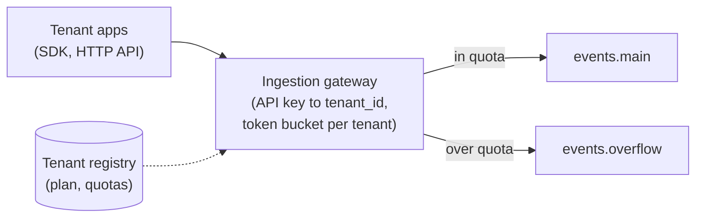
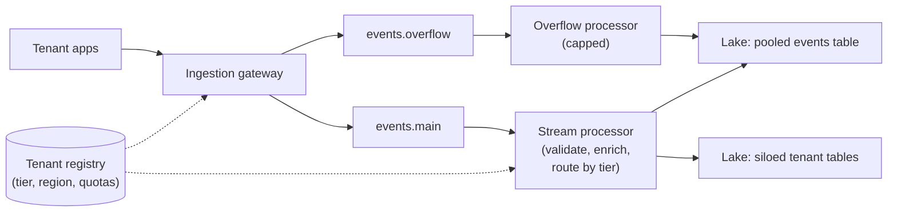
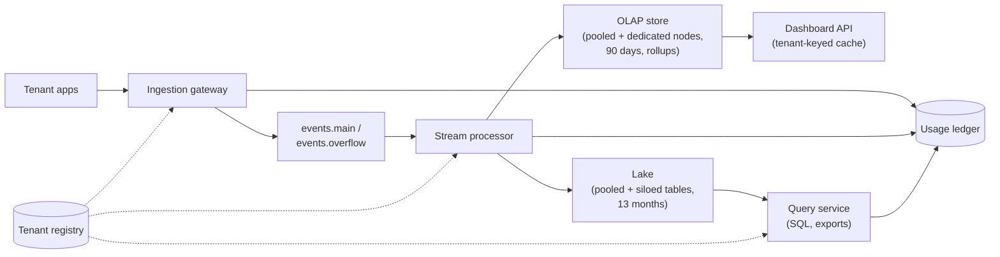
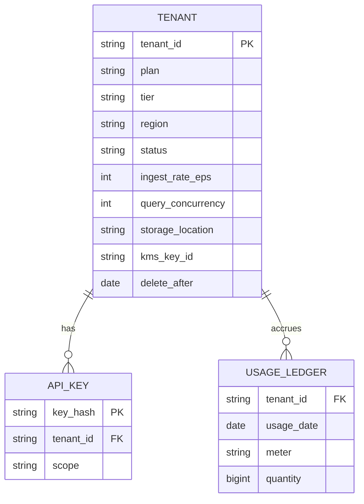
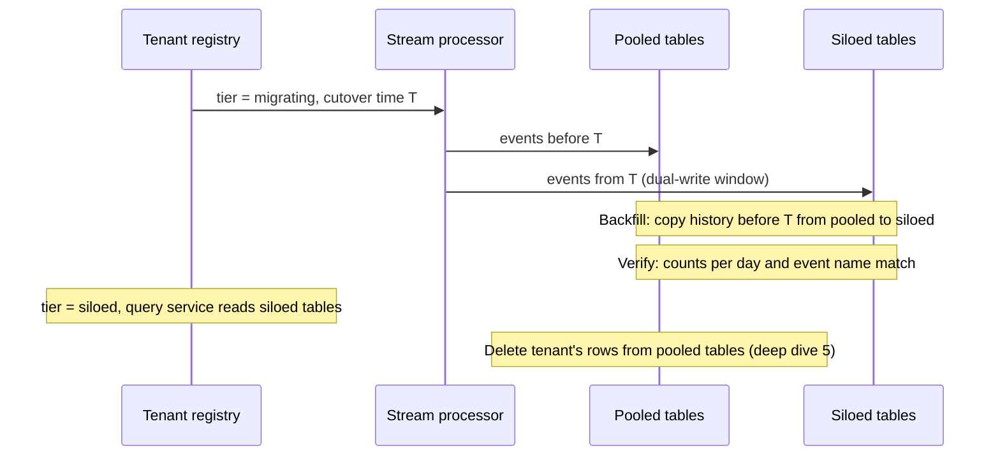
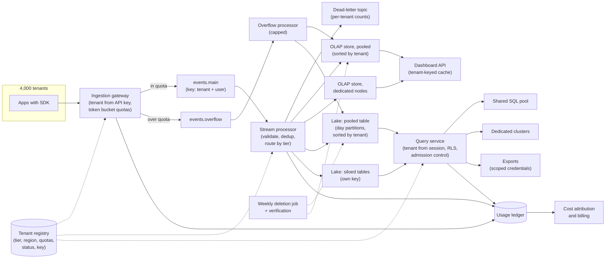

# Design a Multi-Tenant Analytics Platform

This breakdown follows the same seven steps as every other ([The Delivery Framework](../01-the-framework/02-delivery-framework.md)). Here the data belongs to 4,000 paying customers who must never see each other's rows, never slow each other down, and each pay a price that has to cover what they cost you. The interview turns on one question: **how much do you share between customers, and how do you stop the sharing from hurting them?**

## Understanding the Problem

The prompt:

> "We sell a product analytics service. Customers install our SDK in their web and mobile apps, we collect their users' events, and they use our dashboards, a SQL interface and data exports to understand how their product is used. We have about 4,000 customers, from two-person startups to a few very large enterprises. Design the data platform behind it."

Each customer is a **tenant**: one company whose users, data, access and bill are separate from every other company's, even though they all run on your platform. A platform that serves many tenants from shared infrastructure is **multi-tenant**.

You met the internal version of this in [ETL Framework](../05-breakdowns-core/07-etl-framework.md), where 40 teams shared one Airflow and a **noisy neighbour** (one tenant using so much of a shared system that others suffer) was fixed with pools and shards. External tenants make it harder in four ways:

- **A leak is a breach, not a bug.** If customer A sees customer B's user data, you lose both customers and probably face a regulator.
- **Tenants write their own queries.** Through the SQL interface, a customer can run a 13-month scan at 10am. You can't ask them to be considerate.
- **Size varies by thousands of times.** One design has to serve a tenant with 5,000 events a day and one with 1.5 billion.
- **Every tenant has a price.** If you can't say what a tenant costs, you can't tell whether your biggest customer is your most profitable or your most expensive.

The central tension: **pooling everyone on shared infrastructure is what makes the platform cheap, and it is also what lets one tenant leak into, slow down or overspend on behalf of another.** Your job is to share as much as possible and put a wall wherever sharing hurts.

## Requirements

*About 6 minutes.* Ask about the customers before the events:

> **You:** "How uneven are the customers? What share of the events comes from the largest one?"
> **Interviewer:** "Very uneven. The biggest is about 15% of all traffic. The top 20 are about half."
> **You:** "Do any customers require dedicated infrastructure in their contracts?"
> **Interviewer:** "A handful of enterprise customers ask for it, and some ask for their data to stay in the EU."
> **You:** "When a customer leaves, what do we promise about their data?"
> **Interviewer:** "They can export for 14 days, then everything is deleted within 30 days. Legal treats that as a hard commitment."
> **You:** "Is pricing per event, per seat, or flat?"
> **Interviewer:** "Plans with an included event volume, and enterprise contracts negotiated one by one. Finance suspects some of those lose money."

Each answer becomes a design decision: skew, dedicated tiers, deletion, cost per tenant.

### Functional requirements

1. **Ingest** events from each tenant's apps through the SDK or an HTTP API, each request authenticated by the tenant's API key.
2. **Dashboards**: prebuilt charts (event trends, funnels, retention) over a tenant's last 90 days, interactive.
3. **SQL access and exports** for paying plans: a tenant can query its own raw events for the full 13 months and export them to its own storage.
4. **Tenant lifecycle**: a new tenant is live in minutes; a departing tenant's data is deleted within 30 days of the end of its export window; usage is metered per tenant for billing.

**Below the line (out of scope):** the SDK itself, the dashboard UI, the billing system (we feed it usage), user sign-in and single sign-on, and ML features such as anomaly alerts.

### Non-functional requirements

Scale first, then the qualities:

- **Scale:** 4,000 tenants, about 10 billion events a day, peaks around 350,000 events a second. The largest tenant is 15% of volume (worked out in the next step).
- **Security isolation:** no query, export, cache or log line ever returns one tenant's data to another. Zero is the only acceptable number.
- **Performance isolation:** dashboard queries under 3 seconds at p95 for every tenant, and events visible in dashboards within 5 minutes, *whatever any other tenant is doing*.
- **Cost attribution:** compute and storage cost per tenant, monthly, accurate to within about 10%, so finance can price plans.
- **Deletion:** a departed tenant's data gone from every store within the 30-day commitment.
- **Residency:** EU tenants who require it have their data stored and processed only in the EU.

> [!TIP]
> On a multi-tenant prompt, state isolation as two requirements: security ("can't see") and performance ("can't slow down"). They need different mechanisms, and candidates who say "isolation" once usually solve only the first.

## Sources & Volume

*About 4 minutes.* One source type, events from SDKs, and very uneven tenants. Use the conversions in [Key DE Numbers](../02-core-concepts/10-key-de-numbers.md):

1. **Events per second.** "10 billion a day is about 116,000 a second on average. Product usage peaks in business hours, so call the peak 3x: about 350,000 a second."
2. **Bytes.** "An event with its properties is about 1 KB of JSON. Peak ingest is 350 MB/s, and a day is about 10 TB raw."
3. **Lake storage.** "As Parquet at about 1/5 of raw, 2 TB a day. Thirteen months is about 800 TB, roughly $18,000 a month on standard object storage."
4. **The skew.** "The largest tenant is 15%: 1.5 billion events, 300 GB of Parquet a day, about 120 TB over 13 months. The median tenant sends maybe 300,000 events a day: 60 MB of Parquet, about 24 GB over 13 months. That's a 5,000x gap between the median and the top."
5. **Query load.** "Say 40,000 people across all tenants use dashboards, peaking around 300 queries a second. Plus maybe 20,000 SQL queries a day from enterprise analysts, and some of those scan terabytes."

Now say what the numbers imply:

> "Volume is ordinary: a mid-size Kafka cluster and a normal lake. The hard part is the shape. One tenant at 15% would be a **hot partition** (one slice getting far more traffic than the rest) anywhere tenant ID is the key, and a design sized for the median tenant breaks on the top one. And with 4,000 tenants, anything I do per tenant (a cluster, a pipeline, a schema migration) is multiplied by 4,000."

## High-Level Design

*About 12 minutes.* The data flow, as numbered hops:

1. An ingestion gateway authenticates each request and stamps the tenant ID.
2. A message log buffers events.
3. A stream processor validates and enriches them, then writes to two stores.
4. A real-time OLAP store serves dashboards over the last 90 days.
5. A lake on object storage keeps 13 months for SQL access and exports.
6. A tenant registry and a usage ledger tie it together: who each tenant is, where its data lives, and what it used.

Then build it one requirement at a time.

### 1. Ingesting from 4,000 tenants without one drowning the rest

The **ingestion gateway** is a fleet of stateless HTTP servers in front of the message log. Two rules, both non-negotiable:

- **The tenant ID comes from the API key, never from the payload.** The gateway looks the key up in the tenant registry (cached in memory) and writes `tenant_id` onto the event itself. If the SDK could set it, any customer could write into another's data by editing one field.
- **Every tenant has an ingest quota.** Here is why, with numbers.

#### Bad Solution: No limits; the message log absorbs everything

The largest tenant runs a Black Friday sale at 10x its normal traffic: from 52,000 events a second (15% of the peak) to 520,000, more than every other tenant combined. The stream processor falls behind, and **every** tenant's dashboards go stale.

#### Good Solution: A hard per-tenant rate limit at the gateway

Give each tenant a **token bucket**: a counter that refills at the tenant's allowed rate (say 2,000 events a second on a Growth plan) up to a maximum burst (say 5 minutes' worth). Each event takes a token; when the bucket is empty, the gateway rejects the request with HTTP 429 ("too many requests"), and the SDK keeps events in a local buffer and retries.

Other tenants are protected. But a rejected event is often a lost one, because a phone's buffer is small and apps get closed. Customers lose data on exactly the day they most want to analyse.

#### Great Solution: Quotas with an overflow lane

Keep the per-tenant token bucket, but treat going over it as "slower", not "rejected":

- **In quota**: events go to the `events.main` topic, processed with the 5-minute freshness target.
- **Over quota**: events go to `events.overflow`, a separate topic read by its own consumers with fixed, capped parallelism. They arrive in dashboards late (within an hour, say), but they arrive.
- **Over a hard ceiling** (say 20x the plan rate, or a daily cap): only then return 429. This protects the platform from a runaway client, such as an app stuck in a loop sending the same event.

Quotas live in the tenant registry, set by plan, so a contract change needs no deploy.

The message log is Kafka (or a managed one: MSK, Confluent Cloud, Event Hubs). At 350 MB/s peak and about 10 MB/s planned per partition, `events.main` needs at least 35 partitions; take 96 for headroom. Key it by a hash of `tenant_id` and `user_id`, not `tenant_id` alone: keyed by tenant, the 15% tenant would push 52 MB/s through one partition. Keying by user keeps each user's events in order, which sessions and funnels need, and spreads the big tenant across every partition. See [Partitioning](../02-core-concepts/01-partitioning.md) for hot partitions and [Kafka](../04-technology-deep-dives/02-kafka.md) for keys and ordering.



### 2. Where does each tenant's data live?

This is the central decision. There are three standard answers, and the vocabulary is worth using out loud:

- **Siloed model:** each tenant gets its own copy of everything: tables, compute, sometimes its own cluster.
- **Pooled model:** all tenants share the same tables and compute, and a `tenant_id` column says whose each row is.
- **Bridge model:** a mix, decided per tenant: most tenants pooled, some siloed.

#### Bad Solution: Silo every tenant

Give each tenant its own schema, its own tables in the lake and the OLAP store, and its own small query cluster.

Isolation is easy to prove. The numbers kill it. The median tenant has 60 MB of new data a day, so its daily lake partition is one small file, and 4,000 sets of tiny files are the **small-files problem** (so many files that opening them costs more than reading them) times 4,000. Even the smallest always-available query cluster costs real money: at a few hundred dollars a month each, 4,000 of them is over a million dollars a month, mostly idle, for tenants paying $100. And every schema change is a migration run 4,000 times.

#### Good Solution: Pool every tenant

One events table in the lake, one in the OLAP store, one shared query pool. Every row carries `tenant_id`.

This is cheap: a schema change happens once, and a new tenant is a row in the registry. It is how the long tail should run. It falls short at the top: the 15% tenant shares compute with 3,999 others, making the noisy-neighbour problem permanent, and some enterprise contracts *require* dedicated infrastructure or EU-only storage, which one global pool can't offer.

#### Great Solution: The bridge model, with the tier as a registry field

Pool by default, silo by exception, and make the choice data, not code:

| Tier | Who | What's shared | What's dedicated |
|---|---|---|---|
| **Pooled** | ~3,980 tenants, about half the volume | Tables, OLAP cluster, query pool | Nothing; isolation by `tenant_id` and quotas |
| **Siloed** | ~20 tenants: over about 1% of volume, or contractually required | Code, pipelines, the gateway and message log | Their own lake tables and namespace, OLAP tables on dedicated nodes, their own query compute, optionally their own encryption key |
| **Regional** | Tenants requiring EU residency | Nothing across regions | A full copy of the platform (a **cell**) in the EU region, itself pooled and siloed inside |

The tenant registry holds each tenant's `tier`, `region` and storage location. The stream processor reads it to pick the right table, the query service to pick the right compute. The code is the same for every tier, so a siloed tenant is a configuration, not a fork, and promoting a growing tenant is a runbook (deep dive 4). Silo storage and query compute, the expensive parts; per-tenant gateways or Kafka would cost far more, because quotas already protect them.

> [!TIP]
> Say the split with numbers: "20 siloed tenants carry half the volume and maybe 60% of the revenue; 3,980 pooled tenants share the other half." It shows the interviewer where the money is.



### 3. Dashboards under 3 seconds for every tenant

Dashboards over 90 days need fast, small aggregate queries, which is the job of a **real-time OLAP store** (a columnar database such as ClickHouse, Druid or Pinot that ingests a stream and answers aggregate queries in tens to hundreds of milliseconds). [Real-Time Dashboard](../05-breakdowns-core/04-real-time-dashboard.md) covers how it works; here only the tenant parts matter:

- **Tenant first in the sort key.** The pooled OLAP table is ordered by `(tenant_id, event_name, event_time)`, so a query for one tenant reads only that tenant's slice instead of scanning everyone's rows and filtering.
- **Siloed tenants on their own nodes.** Their OLAP tables live on a dedicated node group, so the largest tenant's dashboard refreshes never compete with the long tail.
- **Rollups for the common charts.** The stream processor also writes hourly counts per tenant and event name: 4,000 tenants times about 200 event names times 24 hours is under 20 million rows a day. Trend charts read rollups; funnels and retention read the events.
- **Result caches keyed by tenant.** The dashboard API caches results for 30 seconds. The cache key includes `tenant_id`, always, even when the SQL text is identical (deep dive 2 says why).

### 4. Metering what each tenant uses

Every layer already knows the tenant, so emit usage as a side effect:

- The gateway counts events and bytes accepted, throttled and rejected per tenant per minute.
- The lake writer records bytes written per tenant per partition.
- The query service tags every query with `tenant_id` and records what the engine reports: bytes scanned and compute time.

All of it lands in a **usage ledger**, an append-only table with one row per tenant, day and meter. Billing reads it for invoices; finance reads it for cost (deep dive 3).



## Data Model

*About 5 minutes.* Start with the table that decides where everything else goes.

### The tenant registry



`status` runs `active` → `offboarding` → `deleting` → `deleted`, and every component checks it. `kms_key_id` (the tenant's key in a key management service) is set only for siloed tenants with their own encryption key. `meter` is one of `events_ingested`, `bytes_stored`, `bytes_scanned`, `compute_seconds` or `bytes_exported`. The registry is a small Postgres database, cached by every service.

### The events table

One schema everywhere, pooled or siloed:

| Field | Type | Notes |
|---|---|---|
| `tenant_id` | string | Stamped by the gateway. First column of every key. |
| `event_id` | string | Generated by the SDK. Unique only within a tenant. |
| `user_id` | string | The tenant's end user, in the tenant's own ID scheme. |
| `event_name` | string | `signup`, `checkout_started`, chosen by the tenant. |
| `event_time`, `received_at` | timestamp | Device time and gateway time; devices have wrong clocks. |
| `properties` | map of string to string | Tenant-defined fields. |

Two choices to say out loud:

- **`properties` is a map, not columns.** Tenants define their own event properties, often hundreds each. Turning them into columns would mean 4,000 tenants times hundreds of names in one table's schema. A map keeps the schema fixed. A siloed tenant can have its most-queried properties promoted to real columns in its own table, because its schema is its own.
- **The dedup key is `(tenant_id, event_id)`.** Two tenants' SDKs can generate the same `event_id`; dedup on `event_id` alone would delete one tenant's event because of another's. See [Deduplication at Scale](../02-core-concepts/09-deduplication-at-scale.md).

### Partitioning the pooled table

The pooled lake table holds about 1 TB a day of Parquet from 3,980 tenants. You already know the arithmetic from [Partitioning](../02-core-concepts/01-partitioning.md): a folder per tenant per day would give about 4,000 folders a day, most holding one small file (the median tenant writes 60 MB a day, many write far less). So:

```sql
CREATE TABLE lake.events_pooled (
  tenant_id STRING, event_id STRING, user_id STRING, event_name STRING,
  event_time TIMESTAMP, received_at TIMESTAMP,
  properties MAP<STRING, STRING>
)
PARTITIONED BY (days(event_time));
-- files sorted by (tenant_id, event_name, event_time)
```

**Partition by day, sort by tenant inside the day.** A query for one tenant prunes to the days it asks for, then skips every file and row group whose `tenant_id` range doesn't include it. This is **tenant-aware partitioning**: the tenant is the first sort key everywhere (lake files, OLAP tables, message log key), so every per-tenant read and delete touches a small slice. A siloed tenant's table uses the same layout without `tenant_id` in the sort, since the whole table is one tenant; at 300 GB a day it is large enough to sort by `event_name` instead.

## Pipeline Design

*About 6 minutes.* The high-level design settled most of this; here is the summary and how each path fails.

| Path | Mode | Why |
|---|---|---|
| Gateway → message log | Continuous | Requests need an answer in milliseconds. |
| Stream processor → OLAP store | Streaming, seconds | The 5-minute dashboard freshness target. |
| Stream processor → lake | Micro-batch, 5-minute commits | Bigger files; SQL access tolerates minutes. |
| Overflow processor | Streaming, capped parallelism | Over-quota tenants catch up without taking capacity from the rest. |
| Compaction and re-sort by tenant | Batch, hourly | Rewrites 5-minute files into large files sorted by `tenant_id`. |
| Usage aggregation, exports | Batch, daily or per tenant schedule | Billing, cost reports, files to tenants' own buckets. |
| Tenant deletion | Batch, weekly | Deep dive 5. |

The stream processor ([Flink](../04-technology-deep-dives/08-flink.md), say) drops events for tenants that aren't `active` and routes the rest by tier. A **micro-batch** is a small batch job every few minutes ([Micro-Batch vs Streaming](../03-architecture-patterns/08-micro-batch-vs-streaming.md)).

**Idempotency.** The SDK retries, so duplicates happen. The stream processor deduplicates on `(tenant_id, event_id)` within a window of a few minutes, and the hourly compaction drops duplicates within the hour it rewrites. Lake commits are tied to message-log offsets, so a restarted writer doesn't commit a batch twice.

**Failure is per tenant wherever possible.**

- **Malformed events** from one tenant (a buggy SDK release) go to a dead-letter topic with the tenant ID and reason, counted per tenant. They never stop the partition, because it also carries 3,999 other tenants' events.
- **A siloed tenant's dedicated OLAP nodes down:** only that tenant's dashboards suffer. Its events wait in the message log (3 days of retention) and catch up.
- **Overflow backlog:** grows without hurting `events.main`. Alert if it would miss the 1-hour overflow target.

## Potential Deep Dives

*About 12 minutes.* If the interviewer doesn't steer, lead with the first: it's where a pooled platform hurts first. How to run deep dives is in [Deep Dives](../01-the-framework/08-deep-dives.md).

### 1. "A customer's analyst runs a 13-month query at 10am, and every other customer's dashboards slow down. Fix it."

The SQL interface runs on a shared query engine (Trino, Spark SQL, or a cloud warehouse such as Snowflake or BigQuery). The 15% tenant's analyst runs a funnel over 13 months of raw events: 120 TB of Parquet, maybe 15 TB after column pruning, holding much of a shared cluster for many minutes.

#### Bad Solution: One shared query pool, first come, first served

Dashboards and ad hoc SQL share one pool. The big query takes most of the workers, and thousands of tenants' charts queue behind one tenant's hard question.

#### Good Solution: Separate workloads, and cap every query

Split by workload: dashboards go to the OLAP store (step 3 already did this), ad hoc SQL to its own query pool. On the SQL pool, set limits per query: a timeout (say 30 minutes) and a cap on bytes scanned (most engines and warehouses support one or both).

Dashboards are now safe from SQL. But one tenant can still submit 50 queries at once and take every SQL slot, and the caps are the same for a $100 customer and a $500,000 one.

#### Great Solution: Admission control per tenant, fair scheduling, and dedicated compute at the top

Put a **query service** in front of every engine. It does **admission control**: deciding, before a query runs, whether it may start now, must wait, or is refused.

- **Per-tenant concurrency by plan.** Starter: 2 queries at once, Growth: 5, Enterprise on the pool: 20. A tenant's 51st query waits in *its own* queue, not everyone's.
- **Fair share between tenants.** When the pool is busy, free slots go to the tenant with the fewest running queries, not the oldest request. A tenant sending 50 queries gets its 5, and 400 other tenants still get theirs.
- **Estimate before you run.** The query plan estimates bytes to scan. A query over, say, 5 TB goes to a separate "large query" lane with a few slots; above the plan's cap it is refused with a reason: "this query would scan 15 TB; add a date filter or use an export".
- **The siloed tier gets its own compute.** The 20 largest tenants query on dedicated clusters (in a warehouse, their own **virtual warehouse**: a compute cluster over shared storage; see [Snowflake](../04-technology-deep-dives/05-snowflake.md)). The 120 TB scan now slows down only the customer who asked for it.
- **Autoscale the shared pool on aggregate demand.** Add workers when queues build across *many* tenants, not when one tenant's queue grows; that would hand one tenant free capacity.

> [!WARNING]
> Don't answer noisy neighbours with "autoscale" alone. Autoscaling hides the problem by paying for it: the shared pool grows to fit the noisiest tenant, and the bill lands on everyone's margin. Limits per tenant come first; scaling is for aggregate growth.

### 2. "How do you guarantee tenant A can never see tenant B's data?"

With 3,980 tenants in shared tables, every query is one missing `WHERE` away from a breach. And through the SQL interface, tenants write the queries.

#### Bad Solution: The application adds `WHERE tenant_id = ?`

The dashboard code adds the filter to every query it builds.

One forgotten filter in one code path returns every tenant's rows. And it can't work for the SQL interface at all: a tenant typing `SELECT * FROM events` sees everyone.

#### Good Solution: A view per tenant

Create `events_t4127` as a view over the pooled table filtered to tenant 4127, and grant each tenant's role only its own views.

Now the database enforces it. But 4,000 tenants times every table is tens of thousands of views and grants, managed by automation that can itself have a bug.

#### Great Solution: Tenant identity enforced by the engine, with layers that check each other

- **Row-level security on every pooled table.** **Row-level security (RLS)** means the engine enforces, per row, who may read it, usually through a **row filter**: a rule the engine adds to every query on a table. Here it's one rule per table: `tenant_id = current_tenant()` (a placeholder; engines expose it as a session variable, a context function or a role attribute). The mechanics (row filters, masking, enforcing them through a catalog) are in [Medallion Data Lake](../05-breakdowns-core/06-medallion-data-lake.md); the multi-tenant twist is where `current_tenant()` comes from.
- **Tenant from the session, not the query.** The query service authenticates the user, finds their tenant in the registry, and opens the engine session with that tenant as a session attribute the user can't change. Nothing in the SQL text can name a different tenant.
- **Nobody reads files directly.** Engines get storage credentials only through the catalog. Exports write through **credential vending** (the catalog handing out short-lived credentials scoped to specific files) limited to the tenant's own data, into the tenant's own bucket.
- **Caches and side channels are tenant-keyed.** If the dashboard cache keyed only on SQL text, two tenants running the same prebuilt chart would get each other's results: the classic multi-tenant leak, and it never touches a table. The same goes for query logs, error messages and support tooling.
- **Silos where contracts demand it.** Siloed tenants are in separate tables and namespaces, so a bug in a row filter can't reach them.
- **Prove it continuously.** Two **canary tenants** (fake tenants used only for testing) send marker events every minute. A job logs in as one and tries to read the other's markers through every interface: dashboard API, SQL, export, cache. Any success pages someone. "We believe it's isolated" becomes a check that runs 1,440 times a day.

Each layer catches a different mistake: RLS a forgotten filter, tenant-from-session a malicious query, tenant-keyed caches a leak that never touches a table, canaries whatever you didn't think of.

### 3. "Finance thinks some enterprise customers lose us money. How would you know?"

This is the cost side of the central tension. Start with the monthly bill. These figures are illustrative, built from the list prices in [Key DE Numbers](../02-core-concepts/10-key-de-numbers.md) (about $23 per TB-month for object storage, about $0.05 to 0.09 per GB for egress), not quotes:

| Line | Rough monthly cost | How it's attributed |
|---|---|---|
| Ingestion gateway and message log | ~$30k | By bytes ingested per tenant |
| Stream processing | ~$15k | By events processed per tenant |
| OLAP store (90 days, SSD, shared and dedicated nodes) | ~$45k | Dedicated nodes: directly. Shared: by bytes stored plus query time per tenant |
| Lake storage (~800 TB) | ~$18k | By bytes written per tenant, summed over retention |
| SQL query compute | ~$50k | Dedicated clusters: directly. Shared pool: by compute seconds per query |
| Exports and egress | ~$7k | By bytes exported per tenant |

About $165k a month. Two kinds of cost, two methods:

- **Direct costs** belong to one tenant: a siloed tenant's dedicated nodes and clusters, tagged with `tenant_id` in the cloud bill.
- **Shared costs** are split by usage from the ledger: a tenant that used 4% of the shared pool's compute seconds pays 4% of the pool.

Then **unallocated** cost (idle capacity, headroom, platform overhead): spread it in proportion to allocated cost, and report its size. If it's 40% of the bill, your attribution is guessing.

Now the worked answer. The 15% tenant pays a negotiated $20k a month. Its direct costs (dedicated OLAP nodes and query cluster) are about $18k; its 15% share of ingest, processing and lake storage is about $9k. That's $27k against $20k, a loss of about $7k a month, driven mostly by the query cluster its analysts keep busy all day. Finance can take that into the renewal, and it argues for pricing enterprise plans by compute, not just events.

Check monthly that all tenants' costs plus unallocated add up to the cloud bill. This is **showback** (reporting cost to whoever drives it; see [Log Aggregation](../05-breakdowns-core/01-log-aggregation.md)) with sales and finance as the audience.

### 4. "Your largest customer just doubled. What breaks, and how do you move a tenant between tiers?"

The 15% tenant becomes 26%. Check each stage, because each is keyed differently:

- **Message log:** keyed by tenant and user, so nothing breaks. (Keyed by tenant alone, one partition would carry about 100 MB/s at peak, ten times the planning figure.)
- **Stream processor:** the per-tenant rollup now has one very **hot key** (a key getting far more traffic than the rest). Pre-aggregate on each worker for a few seconds and merge afterwards (**local-global aggregation**, as in [Social Media Analytics](04-social-media-analytics.md)).
- **Batch jobs grouped by tenant:** a quarter of the data lands in one task. Group by `(tenant_id, user_id)` first, then combine per tenant.
- **Its siloed tables and clusters** scale on their own, which is why it was siloed.

The harder question is moving a tenant across tiers. A tenant crossing 1% of volume, or signing a contract that requires a silo, gets promoted while it keeps sending events and querying:



Copying history safely is covered in [Backfill and Reprocessing](../02-core-concepts/03-backfill-and-reprocessing.md). The order matters: verify, switch reads, and only then delete the pooled copy. Because the tier is a registry field, this is a routine runbook, not a project.

### 5. "A customer cancels. Prove their data is gone within 30 days."

The 14-day export window ends and the 30-day clock starts. List every place the data lives:

1. **Stop new data.** Registry status goes to `deleting`: the gateway rejects its API keys, the stream processor drops anything in flight for it, and the query service refuses its sessions.
2. **Message log:** 3-day retention ages it out on its own.
3. **Siloed tenant:** drop its tables and namespace, delete its storage prefix, and schedule its encryption key for deletion (cloud key services enforce a waiting period, often 7 to 30 days, so start early). Deleting the key is **crypto-shredding**: any copy that survives somewhere, such as a backup or a snapshot not yet expired, can no longer be decrypted. This is the main reason to give siloed tenants their own key.
4. **Pooled tables:** a row-level `DELETE FROM lake.events_pooled WHERE tenant_id = 't4127'`. Because the table is sorted by tenant, each daily partition has only a file or two containing that tenant, so the delete rewrites those files, not the whole table. Run it as **copy-on-write** (rewriting the affected files without the deleted rows, rather than just marking them deleted), or compact afterwards, so the rows are physically gone, then **expire snapshots**, or time travel keeps the old files readable. See [Iceberg](../04-technology-deep-dives/07-iceberg.md).
5. **OLAP store, rollups, caches:** delete by `tenant_id`.
6. **Backups:** they expire on their own schedule, so backup retention must fit inside the 30-day promise, minus the time the deletion job takes. (Exports sit in the tenant's own bucket; they're its business.)
7. **Keep what you must:** invoices and usage ledger rows (counts, not events) stay for financial records. Legal decides.

**Batch it.** If 2% of 4,000 tenants leave each month, that's about 80. Deleting each separately rewrites files in roughly 395 daily partitions, 80 times. A weekly job that removes every tenant due that week rewrites each affected file once, well inside the 30 days.

**Then prove it.** Run a verification query against every table the catalog lists with a `tenant_id` column: `SELECT count(*) WHERE tenant_id = 't4127'` must be zero everywhere. Record the result and date in the registry (`status = deleted`).

## Monitoring & SLAs

*About 4 minutes.* The twist on a multi-tenant prompt: **platform-wide averages hide the tenants who are suffering.** A p95 over all queries is dominated by the busiest tenants; 50 small tenants with terrible latency barely move it. Measure per tenant, then report the distribution across tenants. [Monitoring and SLAs](../01-the-framework/09-monitoring-and-slas.md) covers presenting SLAs; [Monitoring and Alerting](../02-core-concepts/06-monitoring-and-alerting.md) covers alert design.

| SLA | Target | Measured by |
|---|---|---|
| **Dashboard latency** | p95 under 3 s for at least 99% of active tenants | Per-tenant p95 from the dashboard API, then the share of tenants meeting it |
| **Freshness** | In-quota events in dashboards within 5 min, p95, for every tenant | A heartbeat event per tenant tier and region, plus per-tenant max `received_at` in the OLAP store |
| **Isolation** | Zero cross-tenant reads | Canary tenant probes every minute; any hit pages |
| **Deletion** | 100% of departed tenants verified deleted within 30 days | Registry: days since `deleting`, verification result |

Behind them:

- **Throttling per tenant:** events sent to overflow or rejected. A tenant throttled daily needs a plan change, not a bigger platform.
- **Top tenants by share** of ingest, storage and query compute, against last month. It flags the next tenant to promote before it becomes a noisy neighbour.
- **Unallocated cost share.** If it rises, something new isn't being tagged.

## Final Design



The EU cell is a copy of this whole diagram in the EU region; nothing flows between cells.

Follow one event through it. At 10:02, a user of tenant 4127 (a pooled Growth customer) taps "Start checkout". The SDK sends the event with 4127's API key; the gateway maps the key to `t4127`, takes a token from its bucket, stamps `tenant_id` and writes to `events.main`, keyed by tenant and user. The stream processor checks that `t4127` is active and pooled, deduplicates on `(t4127, event_id)`, and writes it to the pooled OLAP table and, in the next 5-minute commit, the pooled lake table. At 10:03 the tenant's product manager opens the funnel chart: the query reads only 4127's slice, is cached under `t4127`, and returns in 400 ms, while the 15% tenant's 13-month scan runs on its own cluster. The ledger records 4127's usage. If 4127 cancels next year, the weekly job deletes its rows and the verification query proves it.

## What's Expected at Each Level

### Mid-level

You put `tenant_id` on every event, stamp it at the gateway from the API key, and filter every query by it. You know a pooled design is cheaper than one database per tenant and can say why with the median tenant's 60 MB a day. You recognise the noisy-neighbour problem when the interviewer raises it and answer with rate limits and separate dashboard and SQL workloads. Bar for this problem: the Good options, a sensible day-partitioned table sorted by tenant, and the dedup key including the tenant.

### Senior

You drive, and you state isolation as security and performance from the start. You name pooled, siloed and bridge, place tenants in tiers with numbers (the 15% tenant, the 5,000x gap), and keep the tier in a registry. You key the message log by tenant and user and explain why. You enforce access in the engine with row-level security and tenant-from-session, and you remember caches. You design per-tenant admission control, delete a pooled tenant with copy-on-write and snapshot expiry, and measure SLAs per tenant, not as platform averages.

### Staff+

You treat isolation, cost and pricing as one system. You build cost attribution (direct, shared by usage, unallocated reported), find the loss-making contract with numbers, and tie plan limits to what tenants cost. You plan tier promotion as a runbook, regional cells for residency, per-tenant keys and crypto-shredding for silos, and batched, verified deletion an auditor can check. You prove isolation continuously with canary tenants. And you choose what to share by **blast radius** (how much breaks when one thing breaks): the gateway and message log are pooled because quotas make that safe, while storage and query compute are where silos pay off.

## Related Lessons

- Framework: [The Delivery Framework](../01-the-framework/02-delivery-framework.md), [Requirements Gathering](../01-the-framework/03-requirements-gathering.md), [Sources and Volume](../01-the-framework/04-sources-and-volume.md), [Deep Dives](../01-the-framework/08-deep-dives.md), [Monitoring and SLAs](../01-the-framework/09-monitoring-and-slas.md)
- Concepts: [Partitioning](../02-core-concepts/01-partitioning.md) (tenant clustering, hot partitions, salting), [Cost Optimization](../02-core-concepts/05-cost-optimization.md), [Key DE Numbers](../02-core-concepts/10-key-de-numbers.md), [Deduplication at Scale](../02-core-concepts/09-deduplication-at-scale.md), [Backfill and Reprocessing](../02-core-concepts/03-backfill-and-reprocessing.md), [Monitoring and Alerting](../02-core-concepts/06-monitoring-and-alerting.md)
- Patterns: [Micro-Batch vs Streaming](../03-architecture-patterns/08-micro-batch-vs-streaming.md)
- Technology: [Kafka](../04-technology-deep-dives/02-kafka.md), [Flink](../04-technology-deep-dives/08-flink.md), [Iceberg](../04-technology-deep-dives/07-iceberg.md), [Snowflake](../04-technology-deep-dives/05-snowflake.md)
- Related breakdowns: [ETL Framework](../05-breakdowns-core/07-etl-framework.md) (noisy neighbours between internal teams), [Medallion Data Lake](../05-breakdowns-core/06-medallion-data-lake.md) (row filters, masking, credential vending), [Real-Time Dashboard](../05-breakdowns-core/04-real-time-dashboard.md) (the OLAP serving layer), [Log Aggregation](../05-breakdowns-core/01-log-aggregation.md) (per-service quotas and showback)
- Previous breakdown: [Social Media Analytics](04-social-media-analytics.md). Next: [Recommendation Engine](06-recommendation-engine.md)
