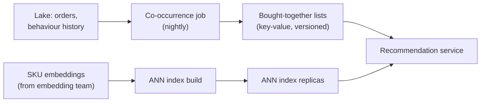
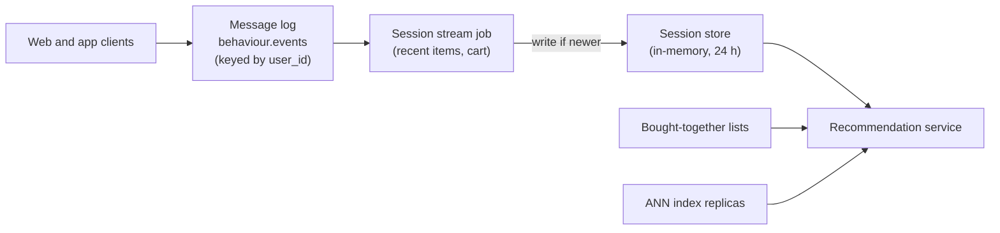
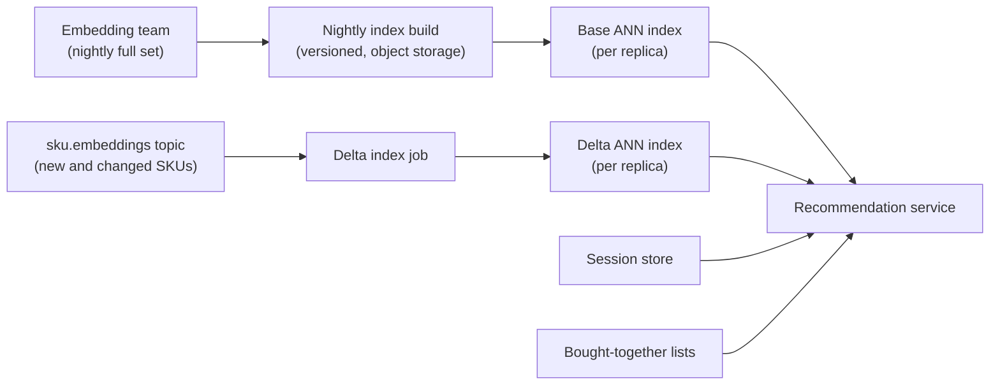
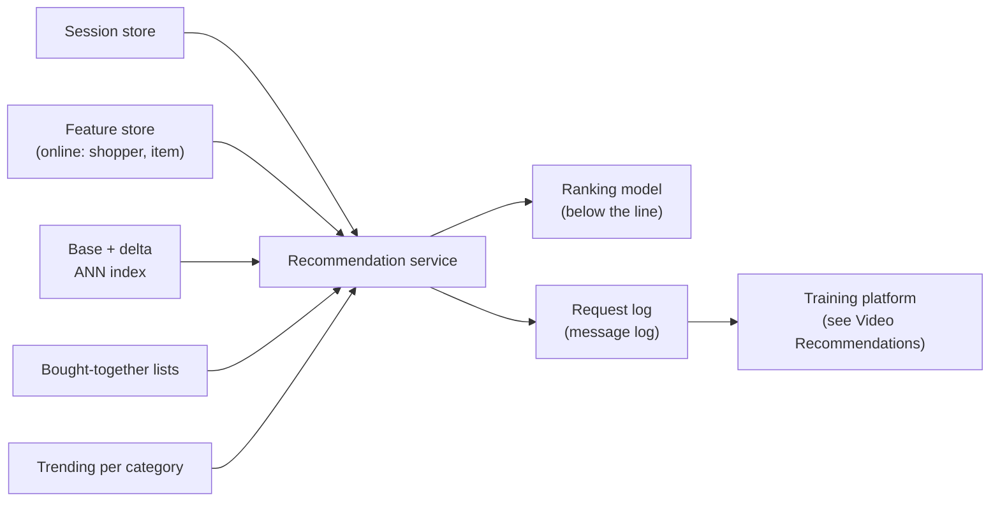
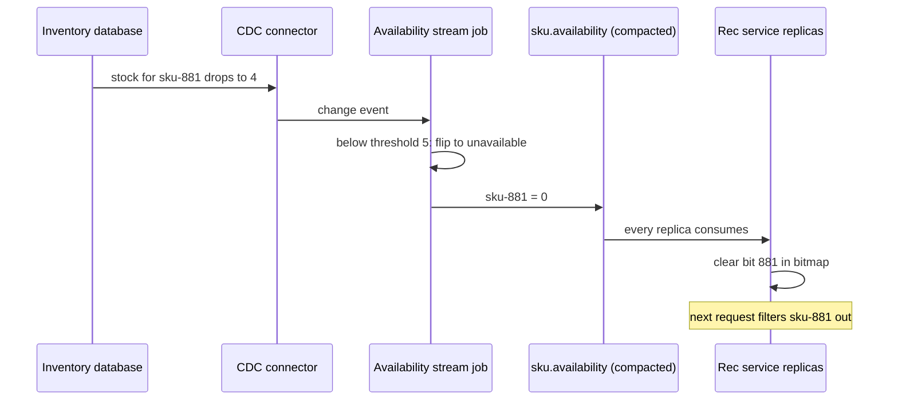
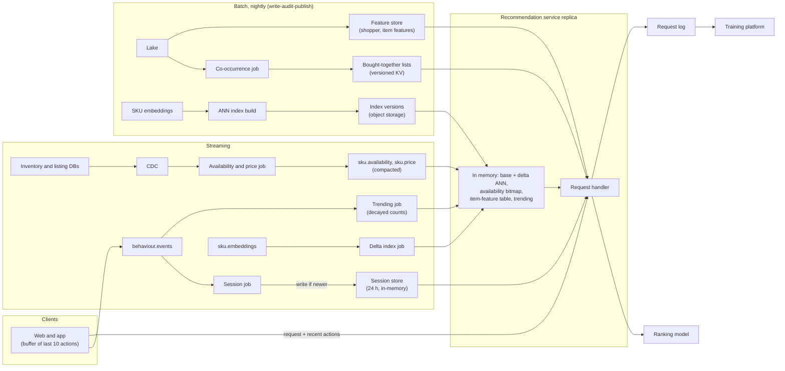

# Design an E-Commerce Recommendation Engine That Stays Fresh

A shopper looks at three hiking tents, adds one to the cart, and the "you might also like" row still shows the phone cases they browsed last week. Nothing is broken; the data behind the row is just hours old. This breakdown is about the serving side of recommendations: getting what a shopper did seconds ago, what sold out a minute ago and what launched this morning into a ranked list, inside a page's latency budget. Nothing here describes how any real company built its system.

## Understanding the Problem

The prompt:

> "We run a large online store. Product pages, the cart and the home page all show rows of recommended products. Today they come from a nightly batch job and feel stale. Design the data side of a recommendation engine that reacts to what shoppers are doing right now."

Some vocabulary first. A **SKU** (stock keeping unit) is one sellable product variant: the green 2-person tent, not "tents". The **catalog** is every SKU the store sells. A **session** is one shopper's visit, closed after 30 minutes without activity (the same sessionization rule the [Video Recommendations](02-video-recommendations.md) breakdown uses).

Recommendation systems answer each request in two stages, and the data design follows from them:

1. **Candidate generation** picks a few hundred plausible SKUs out of millions, cheaply: "items often bought with what's in the cart", "items similar to the last three viewed", "what's trending in camping". Each of these is a **candidate source**.
2. **Ranking** scores those few hundred candidates with a model that reads **features** (input values such as "this shopper's price range" or "this SKU's click rate today") and returns the top 20.

The models are below the line. Your job is everything they read: the candidate sources, the features, and how fresh each one is.

If **online store** or **feature logging** are new to you, the [Feature Store](../05-breakdowns-core/08-feature-store.md) breakdown defines them; this lesson uses that platform rather than redesigning it. How this data becomes training sets (labels, label windows, point-in-time joins) is the [Video Recommendations](02-video-recommendations.md) breakdown.

The central tension has three parts:

1. **Near-real-time signals.** The shopper's last few actions are the strongest signal you have, and they are seconds old.
2. **Candidate generation inputs that change at different speeds.** Co-purchase patterns change over weeks, the catalog's stock changes every second, and new products arrive all day.
3. **Feature serving inside a latency budget.** Every one of those inputs has to be read while the page waits, for hundreds of candidates, in tens of milliseconds.

Say the framing: "The model is someone else's. I'm designing the inputs it reads, and how stale each may be."

## Requirements

*About 6 minutes.* Ask what "fresh" means to the business, how long the page can wait, and what must never appear:

> **You:** "When a shopper adds something to the cart, how soon should recommendations reflect it?"
> **Interviewer:** "On the very next page. That's the complaint that started this."
> **You:** "How long can the recommendation call take?"
> **Interviewer:** "The product page renders server side in about 300 ms. Recommendations get 80 ms at p99."
> **You:** "Is it worse to show an out-of-stock item or to show a slightly less relevant one?"
> **Interviewer:** "Out of stock is much worse. Shoppers click, see 'unavailable', and leave."

Three design drivers: next-page freshness, a hard time budget, live stock as a filter.

### Functional requirements

1. **Track each shopper's live session**: products viewed, carted and searched, available to the recommendation service within seconds.
2. **Maintain candidate sources**: precomputed "bought together" lists, a similarity index over product embeddings that includes new products, and trending products per category.
3. **Serve a ranked list at request time**: gather candidates, drop anything unavailable, attach features, rank, return.
4. **Log every recommendation request** (what was considered, what was shown, what the model saw) for the training platform to consume.

**Below the line (out of scope):** the ranking and embedding models, building training data ([Video Recommendations](02-video-recommendations.md)), feature store internals ([Feature Store](../05-breakdowns-core/08-feature-store.md)), the A/B testing platform, search ranking, sponsored products and page rendering.

### Non-functional requirements

- **Scale:** 200 million customers, 40 million daily active shoppers, 30 million SKUs, about 50,000 new SKUs and 3 million price or stock changes a day. Recommendation traffic in the next section.
- **Session freshness:** an interaction is visible to the recommendation service within 2 seconds (p95), and the shopper's own last action is always reflected on their next page.
- **Catalog freshness:** a sold-out SKU stops being recommended within 30 seconds (p99); a new SKU can be recommended within 15 minutes of going live.
- **Latency:** recommendation call p99 under 80 ms, of which data fetching (session, candidates, features) gets at most 30 ms.
- **Availability:** 99.95%, and never an empty row. If personalized sources fail, show popular items in the category.

> [!TIP]
> Ask for freshness per input, not for "the recommendations". "Session in seconds, stock in 30 seconds, new products in 15 minutes, co-purchase patterns daily" gives you four pipelines, each only as fast as it needs to be.

## Sources & Volume

*About 4 minutes.* Three inputs:

- **Behaviour events** from web and app clients: product views, add-to-cart, searches, purchases. Each carries a client-generated `event_id`, the user, the session and the SKU.
- **Catalog and inventory changes** from the operational databases, captured with **CDC** (change data capture: reading the database's change log so every insert and update becomes an event; see [CDC Patterns](../03-architecture-patterns/04-cdc-patterns.md)).
- **Batch artifacts**: product embeddings and order history in the lake, owned by other teams. An **embedding** is a list of about 128 numbers a model learns for each SKU, so that similar products get similar numbers.

Now the numbers, using [Key DE Numbers](../02-core-concepts/10-key-de-numbers.md). Say the per-user figures are assumptions:

1. **Recommendation requests.** "40 million shoppers × 20 pages a day is 800 million pages. About two recommendation rows per page is 1.6 billion requests a day: about 18,500 a second on average, roughly 55,000 at the evening peak. Black Friday is about 3x that peak: plan for 165,000 a second."
2. **Behaviour events.** "40 million shoppers × 60 events is 2.4 billion a day, about 28,000 a second, 85,000 at peak. At 0.5 KB each that's about 42 MB/s at peak and 1.2 TB a day raw." Five partitions would carry it; take 64, keyed by `user_id`, for consumer parallelism. Ingest is routine.
3. **Session state.** "Keep the last 24 hours per shopper, about 2 KB each (the last 50 SKUs touched, the cart): 40 million × 2 KB is 80 GB." Small enough for an in-memory store.
4. **Candidates per request.** "About 1,000 gathered from all sources; after dedup and filtering, capped at 500 with a quota per source; all 500 scored, top 20 returned." Hold this: 500 SKUs' features per request is what stresses the latency budget.
5. **The similarity index.** "30 million SKUs × 128 numbers × 4 bytes is about 15 GB of vectors; the graph's neighbour links add roughly 5 to 10 GB, so call it 25 GB with headroom." It fits in one server's memory, which means every serving replica can hold a full copy.
6. **Availability.** "One bit per SKU, 'can be recommended right now': 30 million bits is under 4 MB."

State what the numbers imply:

> "Volume is ordinary. The hard part is that each of 55,000 requests a second needs session state, several candidate lookups and features for 500 products inside 30 ms. So I precompute what I can and keep the small, fast-changing pieces in the service's memory."

## High-Level Design

*About 13 minutes.* The data flow in numbered hops:

1. Clients send behaviour events to a message log.
2. A stream job keeps each shopper's session state in a fast store.
3. Batch jobs build candidate artifacts (bought-together lists, the similarity index) and publish them as versions.
4. Stream jobs keep the catalog side fresh: new SKUs into the index, availability and prices to serving, trending counts.
5. At request time, the recommendation service reads session and user features, gathers candidates, filters, attaches item features, ranks and logs.

Then build it per requirement.

### 1. Where candidates come from

#### Bad Solution: Precompute every shopper's final list nightly

A nightly Spark job scores products for every customer and writes the top 50 per customer to a key-value store. Serving is one lookup.

It is the system the interviewer is complaining about: the tent in the cart is invisible until tomorrow, 160 million of the 200 million lists are never read, and a list built at 02:00 recommends an item that sold out at 09:00.

#### Good Solution: Rank at request time, over candidates from one similarity search

Precompute only an embedding per shopper (from their history) and an index over SKU embeddings. At request time, find the SKUs nearest to the shopper's embedding, rank them with fresh features, return the top 20.

Finding the nearest of 30 million vectors exactly would mean comparing against all of them. An **approximate nearest neighbour (ANN) index** is a structure built over the vectors (HNSW, a layered graph, is the common algorithm; FAISS, vector databases and search engines' vector fields implement it) that returns the closest few hundred in about a millisecond, accepting it may miss a few true neighbours.

Ranking is now fresh, but candidates aren't: a shopper who switched from phone cases to tents tonight gets phone-case candidates, freshly ranked. And one source gives one kind of candidate: "goes with your tent" (pegs) is not "similar to your tent" (other tents).

#### Great Solution: Several candidate sources, each fed at its own freshness, merged at request time

| Source | What it answers | Built | Freshness |
|---|---|---|---|
| **Session similarity** | "Like what you're looking at now" | ANN search with a session vector from the live session | Seconds (session), minutes (index) |
| **Bought-together lists** | "Goes with what's in your cart" | Nightly batch over 90 days of orders | A day |
| **Long-term affinity** | "Like what you usually buy" | ANN search with the shopper's nightly embedding | A day |
| **Trending per category** | "Popular right now in camping" | Stream job, decayed counts | Minutes |

A **co-occurrence list** (a bought-together list) is, for each SKU, the other SKUs most often bought or viewed in the same sessions, with a score. Look up the lists for the last few SKUs viewed or carted, merge, and you have complementary candidates without any model at request time.

Each source is its own pipeline with its own schedule and failure; the service queries them in parallel and merges. Freshness lands on the cheap sources (session vector, trending counts), while the heavy artifacts (lists, index) change daily.

### 2. Session signals within seconds

Clients send behaviour events to the message log, topic `behaviour.events`, keyed by `user_id` so one shopper's events stay in order on one partition. A **session stream job** ([Flink](../04-technology-deep-dives/08-flink.md) or similar) keeps per-user **keyed state** (memory the job holds per key) and, on each event:

- appends the SKU to the shopper's recent-items list (last 50, newest first), and updates the cart set on add or remove;
- writes the whole session record to the **session store**, an in-memory key-value store (Redis or a managed equivalent), with the timestamp of the newest event included.

The **session vector** used for similarity search (a weighted average of the embeddings of recent items, carted ones weighted more) is computed by the service at request time, from the vectors already in its ANN index: 50 lookups and an average, microseconds. That keeps the vector in the same embedding version as the index it queries, by construction.

Writing the whole record, not increments, makes the write **idempotent**: a replay after a crash rewrites the same record. Guard it with **write-if-newer** (keep the stored record unless the incoming one has a newer event timestamp) so a replay can't move a session backwards ([Fraud Detection](03-fraud-detection.md) uses the same rule).

The path from tap to session store is a client upload, a replicated Kafka write (5 to 50 ms at p99), processing and a store write: typically well under a second, a few seconds when the job is catching up. That meets the 2-second p95. It does not meet "the very next page" for a shopper who taps 400 ms after adding to the cart; deep dive 1 closes that gap.

### 3. Keeping the similarity index fresh

50,000 SKUs launch every day. A new SKU has no orders, so it's in no bought-together list; the ANN index is its only way in. The embedding team gives every new SKU an embedding from its title, images and category within minutes of listing (their model, below the line). The question is how it gets into the index.

#### Bad Solution: Rebuild the index weekly

One big build, one deploy. New products wait up to seven days to be recommendable, which misses the 15-minute requirement by three orders of magnitude, and seasonal stock is half sold before it appears.

#### Good Solution: Rebuild nightly and swap atomically

A nightly job builds a fresh index (assume one to a few hours on a large machine for 30 million vectors; measure it) and writes it to object storage with a version ID. Each replica loads it beside the old one and switches over; rollback means pointing at the previous version.

Clean and reproducible, but still up to a day before a new SKU appears.

#### Great Solution: Nightly full build, plus a streaming delta index

Keep the nightly versioned build as the base. Add a **delta index**: a small ANN index of only the SKUs added or re-embedded since the base was built.

- A stream job consumes the embedding team's `sku.embeddings` topic and inserts each new vector into the delta index on every replica (HNSW supports inserts; 50,000 a day is tiny).
- At request time the service searches both indexes and merges by distance. The delta holds at most a day's additions, so searching it costs well under a millisecond.
- The next nightly base includes those SKUs, and the delta is reset to "changes since that build".

Delisted SKUs aren't deleted from the index: removing nodes from an HNSW graph slowly degrades it, the availability filter (deep dive 2) drops them within seconds, and the nightly rebuild cleans them out. A new embedding version is still a full build, deployed as a new version.

### 4. Assembling features and logging what the model saw

With about 500 candidates gathered and filtered, the ranker needs **shopper features** (price range, preferred brands) from the feature store's online store, **session features** already in the session record, **request context** (page type, device), and **item features** for each of the 500: price, rating, click rate today, stock level. That last one is 500 reads per request, 27.5 million a second at peak; deep dive 3 makes it fit.

The service calls the ranking model and returns the top 20 with a `request_id`. Asynchronously, it writes a **request log** to the message log: source versions used, the 500 candidates with their source, the features the model saw, and the 20 shown with positions. How that log becomes training rows (log what the model saw, then wait for labels) is the [Video Recommendations](02-video-recommendations.md) design; don't repeat it here.

## Data Model

*About 5 minutes.* Most of this system's data lives in serving stores, so model each one by the read that hits it.

### Behaviour events topic

`behaviour.events`, keyed by `user_id`, 64 partitions, 3 days retention. Fields: `event_id` (generated by the client, used for dedup), `user_id`, `session_id`, `event_type` (view, add_to_cart, remove_from_cart, search, purchase), `sku`, `event_ts`, `client_ts`. The lake writer lands it hourly-partitioned for the batch jobs.

### Session store

| Key | Value |
|---|---|
| `session:u-4471` | `{recent: [(sku, type, event_id, ts) × up to 50], cart: [sku…], last_event_ts}` |

One key per shopper, so one read per request; a 24-hour expiry removes idle shoppers. The `event_id`s let the service merge in events the request carries (deep dive 1).

### Candidate artifacts

- **Bought-together lists:** key `cooc:v2026-11-02:sku-881`, value the top 100 co-occurring SKUs with scores. About 5 million SKUs have enough history; × 100 × 8 bytes is about 4 GB, in a key-value store. The version is in the key, so a new nightly run is written beside the old one and switched by changing one pointer.
- **ANN indexes:** base index files in object storage under `ann/e17/2026-11-02/`, with a small manifest (embedding version, build time, SKU count). The delta index exists only in replica memory and is rebuilt from the topic on restart.
- **Trending:** per category, the top 500 SKUs by an exponentially decayed view and purchase count ([Social Media Analytics](04-social-media-analytics.md) covers decayed counters), a few MB in total, pushed to every replica.

### Item features, availability, request log

Item features are a feature view keyed by SKU in the feature store. **Availability** is deliberately tiny: one bit per SKU, in every replica's memory (deep dive 2). The **request log**'s grain is one row per recommendation request, carrying every source version (`cooc` date, ANN base and delta, trending snapshot) so any row shown can be traced to the artifacts that produced it.

## Pipeline Design

*About 5 minutes.* Each input gets the cheapest mode that meets its freshness:

| Path | Mode | Freshness and behavior |
|---|---|---|
| Behaviour events → session store | Streaming | Under 1 s typical; write-if-newer |
| Inventory and price CDC → availability, item price | Streaming | Seconds; deep dive 2 |
| New SKU embeddings → delta index | Streaming | Minutes after listing |
| Trending counts | Streaming, emit every 30 s | Decayed counts per category |
| Bought-together lists | Batch, nightly (02:00) | Spark over 90 days of orders and sessions |
| Base ANN index | Batch, nightly after embeddings land | Build, validate, publish version |
| Shopper embeddings and features | Batch, nightly via the feature store | Online by 06:00 |
| Request log → lake | Micro-batch, 5-minute commits | For the training platform |

An orchestrator runs the batch side by data dependency: the index build waits for the embedding team's partition, not a clock ([Pipeline Design](../01-the-framework/07-pipeline-design.md)).

**Publishing batch artifacts.** Every nightly artifact goes through the same three steps: build to a new version, validate (row counts against yesterday, a sample of known SKUs gets sensible neighbours, recall on a fixed set of test queries for the index), then flip one pointer that serving reads. That is **write-audit-publish** ([Data Quality Monitoring](../05-breakdowns-core/09-data-quality-monitoring.md)): a failed check means serving keeps yesterday's version, which is a day staler but never wrong.

**Failure behavior.**

- **Session stream job down:** session records stop updating; requests still carry the shopper's last few actions (deep dive 1), so the next-page promise survives a short outage.
- **Nightly job fails:** serving keeps the previous version, and an age alert fires when it passes 36 hours (deep dive 4).
- **Replica restart:** it loads the current base index and availability snapshot from object storage, then replays the delta topic and availability changes from the snapshot's offset before taking traffic.

## Potential Deep Dives

*About 13 minutes.* If the interviewer doesn't steer, lead with the first: it's the complaint in the prompt. How to run deep dives is in [Deep Dives](../01-the-framework/08-deep-dives.md).

### 1. "A shopper adds a tent to the cart and taps through to the cart page 400 ms later. Does the 'complete your trip' row know about the tent?"

Trace it. The tap updates the cart; the client sends a behaviour event through the message log and session job to the session store. Meanwhile the cart page loads and calls recommendations. Usually the event has landed; at the tail, or while the job is catching up, it hasn't, and the row shows yesterday's interests on exactly the page the interviewer cares about.

#### Bad Solution: Accept the stream's lag

"Two seconds at p95 is fresh enough." It isn't, for this page. The promise was the very next page, and the shopper's next page often comes in under a second. A pipeline that runs after the action can't guarantee to include it ([Fraud Detection](03-fraud-detection.md) makes the same point for payment attempts).

#### Good Solution: The cart service writes the session store synchronously

The cart service, after updating the cart, also writes the tent into the shopper's session record before responding.

The cart page now sees the tent. But the cart service's latency and availability now depend on the recommendation team's store, on the checkout path. It covers only server-side actions, not product views. And two writers now update one record, so the stream job can overwrite the cart service's write with an older session unless both use write-if-newer on the same timestamp.

#### Great Solution: The request carries the shopper's latest actions; the service merges

The client already knows what the shopper just did. It keeps a small buffer of its last 10 actions (SKU, type, `event_id`, timestamp) and sends them with every recommendation request, the same events it also sends to the message log. The service:

1. reads the session record from the store;
2. takes the request's actions whose `event_id` is not already in the record;
3. merges them in, recomputes the session vector over the combined list (128 numbers × 50 items is microseconds), and uses that for this request only.

No write happens on the request path; the stream job stays the only writer, and the request fills only the gap between "happened" and "stored". Because the client mints the `event_id` once and it travels both paths, the merge is an exact dedup, not a guess on timestamps.

This is **read-your-writes** for the shopper: their own action is always reflected, even when the pipeline is behind or down. One limit worth saying: the buffer is per device, so a cart change on the phone reaches the laptop only through the stream.

> [!TIP]
> The sentence that lands: "The stream gives me everyone's state within a second or two; the request gives me this shopper's last few seconds exactly. I merge them on `event_id`, so neither path needs to be perfect."

### 2. "A product sells out at 14:00. How long until we stop recommending it? And during a flash sale?"

Requirement: 30 seconds at p99. On a flash sale, the top 200 deal SKUs sell out within minutes, and they are also the most-recommended SKUs on the site, because they're trending.

#### Bad Solution: Filter stock when building the artifacts

Exclude out-of-stock SKUs from the nightly lists and index. Anything that sells out today is recommended until tomorrow, and restocked items stay hidden until tomorrow.

#### Good Solution: Look up stock for every candidate at request time

Call the inventory service, or read stock from the feature store, for the 1,000 candidates before ranking.

Fresh, but 1,000 lookups × 55,000 requests a second is 55 million reads a second against a system built to reserve stock at checkout. On Black Friday it would take down the service that takes orders.

#### Great Solution: Stream availability into a bitmap held in every replica

Recommendations need a different answer than checkout does: one yes or no per SKU (in stock, listed, not blocked), not "how many left".

- **CDC from the inventory and listing databases** goes to a stream job keyed by SKU. It applies the rules (stock above a safety threshold, listing active, not recalled) and emits a change only when a SKU's yes/no flips.
- Flips go to a compacted topic, `sku.availability`, keyed by SKU. **Log compaction** keeps only the latest value per key, so the topic itself is a complete, current table ([Kafka](../04-technology-deep-dives/02-kafka.md)).
- Every service replica consumes the topic and updates its in-memory bitmap: 30 million bits, under 4 MB. Filtering 1,000 candidates is 1,000 bit lookups, microseconds.
- On restart, a replica loads the latest bitmap snapshot from object storage (written every 10 minutes with its topic offset) and replays from that offset.

The safety threshold matters on flash sales: mark a SKU unavailable below, say, 5 units, not at 0, because stock falls faster than any pipeline propagates. The end-to-end path (commit, CDC, stream job, topic, replica) is typically a few seconds, well inside 30.

Say the trade-off: recommendations are "eventually right" about stock, within seconds, and checkout still checks real stock before reserving it. Recommendations only have to stop *advertising* sold-out items. Price changes travel the same way on a `sku.price` compacted topic, feeding deep dive 3.

### 3. "Walk me through the 80 ms. Where does the time go, and what do you precompute so it fits?"

Write the **latency budget** on the board: the request's time limit, split into a share per step, the way a freshness budget splits end-to-end delay. Steps that don't depend on each other run in parallel, so the budget is the longest path, not the sum.

| Step | Target (p99) | Runs |
|---|---|---|
| Read session record + shopper features | 5 ms | In parallel |
| Candidate sources: ANN (base + delta), bought-together lists for up to 5 SKUs, trending | 10 ms | In parallel, after the session read |
| Merge, dedup, availability filter, business rules (already bought, adult items) | 2 ms | In memory |
| Item features for 500 candidates | 10 ms | See below |
| Ranking model | 30 ms | Below the line |
| Headroom (network, serialization, GC pauses) | 23 ms | |
| **Total** | **80 ms** | |

The data path is about 27 ms, inside the 30 ms the requirements gave it. Two of those steps need design, not just a fast store.

**Candidate lookups.** The ANN index and trending lists live in the service's own memory: no network hop. Bought-together lists take one multi-get for the 5 most recent SKUs, about 2 ms. How the feature store keeps its own reads under 10 ms (one key per entity per view, hedged reads, defaults) is the [Feature Store](../05-breakdowns-core/08-feature-store.md) breakdown's deep dive 3; cite it, don't re-derive it.

**Item features for 500 candidates.** This is the e-commerce twist on that lesson. One request needs 500 item keys, not 20, so the store sees 27.5 million key reads a second at peak.

#### Bad Solution: Read all 500 from the online store per request

500 keys spread across every shard, so each request waits on the slowest shard in the cluster, every time. The feature store lesson's tail-latency argument, at 25x the fan-out: one slow shard in a thousand makes most requests slow.

#### Good Solution: Cache item features in every replica, with a short TTL

Item features are the same for every shopper. Keep an in-process cache per replica with a 60-second TTL. Assume the top 1 million SKUs make up about 90% of candidates: 1 million × 500 bytes is 500 MB per replica, and about 50 store reads per request instead of 500.

Where it falls short: a price change can show up a minute late, and every replica refreshes its own copy, so on Black Friday the misses still arrive as a burst.

#### Great Solution: A replicated item-feature table, pushed by change stream

Make the item feature view for the hot SKUs a local, read-only table in every replica, updated by change events instead of expiry:

- The nightly batch features (rating, margin band, 30-day sales) arrive as a snapshot file per version, loaded at startup and swapped atomically.
- Fast-moving fields (price, today's click rate, stock level) arrive on compacted topics like `sku.price`, applied as they change, the same machinery as the availability bitmap.
- Misses (the long tail outside the hot million) go to the online store as one multi-get, about 50 keys, with a deadline. A miss that times out gets the feature store's default, logged, so training sees the same default.

Item feature reads are now mostly memory lookups, and price is seconds fresh. The cost is memory per replica and a second copy of the item feature view, checked against the feature store the way that lesson checks consistency: log what was served, compare a sample.

> [!WARNING]
> Don't size this from the number of requests alone. Candidates multiply everything: 55,000 requests a second is 27.5 million item-feature reads a second. Sizing the online store for 55,000 reads is the classic miss.

### 4. "It's Black Friday: three times the traffic, and last night's bought-together job failed. What does the shopper see?"

Two separate problems: capacity and stale inputs.

**Capacity.** 165,000 requests a second scales out cleanly because the heavy state (index, bitmap, item table) is replicated per instance; the shared stores (session, bought-together, feature store) are the ones to size. Pre-scale everything a day ahead rather than autoscaling on the morning: a new replica takes minutes to load a 25 GB index. The trending source sees its own hot spot (one deal SKU getting a large share of all views) and handles it the way [Surge Pricing](../05-breakdowns-core/10-surge-pricing.md) handles a **hot key**: pre-aggregate per worker, then combine.

**Stale or missing inputs.** Every candidate source has a declared maximum age, and serving checks it per request:

| Source | Normal age | Max age before it's dropped | If dropped |
|---|---|---|---|
| Session record | < 2 s | Request-carried actions always used | Last 10 actions from the request |
| Bought-together lists | < 24 h | 72 h | Session similarity takes its slots |
| Base ANN index | < 24 h | 7 days (same embedding version) | Other sources take its slots |
| Trending | < 1 min | 15 min | Category popularity from the nightly job |
| Shopper features | < 24 h | Feature view TTL | Feature store defaults |

So a failed nightly job means yesterday's lists serve again, 26 hours old, with an alert. Co-purchase patterns barely move in a day; what moves on Black Friday is captured by trending, the source that must stay fresh.

The last line of defence for "never an empty row" is a per-category popular list, rebuilt hourly and cached in every replica, used when every personalized source fails. Log every fallback with its reason in the request log, so training learns from the same degraded inputs serving used.

> [!NOTE]
> The pattern behind all of this: each source fails independently, so a failure removes one source's candidates, not the whole row. Merging several sources at request time is a relevance choice and a reliability choice at once.

## Monitoring & SLAs

*About 4 minutes.* Four SLAs, each tied to a requirement. [Monitoring and SLAs](../01-the-framework/09-monitoring-and-slas.md) covers presenting them; [Monitoring and Alerting](../02-core-concepts/06-monitoring-and-alerting.md) covers alert design.

| SLA | Target | Measured by |
|---|---|---|
| **Latency** | p99 < 80 ms; data path < 30 ms | Per-step timings in the service, per page type |
| **Session freshness** | p95 < 2 s event to session store | `event_ts` vs. write time in the session job; plus a synthetic shopper that adds to cart every minute and checks the next request |
| **Availability freshness** | p99 < 30 s from stock change to bitmap | CDC commit timestamp carried through to the replica's apply time |
| **Sold-out shown rate** | < 0.1% of recommended items unavailable at click | Clicks on recommended items joined to the product page's "unavailable" response |

Behind them:

- **Artifact age per source** on every replica, against the max ages in deep dive 4.
- **Fallback rate per source**: requests where a source was dropped, timed out or defaulted. A jump from 0.5% to 20% is a broken source, even when latency looks fine.
- **Candidate source mix**: share of shown items per source. If bought-together drops from 30% to 5% overnight, check last night's lists before the model.
- **New SKU coverage**: share of SKUs listed in the last 24 hours that appeared in any candidate list. Zero means the delta index job is down.
- **Request-carried merge rate**: how often the request's actions were newer than the store; a rising rate means the session job is falling behind.

The trap specific to this system: **it degrades without erroring.** Every fallback returns a valid row, so health checks stay green while relevance drops. Monitor what was served and from where.

## Final Design

Follow one request through it. At 19:42:10 shopper u-4471 adds a 2-person tent (sku-881) to the cart. The client sends the event and, 400 ms later, opens the cart page; the recommendation request carries the add-to-cart in its last-10 buffer. The session record in the store doesn't have it yet (the job is 1.2 s behind tonight), so the service merges it by `event_id` and builds the session vector from its index's own embeddings. In parallel it reads shopper features, looks up the bought-together lists for the tent and the two tents viewed before it, and searches the base and delta indexes; a sleeping mat listed this morning comes back from the delta. Of 1,040 candidates, the bitmap drops 31, including a lantern whose stock fell below 5 at 19:41:58, and per-source quotas trim the rest to 500. Item features come mostly from the local table, the mat's from the online store. The ranker returns 20: pegs, a footprint, the new mat, in 61 ms, and the request log records every source version and feature value.

## What's Expected at Each Level

### Mid-level

You separate candidate generation from ranking and explain why precomputing every shopper's final list nightly can't be fresh. You put behaviour events on a message log and maintain session state with a stream job, and you filter out-of-stock items with something fresher than the nightly build. The interviewer leads the deep dives. Bar for this problem: request-time ranking over candidates from at least two sources, a session store updated within seconds, and a latency target you can split into steps.

### Senior

You drive, and you assign a freshness to each input before designing its pipeline. You close the next-page gap by merging request-carried actions on `event_id` rather than adding a synchronous write. You keep the index fresh with a nightly versioned build plus a delta, stream availability into a per-replica bitmap from CDC, and size item-feature reads from the candidate fan-out (27.5 million a second, not 55,000). You publish batch artifacts with write-audit-publish and give every source a max age and a fallback.

### Staff+

You treat the recommendation service as the consumer of four teams' artifacts (embeddings, features, catalog, ranking models) and define the contracts: versions, max ages, and who gets paged when one is stale. You keep embedding versions consistent across indexes and models (the bundle manifest from [Video Recommendations](02-video-recommendations.md)), and plan the cut-over when the embedding team ships a new space. You weigh building on a vector database against in-process indexes on cost and tail latency, and you plan Black Friday capacity (pre-scaling, load-shedding by source) as an explicit exercise. You make sure every fallback and default reaches the request log, so training sees what serving actually did.

## Related Lessons

- Framework: [The Delivery Framework](../01-the-framework/02-delivery-framework.md), [Requirements Gathering](../01-the-framework/03-requirements-gathering.md), [Sources and Volume](../01-the-framework/04-sources-and-volume.md), [Pipeline Design](../01-the-framework/07-pipeline-design.md), [Deep Dives](../01-the-framework/08-deep-dives.md), [Monitoring and SLAs](../01-the-framework/09-monitoring-and-slas.md)
- Concepts: [Key DE Numbers](../02-core-concepts/10-key-de-numbers.md), [Monitoring and Alerting](../02-core-concepts/06-monitoring-and-alerting.md)
- Patterns: [CDC Patterns](../03-architecture-patterns/04-cdc-patterns.md)
- Technology: [Flink](../04-technology-deep-dives/08-flink.md), [Kafka](../04-technology-deep-dives/02-kafka.md)
- Breakdowns: [Feature Store](../05-breakdowns-core/08-feature-store.md) (online store, serving tail latency, feature logging), [Video Recommendations](02-video-recommendations.md) (training data, label windows, bundle manifests), [Fraud Detection](03-fraud-detection.md) (request-time freshness, write-if-newer), [Social Media Analytics](04-social-media-analytics.md) (decayed counters), [Data Quality Monitoring](../05-breakdowns-core/09-data-quality-monitoring.md) (write-audit-publish), [Surge Pricing](../05-breakdowns-core/10-surge-pricing.md) (hot keys)
- Previous breakdown: [Multi-Tenant Platform](05-multi-tenant-platform.md). Next: [Activity Feed](07-activity-feed.md)
