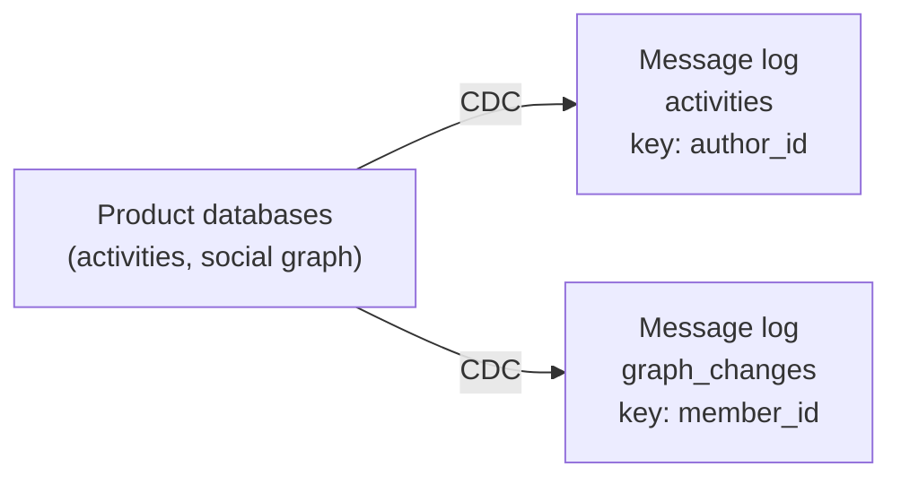
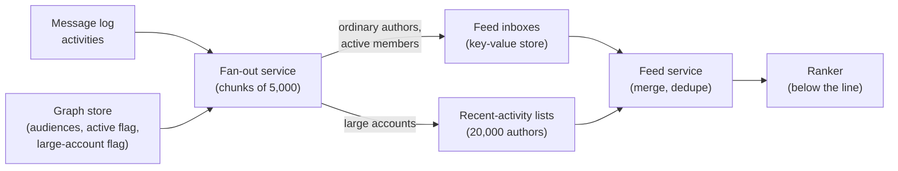
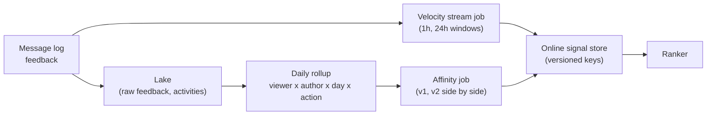
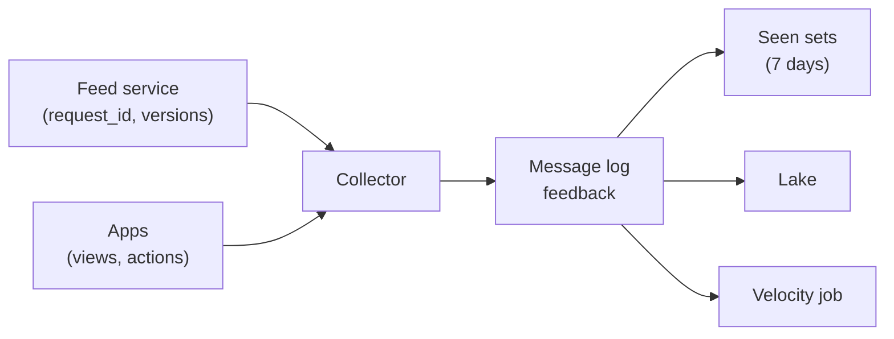
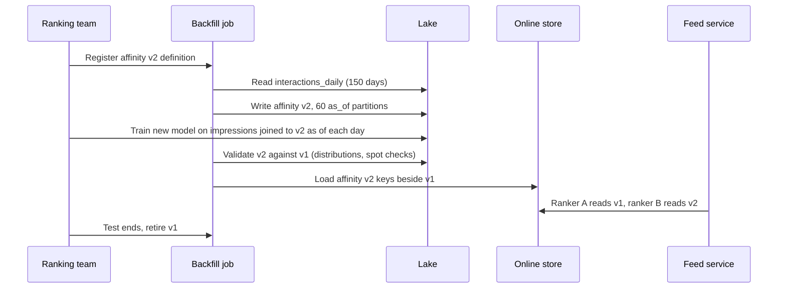
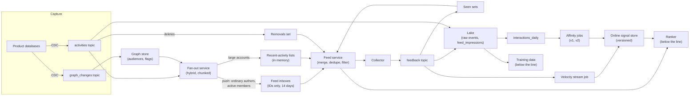

# Design the Data Pipeline Behind a LinkedIn-Style Activity Feed

This breakdown follows the same seven steps as every other ([The Delivery Framework](../01-the-framework/02-delivery-framework.md)). It is about moving one post into millions of feeds, keeping the signals that rank those feeds fresh, and rebuilding history when someone changes what a signal means. "LinkedIn-style" is only the prompt's framing; nothing here describes how any real company built its system.

## Understanding the Problem

The prompt:

> "We run a professional network. Members post updates, share articles, change jobs and comment on each other's posts. Design the data pipeline behind the home feed: getting each activity in front of the right people, the signals the ranking model uses, and what happens when the ranking team changes those signals."

An **activity** is anything that can appear in a feed: a post, a reshare, a job change, a work anniversary. Each member's **audience** is the set of people who should see their activities: their **connections** (two-way relationships both members accepted) plus their **followers** (one-way, so a well-known executive can have millions of followers without knowing any of them).

A ranking model decides the order of each member's feed. You are not designing the model; it is below the line. You are designing everything that feeds it, and the interview turns on three questions:

- **Fan-out.** A post by a member with 300 connections must reach 300 feeds. A post by an executive with 20 million followers must reach 20 million. **Fan-out** here means copying or delivering one activity to every member of its audience. Do you do that work when the post is written, or when each reader opens the app?
- **Ranking signals.** A **signal** is an input the ranker uses, such as "how often does this viewer interact with this author" or "how fast is this post collecting comments". Each has its own pipeline and its own freshness.
- **Backfills when ranking changes.** The ranking team will redefine a signal. The new model needs that signal for every past day it trains on, and the live feed needs it for every member, without a gap and without breaking the old model while the two are compared.

Counting engagements under hot posts is in [Social Media Analytics](04-social-media-analytics.md) and request-time feature serving is in [Recommendation Engine](06-recommendation-engine.md); this lesson links to both. Its own center is the shape of fan-out and the life cycle of a signal. Say that in the first two minutes.

## Requirements

*About 6 minutes.* Ask about the audience shape, how fresh the feed must feel, and how often ranking changes:

> **You:** "How skewed are audiences? Is there a long tail of very large accounts?"
> **Interviewer:** "Most members have a few hundred connections. About 20,000 accounts have more than 100,000 followers, and the biggest have around 20 million."
> **You:** "When I post, how soon should my connections see it?"
> **Interviewer:** "Within a minute is fine. Nobody refreshes a professional feed every second."
> **You:** "If I delete a post, or block someone?"
> **Interviewer:** "It has to disappear quickly. That's a trust and legal issue, not a nice-to-have."
> **You:** "How often does the ranking team change signals?"
> **Interviewer:** "A few times a quarter. They always want to A/B test the new version against the old."

An **A/B test** shows the new version to a random slice of members and compares outcomes with the current one. That last answer means two versions of a signal must be live at the same time. Write it down.

### Functional requirements

1. **Deliver activities**: a new activity becomes a feed candidate for every member of the author's audience.
2. **Produce ranking signals**: viewer-author affinity, activity engagement velocity and member attributes, each at its own freshness, readable by the ranker.
3. **Log feedback**: what each member was shown, at which position, and what they did with it, for signals and for training data.
4. **Support signal changes**: when a signal's definition changes, rebuild it over past data and run old and new side by side.

**Below the line (out of scope):** the ranking model and its training platform ([Video Recommendations](02-video-recommendations.md) covers that data side), the mechanics of request-time feature serving ([Recommendation Engine](06-recommendation-engine.md)), the like and comment counters shown under posts ([Social Media Analytics](04-social-media-analytics.md)), notifications, ads in the feed, and content moderation models (we consume their "removed" decisions).

### Non-functional requirements

- **Scale:** 300 million monthly active members, 100 million daily active, 10 million new activities a day, about 20,000 feed requests a second at peak (worked out next).
- **Delivery freshness:** p95 (95% of activities) visible as a candidate in an audience member's feed within 60 seconds.
- **Feed assembly latency:** gathering candidates for one feed request in under 50 ms at p99, leaving the rest of the page budget to ranking.
- **Signal freshness:** engagement velocity within 1 minute; affinity and member attributes refreshed daily by 06:00 UTC.
- **Correctness:** a deleted activity or a blocked author never appears in a feed more than 60 seconds after the action. No activity appears twice on one feed page.
- **Change:** a redefined signal can be rebuilt over 90 days of history and shipped to an A/B test within a week, with the old version untouched.

> [!TIP]
> Ask about the audience distribution first. "Most have 300, a few have 20 million" decides fan-out; a design that works for the median member and dies on the executive is the most common way to fail this prompt.

## Sources & Volume

*About 5 minutes.* Three inputs:

- **Activities**, written by product services to their own databases.
- **The social graph**: connect, follow, unfollow and block, also in a product database.
- **Feedback events** from the apps: impressions (an activity shown on a screen at a position) and actions (like, comment, reshare, click, hide).

Using [Key DE Numbers](../02-core-concepts/10-key-de-numbers.md):

1. **Activities.** "10 million a day is about 115 a second, maybe 350 at peak. Ingest is tiny; fan-out multiplies it."
2. **Fan-out, everything pushed.** "Ordinary authors: 10 million activities times an average audience of about 300 is 3 billion feed inserts a day. The 20,000 large accounts post about once a day each to an average of 500,000 followers: 10 billion more. Total 13 billion inserts a day, about 150,000 a second on average. And a single post from the biggest account is 20 million inserts at once."
3. **Who is active.** "Only 300 million of roughly 900 million registered members opened the app this month. About two thirds of those inserts land in feeds nobody will read."
4. **Feed reads.** "100 million daily members, about 6 feed loads each: 600 million a day, roughly 7,000 a second on average and 20,000 at peak."
5. **Feedback.** "About 10 impressions per feed load: 6 billion a day, about 70,000 a second on average, 200,000 at peak. At 200 bytes each, 1.2 TB a day raw, about 40 MB/s at peak. Actions are about 300 million a day, small next to that."

State what the numbers imply before you draw:

> "Activities and feedback are ordinary message-log volumes. The number that decides the design is the fan-out: 13 billion writes a day if I push everything, most of it caused by 0.2% of posts and most of it landing in feeds of members who won't come back this month."

## High-Level Design

*About 14 minutes.* The data flow, in numbered hops:

1. Activities and graph changes are captured from product databases into a message log.
2. A fan-out service turns each activity into feed entries for its audience.
3. The feed service assembles candidates for a request and asks the ranker to order them.
4. Feedback events flow back into a message log and the lake.
5. Signal pipelines (streaming and batch) compute ranking signals and publish them to an online store the ranker reads.

Build it one requirement at a time.

### 1. Capturing activities and graph changes

Activities and graph edges live in product databases. Capture both with **CDC** (change data capture: reading the database's change log and publishing each committed insert, update and delete as an event) into two topics, `activities` and `graph_changes`, keyed by author and by member. A delete of an activity row becomes an event too, which you will need for removals. CDC publishes only committed changes, so a post whose transaction rolled back never reaches a feed. See [CDC Patterns](../03-architecture-patterns/04-cdc-patterns.md).

Is `activities` keyed by `author_id` a hot partition risk? No: even the busiest author posts a few times a day. The hot spot is what happens after.



### 2. Getting an activity into every audience member's feed

This is the central decision. A **feed inbox** is a per-member list of activity IDs waiting to be ranked, newest first, kept in a fast key-value store. The question is who fills it, and when.

#### Bad Solution: Pull everything at read time

Store nothing per reader. On each app open, fetch recent activities from everyone the member is connected to or follows (about 400 accounts), merge, and rank. This is **fan-out on read**, or the **pull** model.

Writes are free and a delete is instant. But reads explode. 20,000 requests a second times 400 authors is 8 million lookups a second, most of them for authors with nothing new, and the 50 ms budget dies on the slowest of 400 parallel calls.

#### Good Solution: Push every activity into every audience member's inbox

When an activity arrives, a fan-out worker reads the author's audience from the graph store and appends the activity ID to each member's inbox. This is **fan-out on write**, or the **push** model. A feed read is now one key lookup.

Reads are cheap and fast. It falls short on the numbers from the last step: 13 billion inserts a day, two thirds of them into inboxes nobody reads this month. And the 20-million-follower post: at a planning assumption of 100,000 inserts a second for the fan-out write path (the same order as the roughly 100,000 operations a second per key-value node used in [Feature Store](../05-breakdowns-core/08-feature-store.md); measure yours), the last follower gets it 200 seconds later, and every ordinary member's post queued behind it waits too. Your 60-second freshness target is broken by one person posting.

#### Great Solution: Hybrid fan-out, with push filtered to active members

Split authors by audience size, and split readers by activity:

- **Ordinary authors (under 100,000 followers): push**, but only to audience members active in the last 30 days. That turns 3 billion inserts into about 1 billion a day: roughly 12,000 a second on average and 35,000 at peak.
- **Large accounts (over 100,000 followers): pull.** Their activities go into a small per-author **recent-activity list** (the last 100 activity IDs). At read time, the feed service merges the member's inbox with the recent-activity lists of the large accounts they follow.
- **Members inactive for 30 days or more** get nothing pushed. When they return, their inbox is rebuilt on the spot (deep dive 4).

This is **hybrid fan-out**: push for the many small audiences, pull for the few huge ones. Why is pull cheap for exactly the accounts where push is expensive? Because the pulled set is tiny. 20,000 large accounts × 100 entries × 32 bytes is 64 MB, small enough to keep in memory on every feed server and refresh from a topic. A member follows, say, 8 large accounts, so a request adds 8 in-memory reads, not 400 remote ones. Pull fails when it covers everyone; it works when it covers a hot set that fits in RAM.

Even below the threshold, an author with 90,000 followers is a big job. Split each fan-out into chunks of 5,000 audience members, with separate queue lanes for large and small jobs, so one big job cannot block a thousand small ones.

Say the trade-off: "I've moved the cost of the biggest posts from write time, where it's huge and bursty, to read time, where it's a few in-memory lookups. In exchange, feed assembly now merges two sources, and the threshold becomes something I have to manage."



### 3. Ranking signals, each at its own freshness

The ranker needs signals about the viewer, the author, the activity and the pair. They change at very different speeds:

| Signal | Example | Changes | Freshness needed |
|---|---|---|---|
| Activity engagement velocity | Comments and reactions in the activity's first hour | Every second for a new post | 1 minute |
| Viewer-author **affinity** | How much this viewer has interacted with this author over 90 days | Slowly | Daily |
| Member attributes | Industry, seniority, connection count | Rarely | Daily |

**Affinity** is a score for a (viewer, author) pair built from the viewer's past interactions with that author: views, reactions, comments, profile visits.

#### Bad Solution: Score each entry at fan-out time and store the score in the inbox

The fan-out worker computes a score when it writes the entry, and the feed service sorts inboxes by it.

It freezes everything. A post that collects 500 comments in its first hour keeps its second-one score. Worse, the moment the ranking team changes anything, every stored score is wrong: you would have to rewrite about 14 billion inbox entries (1 billion a day kept for 14 days) to ship a new model. Ranking logic has leaked into the storage layer.

#### Good Solution: Inboxes hold IDs only; signals live in their own pipelines and an online store

The inbox stores only `activity_id`, `author_id`, `created_at` and a reason code. Signals are computed separately:

- **Engagement velocity**: a stream job reads the feedback topic and keeps per-activity counts over 1-hour and 24-hour windows. The counting mechanics, including posts that go viral, are the subject of [Social Media Analytics](04-social-media-analytics.md); here they are an input.
- **Affinity and member attributes**: daily batch jobs over the lake.

Both publish to an **online store** (a key-value store holding the latest value of each signal per key, read in milliseconds). The ranker reads them at request time; [Recommendation Engine](06-recommendation-engine.md) covers that read.

A ranking change now touches no inboxes. Where it falls short: each signal table has one meaning. When the team redefines affinity, the new job overwrites the old values, and the current model, which was trained on the old meaning, starts receiving numbers it has never seen.

#### Great Solution: Versioned signals, built from an immutable event history

Give every signal a definition version, and treat each version as its own output:

- The batch job writes `affinity` rows tagged `v1` or `v2`; the online store keys them separately. The ranker asks for the version its model was trained on.
- Every signal is derived from the lake's raw feedback events (never edited), through an intermediate table kept at a fine grain: one row per viewer, author, day and action type. A new definition is a new computation over the same history.
- The feed service logs, per request, which ranker version and signal versions it used ([Video Recommendations](02-video-recommendations.md) covers turning that log into training data).

A redefinition is now additive: build `v2` beside `v1`, A/B test, retire `v1` later. Deep dive 3 walks through it.



### 4. Logging feedback

The feed service mints a `request_id` for each feed it serves and logs one **impression** row per activity shown (member, activity, position, request, ranker and signal versions). The apps send views and actions carrying that `request_id`. A collector (a stateless HTTP service) writes them to the `feedback` topic, which feeds the velocity job, the lake, and one more thing the feed needs: a **seen set**, the activity IDs this member has already been shown in the last 7 days, so a refresh does not show the same post at the top again. The seen set is small per member (a few hundred IDs) and lives next to the inbox.



## Data Model

*About 5 minutes.* Model from the readers backwards: the feed service and the signal jobs.

### Topics

- `activities`: one event per activity created, edited or deleted, keyed by `author_id`. Fields: `activity_id`, `author_id`, `type`, `created_at`, `visibility` (public, connections only), `op` (create, update, delete).
- `graph_changes`: connect, follow, unfollow, block, keyed by `member_id` so one member's changes stay in order.
- `feedback`: impressions and actions, keyed by `member_id`. About 40 MB/s at peak needs only a handful of partitions at 10 MB/s each; take 32 for consumer parallelism.

### Feed inbox and recent-activity lists

One key per member, value a list of entries capped at 500 or 14 days, whichever is smaller:

| Field | Size | Why |
|---|---|---|
| `activity_id` | 8 bytes | What to rank. Also the dedup key. |
| `author_id` | 8 bytes | Filter blocked authors without another lookup. |
| `created_at` | 8 bytes | Order and expiry. |
| `reason`, flags | 8 bytes | "connection posted", "followed account reshared". |

1 billion inserts a day kept 14 days is 14 billion entries × 32 bytes, about 450 GB, or about 1.4 TB with three replicas. That suits a disk-backed wide-column or key-value store (Cassandra, ScyllaDB, DynamoDB, Bigtable). Peak writes of 35,000 a second are comfortable for a modest cluster (a planning assumption: tens of thousands of writes a second per node on disk-backed stores, so a handful of nodes for throughput; the 1.4 TB sets the real size). The recent-activity lists (64 MB) live in memory on every feed server.

### Graph store

Audiences by author, with two flags the fan-out reads on every activity: `is_large_account` (over 100,000 followers) on authors, and `active_30d` on members. A daily job sets `active_30d` from the lake; the feed service sets it immediately when a member returns.

### Signal tables (lake)

```sql
-- intermediate grain: one row per viewer, author, day and action type
CREATE TABLE signals.interactions_daily (
  viewer_id BIGINT, author_id BIGINT, day DATE,
  action STRING,          -- view, react, comment, profile_visit, hide
  n INT
) PARTITIONED BY (day);

-- output: one row per viewer, top authors only, per version and as-of date
CREATE TABLE signals.affinity (
  viewer_id BIGINT, as_of DATE, version STRING,
  top_authors ARRAY<STRUCT<author_id BIGINT, score FLOAT>>
) PARTITIONED BY (version, as_of);
```

`interactions_daily` is about 3 billion rows a day (100 million active viewers × about 30 authors each), roughly 70 GB a day in Parquet. Keep it for 13 months, about 27 TB or roughly $600 a month in object storage: it is what makes a new affinity definition cheap to compute (deep dive 3).

`affinity` holds **one row per viewer**, with their top 50 authors in an array, not one row per pair. That choice is about loading the online store, and deep dive 3 shows why.

### Feed request log (lake)

`feed_impressions`: one row per activity shown in one feed response (`request_id`, `member_id`, `activity_id`, `position`, `served_at`, `ranker_version`, `signal_versions` as a map of signal to version), partitioned by day.

## Pipeline Design

*About 5 minutes.*

| Path | Mode | Why |
|---|---|---|
| CDC → `activities`, `graph_changes` | Continuous | Deletes and blocks must propagate in under 60 s. |
| Fan-out | Streaming, chunked | The 60-second delivery target. |
| Velocity signal | Streaming ([Flink](../04-technology-deep-dives/08-flink.md) or similar) | 1-minute freshness. |
| Seen sets | Streaming | The next refresh must know. |
| `interactions_daily` | Batch, daily, per closed day | Feeds the daily signals. |
| Affinity, member attributes | Batch, daily ([Spark](../04-technology-deep-dives/01-spark-internals.md)), then load to the online store | Daily freshness is enough. |

The batch chain is a small DAG in an orchestrator ([Airflow](../04-technology-deep-dives/03-airflow.md) or similar): rollup, each signal version, validate, load.

**Idempotency.** Every write in this system should be safe to repeat, because every piece of it will be retried:

- **Inbox writes** add `activity_id` to a set-like list. Writing it twice leaves one entry, so a fan-out chunk that crashed halfway can simply be redone. The fan-out unit is (activity, chunk number), and the service records finished chunks so a restart skips them.
- **Daily tables** overwrite their partition (`day` or `(version, as_of)`), so a rerun replaces rather than appends ([Backfill and Reprocessing](../02-core-concepts/03-backfill-and-reprocessing.md)).
- **Online store loads** write each viewer's row with its `as_of` date and ignore a write older than what is stored, so a rerun of yesterday never overwrites today.

**Failure behavior.**

- **Fan-out falls behind:** the activities topic buffers; consumer lag rises; feeds are stale but correct. Alert on delivery delay, not just lag.
- **Online store load fails:** the ranker keeps reading yesterday's affinity. A day-old affinity is a mild ranking loss, not an outage.
- **Velocity job down:** the ranker falls back to a default for the missing signal (the model is trained to tolerate missing values). The feed still renders.
- **Inbox store unreachable:** serve from the recent-activity lists and a cache of the member's last page, not an empty feed.

## Potential Deep Dives

*About 12 minutes.* If the interviewer gives no lead, start with the first: it is where a naive design breaks first. [Deep Dives](../01-the-framework/08-deep-dives.md) covers how to choose.

### 1. "An ordinary member's post goes viral and they gain 300,000 followers in a week. What changes, and what breaks at the threshold?"

Accounts cross the threshold in both directions, and the crossing is where bugs hide.

#### Bad Solution: Flip the flag and move on

When follower count passes 100,000, set `is_large_account = true`. New posts go to the recent-activity list.

Two problems. Posts from the last 14 days are already in inboxes; once the feed service also pulls the author's list, the same post arrives twice. And an account hovering around 100,000 flips between paths daily.

#### Good Solution: Dedupe at merge, and use two thresholds

The feed service merges inbox and pulled entries and **dedupes on `activity_id`** before ranking. That is required anyway: a reshare can reach a member both through a connection's inbox entry and a followed account's list. Use **hysteresis** (two thresholds instead of one, so a value near the line doesn't flip back and forth): switch to pull above 100,000, back to push only below 80,000.

#### Great Solution: Make the transition a backfill-free cutover, decided per post

Stamp the delivery mode on each activity when it is created, from the author's flag at that moment, and never change it. Posts created before the flip stay pushed and age out of inboxes in 14 days; posts after are pulled. Nothing is rewritten, and dedupe at merge covers any overlap.

Going large to ordinary, the old posts sit in the recent-activity list rather than inboxes, so keep merging that author's list until it rolls over. Nothing is copied in either direction.

> [!TIP]
> Justify the threshold: high enough that the pulled set fits in memory and a member follows only a handful of pulled accounts; low enough that no push job breaks the 60-second target. At 100,000 followers the biggest push is about 33,000 inserts (one third active), under a second of fan-out capacity.

### 2. "A member deletes a post, or blocks someone. How fast does it disappear, given it's already in 300 inboxes?"

The push model copied the activity ID into inboxes; now you have to take it back.

#### Bad Solution: Fan out the delete to every inbox

Read the audience again, remove the entry from each inbox. It costs as much as the fan-out and races with it: if the delete arrives while chunks are still running, some inboxes get the entry after it was "removed". A block is worse: it affects every past activity from that author in one viewer's inbox, and the reverse.

#### Good Solution: Filter at read time against a removals set

Keep a **removals set**: activity IDs deleted or taken down by moderation in the last 14 days (inbox retention). It is small (a few hundred thousand IDs a day, tens of MB) and is pushed to every feed server from the `activities` topic's delete events. Blocks live per member in the graph store, and the inbox entry already carries `author_id`, so filtering costs nothing extra. The feed service drops any candidate in either before ranking.

This meets the 60-second target because it depends only on the delete event reaching the feed servers, not on rewriting inboxes. Stale entries are harmless clutter and age out.

#### Great Solution: Read-time filtering for correctness, lazy cleanup for tidiness

Keep the read-time filter as the guarantee, and add a low-priority cleanup that removes dead entries from an inbox the next time it is written or read. Say so: **correctness comes from the read-path filter; the inbox is a cache of candidates that may be stale.** The same filter covers visibility changes ("connections only") and the lake, where a deleted activity's rows must also be removed or masked for privacy ([Data Contracts](../02-core-concepts/07-data-contracts.md) covers agreeing such rules with producers).

### 3. "The ranking team wants to redefine affinity: decayed weights instead of 90-day counts, and comments worth more than views. How do you ship it?"

This is the central tension asked directly. A redefined signal needs three things, and candidates usually only think of the first:

1. **Live values** for every member, so the new model can serve.
2. **Historical values**, the value it *would have had* on each past day, so the new model can be trained on months of impressions.
3. **Both versions live at once**, because the A/B test runs the old model (needing `v1`) and the new model (needing `v2`) side by side.

**Decay** here means old interactions count for less: each one's weight halves after a fixed time (the half-life), say 30 days.

#### Bad Solution: Change the job and let it overwrite

Edit the affinity job and let tomorrow's run write new values to the same keys.

The current model, trained on 90-day counts, now reads decayed scores on a different scale, and feed quality drops overnight. The new model has no history to train on, and there is no A/B test, because only one version exists.

#### Good Solution: Backfill a shadow table, validate, then switch

Compute `v2` for each of the last 90 days into a separate table, compare it with `v1` (distributions, a few hand-checked members), then point the online store load at `v2` when the new model ships. This is the shadow-table approach from [Backfill and Reprocessing](../02-core-concepts/03-backfill-and-reprocessing.md).

Better, but it still treats the switch as one moment. During the A/B test, half the traffic needs `v1` and half needs `v2`, from the online store, every request.

#### Great Solution: Additive versions, backfilled from the fine-grained rollup, loaded side by side

Treat `v2` as a new output, not a change:

- **Backfill from the rollup, not raw events.** Affinity for day D uses the 90 days before it. To train on 60 days of impressions, you need `v2` for each of those 60 days. Computing them from raw feedback would reread up to 150 days of events, around 36 TB of Parquet. From `interactions_daily` it is 150 days × 70 GB ≈ 10 TB. Decay even lets the job make one pass in day order: each day's score is yesterday's score times a constant factor plus that day's weighted interactions, so it emits all 60 `as_of` partitions from a single read. At 10 to 20 MB/s per core with a shuffle, that is about 200 core-hours: around $10, under an hour on a few hundred cores. The rollup grain made it cheap: it kept the action type and the day, so "comments worth more than views, with decay" is a new formula over existing rows. Stored as 90-day totals only, you would be back to raw events.
- **Point in time.** Each `as_of` value uses only interactions before that day, so training rows never see the future. That is the **point-in-time join** discipline from [Feature Store](../05-breakdowns-core/08-feature-store.md), applied to a backfill.
- **Load both versions.** The online store holds `affinity:v1:{viewer}` and `affinity:v2:{viewer}`. One row per viewer with the top 50 authors in it is about 600 bytes; 300 million viewers is about 180 GB per version. Load it as 300 million writes: at an assumed 200,000 writes a second across a cluster of a few dozen nodes, about 25 minutes. One row per pair would be 15 billion writes, most of a day, every day.
- **Ship by config.** Each ranker version names its signal versions; the A/B framework assigns members to rankers. Retire `v1` (stop the job, delete its keys) only after the test ends.



What does *not* need a backfill? The inboxes (they hold IDs, not scores) and the velocity signal's live state, since a new velocity definition only matters for the next 24 hours of each post; replay the last day of feedback through the new stream job for training, as in [Kappa Architecture](../03-architecture-patterns/02-kappa-architecture.md). Saying what you will not rebuild is half of a good backfill answer.

> [!WARNING]
> Don't overwrite a signal the live model depends on. A model and the signal definitions it was trained on are one unit; change one without the other and you get **training-serving skew** (the model sees values in production unlike those it trained on), which fails silently.

### 4. "A member who hasn't logged in for six months opens the app. What's in their feed?"

Nothing was pushed to them: `active_30d` was false. Their inbox is empty or expired.

**Rebuild on return, by pull, once.** The feed service marks the member active (so fan-out pushes from now on) and builds a starter inbox from an **author activity index** (author to recent activity IDs, kept 14 days): up to 400 author lookups, perhaps 200 ms, acceptable once after six months. If 1 to 2 million members return a day, that is about 20 rebuilds a second, a background trickle. Pushing to the 600 million inactive members would have cost about 2 billion inserts a day to save it.

## Monitoring & SLAs

*About 4 minutes.* [Monitoring and SLAs](../01-the-framework/09-monitoring-and-slas.md) covers how to present these; [Monitoring and Alerting](../02-core-concepts/06-monitoring-and-alerting.md) covers alert design.

| SLA | Target | Measured by |
|---|---|---|
| **Delivery freshness** | p95 of activities in audience inboxes within 60 s | Fan-out records `created_at` to last-chunk-done per activity |
| **Delivery completeness** | Under 0.01% of sampled (activity, audience member) pairs missing | Hourly: sample 10,000 recent activities, pick random active audience members, check their inboxes |
| **Removal latency** | 99.9% of deletes and blocks effective within 60 s | Synthetic test accounts post, delete and block, then load feeds |
| **Signal freshness** | Velocity under 1 min behind; affinity `as_of` = yesterday by 06:00 | Consumer lag; latest partition date in the online store |

Behind them:

- **Fan-out queue depth by lane**, so a large job's lag does not page you for the small lane.
- **Feed assembly p99** and the fraction of requests that fell back.
- **Signal distribution checks** on every daily load: the mean, percentiles and null rate of each signal version against last week. A broken affinity job usually produces plausible-looking numbers on the wrong scale, not errors.
- **Empty-feed rate** for active members. It is the one metric members notice first.

## Final Design



Follow one post through it. At 09:00 a product manager with 600 connections posts. The fan-out service sees an ordinary author and writes the ID into the inboxes of the roughly 200 audience members active this month, in one chunk, done by 09:00:02. At 09:20 a connection opens the app. The feed service reads his inbox, pulls the recent-activity lists of the 6 large accounts he follows, dedupes, drops one deleted post (removals set) and two already seen, and hands 300 candidates to the ranker. The ranker reads `affinity:v1` for him (he is in the control group) and the post's velocity, which shows 40 comments in 20 minutes. The post lands at position 2. The impression is logged with `request_id`, ranker version and signal versions; tonight it becomes a row in `interactions_daily`, and tomorrow's affinity for him and this author goes up a little.

## What's Expected at Each Level

### Mid-level

You separate capture, fan-out, feed assembly and signals, and you know what push and pull each cost. You do the fan-out math and see that the 20-million-follower account breaks pure push, even if the interviewer steers you to hybrid. You keep inboxes as IDs. Bar for this problem: the Good options in the high-level design, idempotent inbox writes, and a delivery freshness SLA.

### Senior

You drive, and the numbers drive you: 13 billion inserts a day, mostly to inactive members and mostly from 0.2% of posts, gets you to hybrid fan-out with an active-member filter, and you justify the threshold by the size of the pulled set. You handle deletes and blocks with read-time filtering and say the inbox is a cache. You treat a signal redefinition as a new version: backfilled point in time from a fine-grained rollup, loaded beside the old one for the A/B test, with the model and its signal versions shipped together. You know what does not need a backfill.

### Staff+

You treat the feed as a platform that several teams change every week. You set rules: every signal is versioned and registered with an owner, every ranker declares the signal versions it reads, and retiring a version is a tracked step with a cleanup deadline so the online store does not grow forever. You count the cost of keeping two versions live (online store size doubles for that signal during a test) and limit overlapping tests. You raise the feedback loop: the feed's own ranking decides what gets impressions, which then shapes affinity, so you keep a small exploration slice whose impressions are ranked without the model. And you plan for deleted members and privacy requests across inboxes, the lake and every signal version.

## Related Lessons

- Framework: [The Delivery Framework](../01-the-framework/02-delivery-framework.md), [Deep Dives](../01-the-framework/08-deep-dives.md), [Monitoring and SLAs](../01-the-framework/09-monitoring-and-slas.md)
- Concepts: [Backfill and Reprocessing](../02-core-concepts/03-backfill-and-reprocessing.md), [Key DE Numbers](../02-core-concepts/10-key-de-numbers.md), [Data Contracts](../02-core-concepts/07-data-contracts.md), [Monitoring and Alerting](../02-core-concepts/06-monitoring-and-alerting.md)
- Patterns: [CDC Patterns](../03-architecture-patterns/04-cdc-patterns.md), [Kappa Architecture](../03-architecture-patterns/02-kappa-architecture.md)
- Technology: [Flink](../04-technology-deep-dives/08-flink.md), [Spark Internals](../04-technology-deep-dives/01-spark-internals.md), [Airflow](../04-technology-deep-dives/03-airflow.md)
- Related breakdowns: [Social Media Analytics](04-social-media-analytics.md) (counters and hot posts), [Recommendation Engine](06-recommendation-engine.md) (request-time feature serving), [Video Recommendations](02-video-recommendations.md) (training data from impressions), [Feature Store](../05-breakdowns-core/08-feature-store.md)
- Previous breakdown: [Recommendation Engine](06-recommendation-engine.md). Next: [Ad Clickstream](08-ad-clickstream.md)
