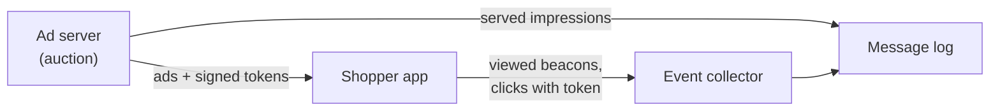
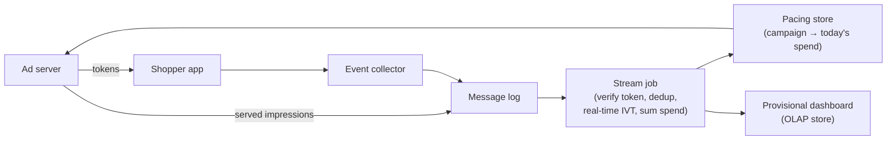
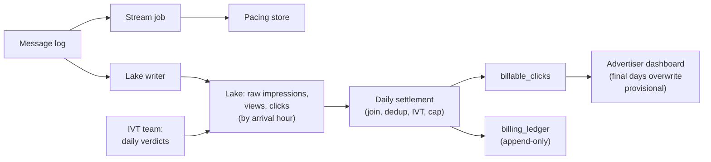
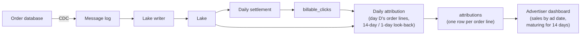
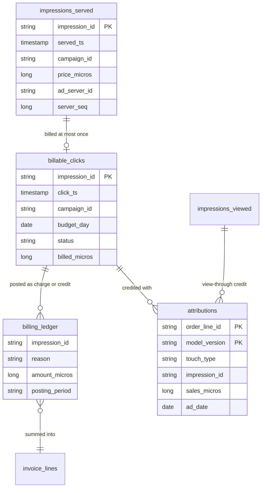
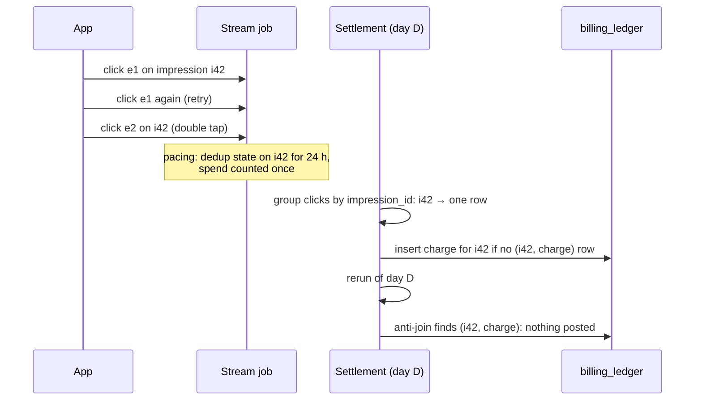
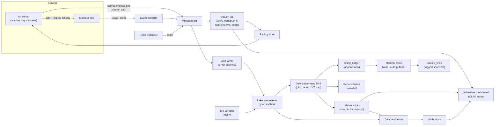

# Design an Ad Impression and Click Pipeline for Billing and Attribution

This breakdown follows the same seven steps as every other ([The Delivery Framework](../01-the-framework/02-delivery-framework.md)). Counting clicks is the easy part; [URL Shortener Analytics](../05-breakdowns-core/02-url-shortener-analytics.md) already does that. Here every click is an invoice line, and it is only valid if you can tie it to the ad that was actually shown. The interview is about three joins and one promise: clicks to impressions, purchases to the ads that earned them, your fast numbers to your exact ones, and the promise that no click is billed twice.

## Understanding the Problem

The prompt:

> "We run a grocery delivery marketplace. Brands pay us to promote their products in search results and on category pages. Design the data pipeline that bills those brands and shows them what their ads sold."

This is a **retail media** business: a store sells ad space on its own shelves. A shopper searches "oat milk", and two of the results are **sponsored**: a brand bid to be placed there. Some vocabulary first, because every requirement uses it:

- An **impression** is one ad shown to one shopper in one slot at one moment.
- A **click** is the shopper tapping that ad to open the product page.
- **Cost per click (CPC)** billing means the brand pays only for clicks, at a price set by the auction that placed the ad. The **ad server** runs that auction for every page and decides which ads appear.
- **Attribution** is deciding which ad, if any, gets credit for a sale. If a shopper clicks the oat milk ad on Monday and buys that oat milk on Thursday, the brand wants that sale reported as "driven by the ad".
- An **attribution window** is how long after an ad interaction a purchase can still be credited to it, for example 14 days after a click.

Two things make this prompt different from ordinary clickstream work.

**Errors cost money in both directions.** An over-count overcharges a customer. And each campaign has a **daily budget**: the ad server must stop showing its ads once it is spent, so an under-count on the live path means serving ads you can never bill.

**The truth arrives in pieces.** The ad server logs the impression, the phone logs the click, the order system logs the purchase, and a fraud team says "that was a bot" days later. Every billed number is a join across those pieces, each with its own delay.

So the central tension: **advertisers need fast numbers to steer campaigns, and exact numbers on the invoice, and those can only be exact after slow joins and late verdicts.** Say that early, then show where each number gets computed.

## Requirements

*About 6 minutes.* Ask how billing works, what counts, and what happens when the facts change:

> **You:** "Are brands billed per click, per impression, or both?"
> **Interviewer:** "Per click for sponsored products. Display banners are per thousand impressions, but leave those aside."
> **You:** "When the daily budget runs out, can we bill clicks above it?"
> **Interviewer:** "Never. The contract says we charge at most the daily budget. Anything above is our loss."
> **You:** "Who decides a click was fraudulent, and when?"
> **Interviewer:** "Simple rules run in real time. The invalid-traffic team runs models daily, and sometimes flags a click farm weeks later. Advertisers get credited."
> **You:** "What attribution do advertisers expect?"
> **Interviewer:** "Sales within 14 days of a click, or within 1 day of a viewed impression. Last touch wins. Shoppers are always logged in."

That last line is a gift: every event carries a `user_id`, so no cookie matching or cross-device guessing.

**Invalid traffic (IVT)** is clicks and impressions not made by a real shopper with real interest: bots, click farms, a competitor tapping your ads to drain your budget. Advertisers are never charged for it.

### Functional requirements

1. **Billable clicks:** each valid click on a served ad is billed once, at that ad's auction price, up to the campaign's daily budget.
2. **Budget pacing:** the ad server sees each campaign's spend for today quickly enough to stop serving when the budget is gone. **Pacing** is this feedback loop from spend back to serving.
3. **Attribution:** sales credited to ads, under the 14-day click and 1-day view windows, reported per campaign and day.
4. **Invoices:** a monthly invoice per advertiser, reproducible years later, with credits for clicks later found invalid.

**Below the line (out of scope):** the auction and bidding logic, display (per-impression) billing, the advertiser's campaign UI, multi-touch attribution models (crediting several ads for one sale), and measurement by outside parties.

### Non-functional requirements

- **Scale:** 15 million daily active shoppers, 3 billion impressions served a day, 12 million clicks a day, 2 million orders a day, 400,000 active campaigns (worked through next).
- **Billing correctness:** zero duplicate charges. Re-running a closed month's invoices returns identical amounts, to the cent.
- **Pacing freshness:** spend visible to the ad server within 60 seconds (p99). Overdelivery, meaning valid clicks above the budget that we can't bill, under 1% of daily budget across all campaigns.
- **Reporting freshness:** advertiser dashboards show provisional clicks and spend within 5 minutes; each day's billed numbers are final by 10:00 two days later; attributed sales for a day become final 15 days later.
- **Invoices:** issued by the 3rd of each month.
- **Retention:** click-level billing evidence and invoices kept 7 years for audit; raw impressions 13 months.

> [!TIP]
> Ask "can we bill above the daily budget?" early. The answer turns pacing into a revenue leak with a number on it.

## Sources & Volume

*About 4 minutes.* Four inputs, using [Key DE Numbers](../02-core-concepts/10-key-de-numbers.md):

| Source | Per day | Average rate | Peak (3x, Sunday evening) | Size each | Raw per day |
|---|---|---|---|---|---|
| Served impressions (ad server log) | 3 billion | ~35,000/s | ~100,000/s | ~600 B | ~1.8 TB |
| Viewed impressions (app beacon) | ~1.8 billion (60% of served) | ~21,000/s | ~60,000/s | ~200 B | ~360 GB |
| Clicks (app) | 12 million (0.4% of served) | ~140/s | ~500/s | ~500 B | ~6 GB |
| Order lines (order database, via CDC) | 50 million (2 million orders) | ~600/s | ~2,000/s | ~300 B | ~15 GB |

A **viewed impression** is one that actually appeared on screen: by a common industry definition, at least half of the ad was visible for at least one second.

**CDC** (change data capture) streams every insert and update from the order database as an event ([CDC Patterns](../03-architecture-patterns/04-cdc-patterns.md)).

Then the money: at an average clearing price of $0.50, roughly 10 million billable clicks a day is about **$5 million a day, $150 million a month**. A 1% billing error is $1.5 million a month of either overcharges or lost revenue.

State what the numbers imply:

> "Ingest is ordinary: the impression stream peaks at about 60 MB/s, a small Kafka cluster. The shape matters more than the size. Clicks are 250 times rarer than impressions, so holding impressions in memory to wait for clicks keeps a lot of state to match very little. And attribution looks back 14 days: huge as a stream join, cheap once a day."

## High-Level Design

*About 13 minutes.* The data flow first:

1. The ad server logs every served impression and hands the app a token for each ad.
2. The app sends viewed beacons and clicks, carrying that token, to an event collector.
3. A stream job turns clicks into live spend per campaign, for pacing and dashboards.
4. Everything lands in a lake on object storage.
5. A daily billing job joins clicks to impressions, removes duplicates and invalid traffic, applies budgets, and posts charges to a billing ledger.
6. A daily attribution job joins orders to the clicks and views that preceded them.
7. A monthly close turns the ledger into invoices.

Build it one requirement at a time.

### 1. How does a click find its impression?

The click has to be matched to the impression it came from: that is where the campaign and the price live. If you match wrongly, you bill the wrong brand or the wrong price.

#### Bad Solution: Match clicks to impressions by user, product and time

The app sends "user 81 clicked product P at 14:02:07". A job finds the most recent impression of P shown to user 81 and takes its campaign and price.

It breaks on ordinary behavior: two campaigns of one brand can promote the same product at different prices, in search and on a category page seconds apart. "Most recent" sometimes picks the wrong one, and you bill the wrong campaign.

#### Good Solution: The ad server mints an `impression_id`; the click carries it; a stream job joins them

The ad server gives every impression a unique `impression_id` and returns it with the ad. The app sends it back in the click. A stream job does an **interval join**: a stream-to-stream join where a record on one side matches records on the other side whose timestamps fall within a fixed range of its own. Here: a click matches the impression with the same `impression_id` served up to 30 minutes earlier. Because the range is bounded, the job keeps impressions only for 30 minutes and then drops them. [Flink](../04-technology-deep-dives/08-flink.md) supports this directly (an interval join in its DataStream API and in Flink SQL), keeping the state in its keyed state store.

The match is now exact. Two costs remain. **State for very little:** 30 minutes of impressions at the 100,000/s peak is 180 million entries, around 27 GB at 150 bytes each, held so 0.4% of them can be matched. **The fast path waits on the big stream:** if the impression topic lags five minutes at the Sunday peak, pacing goes blind just as budgets run out.

#### Great Solution: A signed token carries the billing facts; the stream trusts it, the batch verifies it

The ad server puts everything billing needs into the token: `impression_id`, `campaign_id`, `product_id`, `price_micros`, `served_ts`, and signs it with an **HMAC**: a short signature computed from the contents and a secret key, which only the holder of the key can produce. The app cannot read the key, so neither the app nor a bot can change the price, swap the campaign or invent an impression; any edit makes the signature fail.

Money is stored as integer **micros** (millionths of a currency unit, so $0.50 is 500,000), never floating point, because sums of floats drift by fractions of a cent and invoices must add up exactly.

Now the click is self-describing. The stream job checks the signature and counts spend immediately, with no impression state and no wait on the impression topic. The exact join still happens in the daily billing job, where it is cheap: 12 million clicks joined to the day's served impressions on `impression_id`. That join is the verification the invoice is built from (deep dive 1).

The event collector is a thin HTTPS endpoint that authenticates the session, stamps a `received_ts`, and writes to the message log ([Kafka](../04-technology-deep-dives/02-kafka.md), or a managed equivalent such as MSK, Confluent Cloud or Event Hubs). Each token also carries a key ID, so month-old tokens still verify after the signing key is rotated.

### 2. Live spend for pacing and dashboards

A stream job reads clicks, verifies tokens, drops repeats of the same `impression_id`, applies simple real-time IVT rules (more than 20 clicks a minute from one user, a known bot device), and sums `price_micros` per campaign for its current budget day (in the advertiser's time zone).

It writes each campaign's **running total** to a key-value store the ad server reads before every auction (Redis, DynamoDB, Bigtable or Cassandra). 400,000 campaigns is a few tens of MB, all in memory.

Two rules make this path safe:

- **Write totals, not increments.** The job writes "campaign 9 has spent 412,350,000 micros today", not "add 500,000". If the job restarts and replays the last minute of clicks from its checkpoint, it rewrites the same totals instead of adding them twice. The write is **idempotent**: same result however many times it runs.
- **Err toward stopping early.** The two errors on this path cost different amounts. Counting a duplicate makes a campaign stop a little early: a little revenue missed. Missing a click makes it run past its budget: valid clicks we can never bill. So the live path is allowed to over-count slightly, and never designed to under-count.

The same job feeds per-minute click and spend counts to a **real-time OLAP store** (a database built for fast aggregate queries over fresh events, such as ClickHouse, Druid or Pinot) for the advertiser dashboard; [Real-Time Dashboard](../05-breakdowns-core/04-real-time-dashboard.md) covers that serving pattern. These numbers are labeled provisional, and the next section replaces them.

### 3. Billing-grade counts

This is the central decision. You have a fast path that is nearly right. The invoice must be exactly right.

#### Bad Solution: Invoice from the pacing totals

At midnight, copy each campaign's pacing total into the billing table.

It bills everything the live path got wrong: the duplicates it deliberately over-counts, the click farm flagged tomorrow, clicks whose impression was never logged. And a running total has no click list behind it, so after a bug you cannot recompute last month.

#### Good Solution: Bill with the same stream job, made exactly-once

Make the stream job transactional end to end: Flink checkpoints plus a two-phase-commit sink into a billing table ([Deduplication at Scale](../02-core-concepts/09-deduplication-at-scale.md) explains the mechanics), with global dedup on `impression_id`.

That fixes restarts and retries, but not facts that arrive after the stream has moved on: IVT verdicts come daily, and the stream has already "billed" by then. Exactly-once in a stream processor means each message affects the output once. It says nothing about whether the click should have been billed at all.

#### Great Solution: The stream paces; a daily settlement job bills

Keep the stream job for pacing and provisional dashboards. Build the bill in a daily batch job, **settlement**, which runs for each budget day once the facts are in: at 08:00 on day D+2, after late clicks and the daily IVT verdicts for day D have landed. For each campaign and day, it:

1. Joins the day's clicks to the served impression log on `impression_id`, verifies each token, and checks the click came within 30 minutes of its impression (the contract's rule; older clicks are not billable).
2. Keeps one billable click per `impression_id`.
3. Removes clicks flagged as IVT by the real-time rules or the daily models.
4. Applies the daily budget cap (below).
5. Posts each billable click to the billing ledger.

The **billing ledger** is an append-only table of postings: +price for a billed click, and later -price for a credit. Rows are never updated. The same structure, and why it keeps closed periods from changing, is worked through in [Music Streaming Analytics](01-music-streaming-analytics.md); here you need only the result: an invoice is the sum of one month's postings, and corrections become dated credit rows in a later month.

**The budget cap, made deterministic.** A campaign with a $300 budget may have $318 of valid clicks: pacing stopped serving at $300, but ads already on screens kept getting clicked. Settlement orders the day's valid clicks by `(click_ts, impression_id)` and bills them in that order until the running sum reaches the budget. The click that crosses the line is billed only the remainder; the rest are recorded as `over_budget`, not billed. Same input, same order, same bill, every time you rerun it.

Why D+2 and not midnight? Settling freezes which clicks fit under the cap, so wait for the facts: assume 99.99% of clicks arrive within an hour and the daily IVT models finish early next morning. D+2 at 08:00 covers both plus one failed run. Clicks arriving after their day settled are counted as written off, not billed: at 0.01% that is about $500 a day, cheaper than reopening budgets. A business choice the number justifies.

This is a [Lambda architecture](../03-architecture-patterns/01-lambda-architecture.md): a fast layer and an exact batch layer over the same events. Defend it the way that lesson does: the two paths answer different questions ("should we keep serving this campaign right now?" and "what does this brand owe?"), and once a day settles, its final numbers overwrite the dashboard's provisional ones, so advertisers never see two answers for the same past day.

### 4. Attribution

Each order line needs to know which ad, if any, earned it. The rules from the interviewer:

- An order line for product P by shopper U is **click-attributed** to the latest valid click by U on an ad for P in the 14 days before the order. Valid means settled as `billed` or `over_budget`: a click above the budget cap is still a real click that earned the sale.
- If there is no such click, it is **view-attributed** to the latest viewed impression by U of an ad for P in the 1 day before.
- Last touch wins; clicks beat views.

**View-through attribution** is the second rule: crediting a sale to an ad the shopper saw but did not click.

#### Bad Solution: A stream job that keeps the attribution windows as state

Join the order stream to clicks and views as they arrive, keeping 14 days of clicks and 1 day of viewed impressions in state.

Do the arithmetic: 14 days of clicks is about 170 million entries, around 17 GB, fine. But a day of viewed impressions is 1.8 billion entries; at even 60 bytes each that is over 100 GB of state, checkpointed constantly, so an order can be attributed seconds after it is placed. Nobody needs that: attributed sales are reported daily.

#### Good Solution: A nightly batch that recomputes the last 15 days of attribution

Every night, re-join all orders from the last 15 days to all clicks and views in their windows, and overwrite the table. Simple, but it rereads 15 days of everything to change one day's answers, and silently rewrites numbers advertisers have already seen.

#### Great Solution: Attribute each order once, from its own arrival, and report by ad date

Run the attribution job right after settlement of day D, over the **order lines that arrived on day D** (by arrival partition, so late orders are never missed). Running after settlement matters: every click through day D is already final in `billable_clicks`, so no order is attributed against unsettled clicks. For each order line, look back through `billable_clicks` (14 days) and viewed impressions (1 day). Two things keep this cheap:

- **Semi-join first.** Only 2 million shoppers ordered that day. Filter the 1.8 billion viewed impressions to those shoppers and to the products they bought before joining, and the view side shrinks from billions of rows to a few million.
- **Write once per order line.** The result is one row per `order_line_id`, written with an **upsert** keyed on it and the model version (insert, or update if the key already exists), so a rerun replaces rather than duplicates.

Then report the sale under the **date of the ad interaction**, because that is what an advertiser judges: "what did Tuesday's clicks sell?". That number grows for 14 days as buyers come back, **matures** on day 15, and is labeled maturing until then: the label window from [Video Recommendations](02-video-recommendations.md), with money attached.

Refunds arrive through CDC as updates to the order line, so they appear in that day's changes and the same run lowers attributed sales.

> [!WARNING]
> Don't let "sales from last Tuesday's ads" change every day for two weeks with no label. Advertisers conclude the numbers are made up. Pick a reporting date, label maturity, and say so in the interview.

### 5. Monthly invoices

On the 2nd, once the previous month's last day has settled, a **monthly close** sums that period's ledger per advertiser and campaign into `invoice_lines`. Publish with **write-audit-publish** ([Data Quality Monitoring](../05-breakdowns-core/09-data-quality-monitoring.md)): write invoices where nobody can see them, check them, and make them visible in one step only if the checks pass. Tag the table snapshot so the published invoices can be read back exactly, years later ([Iceberg](../04-technology-deep-dives/07-iceberg.md)).

## Data Model

*About 5 minutes.* Start from the invoice and work backwards, because it is the table that cannot be wrong.

**Raw tables (lake).** `impressions_served`, `impressions_viewed`, `clicks_raw` and `order_line_changes`, one row per event as received, partitioned by **arrival hour** (`received_ts`). That way "settle day D" and "attribute day D's orders" read exactly the partitions that arrived, whatever time the events claim. Each served impression carries `server_seq`, a counter each ad server increments per impression, which proves the log is complete (deep dive 1). Served impressions are the bulk: about 360 GB a day as Parquet (5x smaller than raw), around 140 TB for 13 months, roughly $3,200 a month in object storage.

**`billable_clicks`.** Grain: **one row per impression that received at least one click**, keyed by `impression_id`. That key is the billing rule written as a schema: at most one billable click per impression, however many taps, retries or replays. `status` is one of `billed`, `over_budget`, `invalid`, `unmatched`, `written_off`. Every click is kept with a reason, so nothing disappears silently. Partitioned by `budget_day`, about 12 million rows a day.

**`billing_ledger`.** Grain: one posting. Unique key `(impression_id, reason)`, where reason is `charge` or `ivt_credit`. Partitioned by `posting_period` (month), so an invoice reads one partition. About 300 million rows a month, small.

**`attributions`.** Grain: one order line per attribution model version, keyed by `(order_line_id, model_version)`. Versioning the model matters the day an advertiser negotiates a 30-day window: the new version is computed beside the old one instead of over it.

**`invoice_lines`.** Grain: advertiser, campaign, month, with charges and credits in separate columns.

Topics: `ads.served` (48 partitions: the 60 MB/s peak needs only 6, the rest is consumer parallelism), `ads.viewed`, `ads.clicks` and the order-line CDC topic, each kept 7 days so pacing can be rebuilt after a bad deploy.

## Pipeline Design

*About 5 minutes.* The high-level design settled most of this:

| Path | Mode | Schedule and dependency |
|---|---|---|
| Collector → message log | Continuous | Must accept every click; it is money. |
| Pacing and provisional dashboard | Streaming ([Flink](../04-technology-deep-dives/08-flink.md)), 10 s checkpoints | 60-second pacing target. |
| Lake writer | Micro-batch, 5-minute commits | Freshness of minutes is fine; nothing exact reads the lake intraday. |
| Settlement | Daily batch ([Spark](../04-technology-deep-dives/01-spark-internals.md)), per budget day at D+2 08:00 | Waits on: lake partitions through 07:00, the IVT verdicts for day D, and the served-log completeness check. |
| Attribution | Daily batch, after settlement | Needs `billable_clicks` for the look-back. |
| Monthly close | Batch on the 2nd, then human sign-off | Waits on the last day of the month being settled. |

The orchestrator ([Airflow](../04-technology-deep-dives/03-airflow.md) or similar) runs settlement on **data readiness, not the clock**: the IVT verdicts are a separate team's output, and settling without them would bill a click farm and then credit it a day later.

**Idempotency** lets every step be rerun. Settlement overwrites the `billable_clicks` partition for its budget day. The ledger insert is an **anti-join** on `(impression_id, reason)`: it posts only clicks with no charge row yet, so a second run finds nothing new. Attribution upserts by order line. See [Backfill and Reprocessing](../02-core-concepts/03-backfill-and-reprocessing.md).

**Failure behavior.**

- **Stream job down:** pacing values freeze. The ad server treats a total older than 2 minutes as stale and throttles campaigns above 90% of budget: losing a little delivery is cheaper than overdelivering everywhere.
- **Collector unreachable:** the app queues clicks on the device and retries with the same `click_event_id`; the one-click-per-impression key absorbs the repeats.
- **Settlement fails a check:** the day stays unsettled, someone is paged, and dashboards keep showing provisional numbers, labeled as such.

## Potential Deep Dives

*About 13 minutes.* If the interviewer doesn't pick, lead with the second: it is the promise advertisers care about most. [Deep Dives](../01-the-framework/08-deep-dives.md) covers how to steer.

### 1. "Settlement finds 40,000 clicks whose impression isn't in the served log. Do you bill them?"

A click whose token verifies but whose `impression_id` has no row in `impressions_served` is **unmatched**. Before deciding, find out why. There are three causes, and they need opposite answers:

| Cause | How you tell | Bill? |
|---|---|---|
| The impression is in the log but arrived late (an ad server's log shipper was behind) | The impression shows up in a later arrival partition | Yes, once it arrives |
| The ad server crashed before flushing its log | Gaps in that server's `server_seq` for that hour | Yes, on the token, if the token verifies |
| The token is forged or replayed | Signature fails, or the key ID is unknown or expired | Never |

#### Bad Solution: Bill every click whose token verifies

The token proves the ad server signed it, not that the impression was recorded. You lose the check of served counts against clicks, and a leaked key bills any number of fake clicks.

#### Good Solution: Bill only matched clicks

Safe for the advertiser, but every ad server crash becomes unbilled revenue.

#### Great Solution: Look back across arrival partitions, then decide by the completeness evidence

Settlement joins each day's clicks to impressions that arrived that day or the next, which catches shipping lag. For clicks still unmatched, it checks `server_seq`: if that server's sequence has a hole covering the click's `served_ts`, the log is known to be incomplete there, and the verified token is billed with `match_type = 'token_only'`. Anything else stays `unmatched`, unbilled and counted.

Unmatched clicks should be well under 0.01%. A spike points at one ad server or one app release; alert on it, and block settlement if it passes 0.1% of a day's spend.

### 2. "Phones retry, people double-tap, and the stream job restarted twice last week. Prove no click was billed twice."

Duplicates come from four places: app retries (same `click_event_id`), double taps (two `click_event_id`s, one impression), stream replays after a restart, and settlement reruns.

The fix is the **dedup key**: the column that identifies one real-world billable event ([Deduplication at Scale](../02-core-concepts/09-deduplication-at-scale.md)). An event ID handles retries but not double taps. The billing rule is "one billable click per impression", so the dedup key is `impression_id`, and it handles all four:

Three layers, each with a job:

1. **Stream job, for pacing:** a set of `impression_id`s seen in the last 24 hours, kept as Flink keyed state with a time-to-live. 12 million clicks a day at about 40 bytes is under 1 GB: easy. A click more than 30 minutes after its impression is not billable anyway, so 24 hours is generous.
2. **Settlement, for the bill:** a group-by on `impression_id` over every arrival partition that can hold a click for that day. Because a click only counts within 30 minutes of its impression, that is a complete (global) dedup for the day, not a windowed guess.
3. **The ledger, as the last line:** the unique key `(impression_id, 'charge')` and the anti-join insert mean even a buggy settlement rerun cannot post a second charge. A blocking check at close confirms zero duplicate keys.

Say where the stream processor's exactly-once stops: checkpoints make Flink's state exact after a restart, and writing totals makes the pacing store safe, but neither knows `e1` and `e2` are one billable event. Only the business key does.

### 3. "On November 12, the IVT team flags a click farm: 400,000 clicks across October and November. What happens to the bill?"

October's invoices went out on November 2. November's days up to the 10th have settled.

The ledger handles the money with no new machinery: for every flagged click that was billed, post an `ivt_credit` row of minus its billed amount in the **current open period**, November. October's invoice stays as issued; November's shows "credits for October activity", and the advertiser pays less. That is the posting-period rule from [Music Streaming Analytics](01-music-streaming-analytics.md) and [E-Commerce Warehouse](../05-breakdowns-core/03-e-commerce-warehouse.md); point at it, don't re-derive it.

The interviewer is really asking about the budget cap. A campaign capped at $300 on November 4 had $318 of valid clicks; $18 was `over_budget`. Now $40 of its billed clicks turn out to be IVT. Do the $18 of unbilled clicks become billable to fill the freed budget?

#### Bad Solution: Re-settle the day and bill the clicks that now fit

The advertiser receives a credit and a new charge for the same day, weeks later, for clicks they were told were free. Every IVT sweep reopens every capped day it touches.

#### Great Solution: Credits only, never re-bill upward after settlement

After settlement, a day's charges can only go down. The campaign gets its $40 credit, the $18 stays unbilled, and the ledger records what happened and when. It never surprises a customer with a higher bill, and it costs little: if IVT credits are 1–2% of spend and a third of campaigns hit their cap, the forgone re-billing is well under 1% of revenue.

Two follow-ons: flagged clicks are marked `invalid`, so the next attribution run drops the bot farm's "sales" too; and an advertiser whose credits exceed, say, 5% of last month's spend gets a call before the invoice.

### 4. "An advertiser says the dashboard showed $41,300 of spend on Tuesday, but the invoice line says $40,120. Which is right?"

Both, for different questions, and you have to prove the gap line by line. This is **reconciliation**: comparing two computations of the same thing and explaining every difference. In [Lambda Architecture](../03-architecture-patterns/01-lambda-architecture.md) it is a health check between layers; here you also send it to a customer.

The screenshot was Tuesday's provisional stream number, taken before settlement; the dashboard now shows $40,120 too. The stream number was higher by design. Show the gap as a **waterfall**, built by settlement for every campaign and day from the `status` column:

| Step | Amount |
|---|---|
| Provisional spend (stream job at end of day) | $41,300 |
| − Duplicate clicks the stream let through | −$180 |
| − Invalid traffic (daily IVT models) | −$610 |
| − Unmatched clicks | −$40 |
| + Late clicks the stream missed, arriving before settlement | +$90 |
| − Above daily budget (`over_budget`) | −$440 |
| **= Billed (settled)** | **$40,120** |
| Unexplained | $0 |

The middle rows come from settlement's per-status sums, so the waterfall is generated, not argued. The **unexplained** line is the one you monitor. Cents of rounding are fine; above 0.1% of a campaign's spend means the two paths have drifted (an IVT rule changed in one and not the other), and the day is held from the invoice until it is understood.

Reconcile the other seams too: the served log against each ad server's hourly count (exact, thanks to `server_seq`), and invoice totals against ledger sums at close, to the micro.

## Monitoring & SLAs

*About 4 minutes.* Each SLA ties back to a requirement; [Monitoring and SLAs](../01-the-framework/09-monitoring-and-slas.md) covers how to present them and [Monitoring and Alerting](../02-core-concepts/06-monitoring-and-alerting.md) covers alert design.

| SLA | Target | Measured by |
|---|---|---|
| **Pacing freshness** | Spend visible to the ad server within 60 s, p99 | Age of each pacing value when the ad server reads it |
| **Overdelivery** | Under 1% of total daily budget | `over_budget` spend from settlement, per day |
| **Settlement on time** | Each budget day settled by 10:00 on D+2 | Job completion; a [dead man's switch](../02-core-concepts/06-monitoring-and-alerting.md) alert if no settlement exists for D by then |
| **Billing exactness** | Zero duplicate charges; invoices equal ledger sums | Blocking checks at settlement and close |
| **Invoices on time** | Published by the 3rd | Close completion and sign-off |

Behind them: unmatched click rate per ad server and app version, `server_seq` gaps, the unexplained reconciliation gap, click arrival delay (is D+2 still right?), and **attribution maturity**, the share of a day's final attributed sales present by day 3 and day 7. A sudden drop there means orders or CDC are late, not that ads stopped working.

Checks that guard money **block** settlement and close and page someone; everything else **alerts**. A late dashboard is an annoyance. A wrong invoice is a credit note, a phone call and a lost customer.

## Final Design

Follow one click. At 19:42 on Tuesday, November 3, shopper U searches "oat milk". The ad server places campaign 9's ad at $0.52, logs impression i42, and sends the app a signed token. The app sends a viewed beacon. U taps it twice. The stream job verifies the token, counts $0.52 once, and the pacing store shows campaign 9 at $287.40 of its $300 within seconds. At 21:10 the campaign hits $300 and stops serving; already-open pages produce $6 more of clicks, which settlement will mark `over_budget`. On Thursday at 08:00, settlement joins i42 to the served log, collapses the two taps into one row, finds no IVT flag, and posts one $0.52 charge to November's ledger. On November 9, U buys that oat milk; attribution credits $3.49 of sales to campaign 9 on November 3, a day still maturing. On December 2, the close sums November's ledger into campaign 9's invoice line. If U's account is flagged on December 10, a $0.52 credit lands in December, and November's invoice stays as sent.

## What's Expected at Each Level

### Mid-level

You produce the right shape: events into a message log, a lake, a stream job for live spend and a batch job for the bill. You know the click must carry an impression ID so it can be joined, and that duplicates come from retries. You can explain a 14-day attribution window and why it means the numbers keep changing. The interviewer leads the deep dives and may have to raise invalid traffic and the budget cap. Bar for this problem: an ID-based click-impression join, billing computed in batch rather than copied from stream counters, and money stored as integers.

### Senior

You drive, and name the central tension early: fast numbers to steer, exact numbers to invoice. You do the join-state arithmetic and use it to put click verification and attribution in daily batch. You take the dedup key from the billing rule (one click per impression), not the event ID. You let pacing over-count on purpose and say why. You define settlement with a deterministic budget cap and credits-only corrections, produce the reconciliation waterfall, and know which checks block the invoice.

### Staff+

You treat billing as a contract with tens of thousands of customers and the pipeline as its evidence. A new IVT model or attribution window is versioned, run in parallel and announced before it moves invoices. You cover signing-key rotation and what a leaked key means. You name the business levers (settlement delay, write-off threshold, accepted overdelivery) as decisions for finance, with numbers. You plan for an advertiser audit ("every click you billed us in Q3, with its impression") and for deleting shopper data without breaking 7-year billing evidence, for example by pseudonymizing `user_id`: replacing it with a key that only a separate, protected table links back to the shopper.

## Related Lessons

- Framework: [The Delivery Framework](../01-the-framework/02-delivery-framework.md), [Requirements Gathering](../01-the-framework/03-requirements-gathering.md), [Sources and Volume](../01-the-framework/04-sources-and-volume.md), [Deep Dives](../01-the-framework/08-deep-dives.md), [Monitoring and SLAs](../01-the-framework/09-monitoring-and-slas.md)
- Concepts: [Deduplication at Scale](../02-core-concepts/09-deduplication-at-scale.md), [Late-Arriving Data](../02-core-concepts/08-late-arriving-data.md), [Backfill and Reprocessing](../02-core-concepts/03-backfill-and-reprocessing.md), [Monitoring and Alerting](../02-core-concepts/06-monitoring-and-alerting.md), [Key DE Numbers](../02-core-concepts/10-key-de-numbers.md)
- Patterns: [Lambda Architecture](../03-architecture-patterns/01-lambda-architecture.md), [CDC Patterns](../03-architecture-patterns/04-cdc-patterns.md)
- Technology: [Flink](../04-technology-deep-dives/08-flink.md) (keyed state, checkpoints, exactly-once sinks), [Kafka](../04-technology-deep-dives/02-kafka.md), [Spark Internals](../04-technology-deep-dives/01-spark-internals.md), [Iceberg](../04-technology-deep-dives/07-iceberg.md), [Airflow](../04-technology-deep-dives/03-airflow.md)
- Related breakdowns: [Music Streaming Analytics](01-music-streaming-analytics.md) (append-only ledger and posting periods), [Video Recommendations](02-video-recommendations.md) (impressions and label windows), [URL Shortener Analytics](../05-breakdowns-core/02-url-shortener-analytics.md) (click counting without money), [Real-Time Dashboard](../05-breakdowns-core/04-real-time-dashboard.md), [Data Quality Monitoring](../05-breakdowns-core/09-data-quality-monitoring.md) (write-audit-publish), [E-Commerce Warehouse](../05-breakdowns-core/03-e-commerce-warehouse.md) (closed accounting periods)
- Next breakdown: [Data Mesh Platform](09-data-mesh-platform.md)
