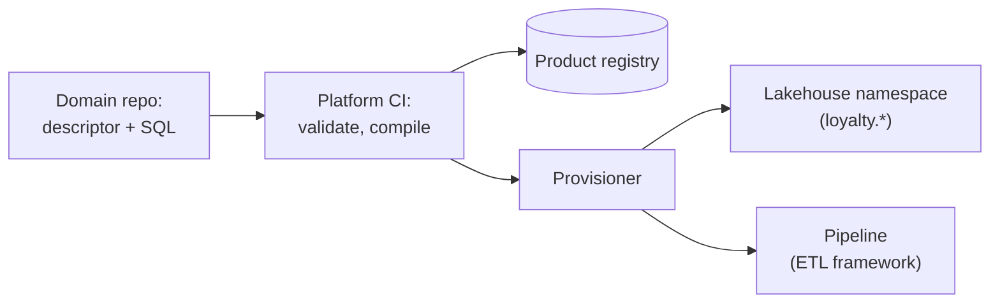
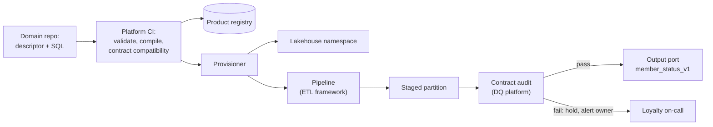
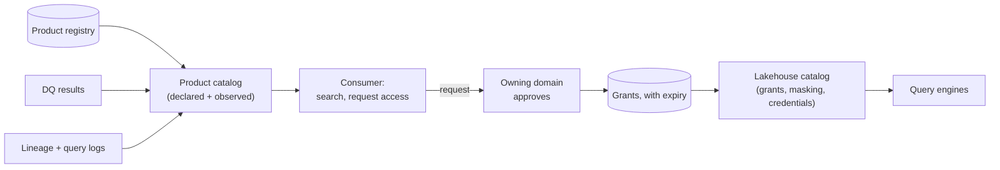
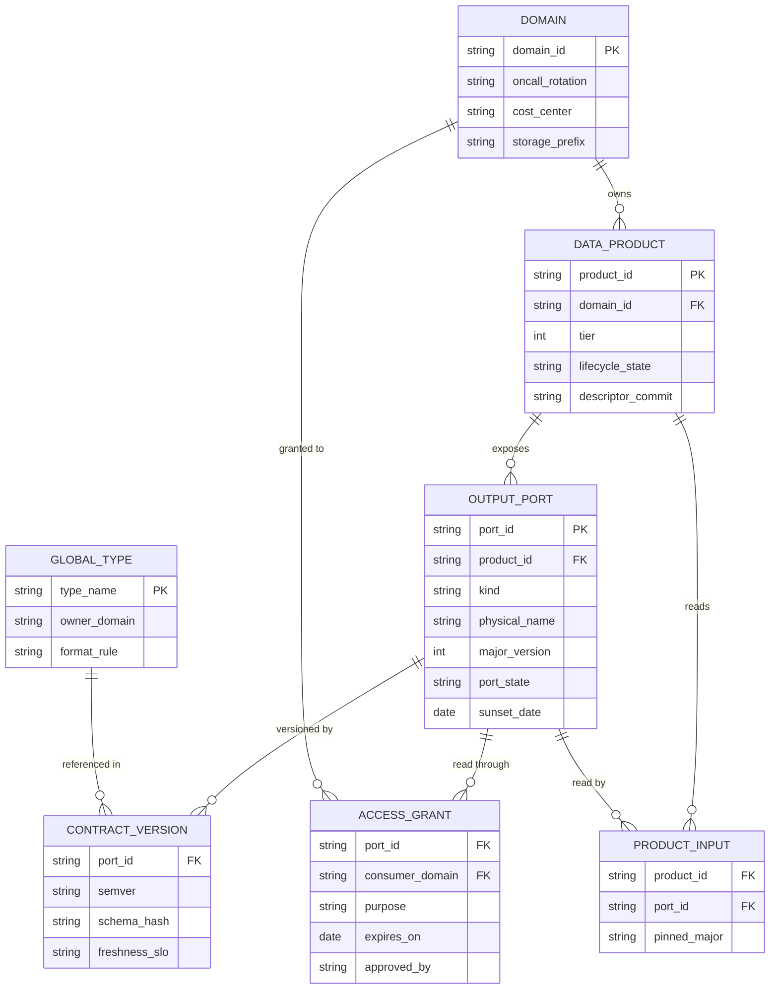
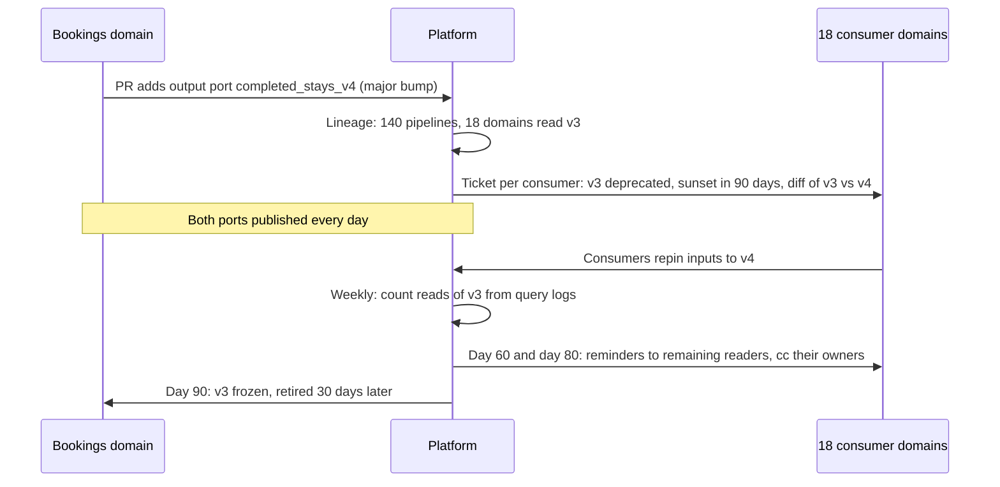
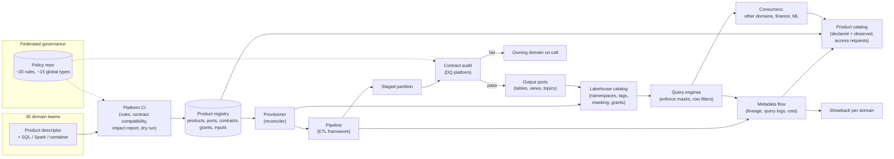

# Design a Data Mesh Platform

This breakdown follows the seven steps from [The Delivery Framework](../01-the-framework/02-delivery-framework.md). Like the [ETL Framework](../05-breakdowns-core/07-etl-framework.md), it designs something other teams build on, but the users here are whole business domains, most of them without a data engineer. The interview turns on one question: **how much does the platform decide for 35 autonomous teams, so that their data stays combinable and trustworthy, without the platform team becoming the bottleneck the mesh was meant to remove?**

## Understanding the Problem

The prompt:

> "We're an online travel company with about 35 product teams: flights, hotels, bookings, payments, pricing, loyalty, support and so on. A central data team of 12 owns every pipeline, and its backlog is 14 weeks long. Leadership has decided that domain teams will own their own data. Design the platform that lets them publish data products other teams can find, trust and use."

Leadership has chosen the pattern, so don't argue for or against [Data Mesh](../03-architecture-patterns/06-data-mesh.md); that lesson covers the principles and when mesh is overkill. Your job is its third and fourth principles: the self-serve platform and the federated governance it enforces. A **domain** is a part of the business with its own team and vocabulary; a **data product** is what it publishes, with an owner, contract, catalog entry and service level.

Most of the parts already exist in this course. A lakehouse with one catalog and tag-based access ([Medallion Data Lake](../05-breakdowns-core/06-medallion-data-lake.md)), config-driven pipelines ([ETL Framework](../05-breakdowns-core/07-etl-framework.md)), quality gates ([Data Quality Monitoring](../05-breakdowns-core/09-data-quality-monitoring.md)), contracts ([Data Contracts](../02-core-concepts/07-data-contracts.md)), lineage ([Data Lineage](../02-core-concepts/04-data-lineage.md)) and cost attribution ([Multi-Tenant Platform](05-multi-tenant-platform.md)). A strong answer composes them behind one interface; a weak one redesigns each and runs out of time.

The central tension shows up four ways:

- **Self-serve infrastructure:** how much a domain can do without asking anyone, when most domains have software engineers but no data engineers.
- **Contracts:** 35 teams change their products independently, and every change can break someone in another domain.
- **Discovery:** 1,500 products are useless if a consumer can't find the right one and tell whether to trust it.
- **Federated governance:** the rules have to be agreed by the domains and enforced by machines, because 15 platform engineers cannot review 1,500 products.

## Requirements

*About 6 minutes.* On a platform prompt, ask about the people first:

> **You:** "How many of the 35 domains have someone who has built a data pipeline before?"
> **Interviewer:** "Maybe ten. The rest have backend engineers, and some have analysts who write SQL."
> **You:** "What exists today: lake, warehouse, orchestrator?"
> **Interviewer:** "A lake on object storage with Iceberg tables behind one catalog, a cloud warehouse, Kafka, and Airflow. The central team runs all of it."
> **You:** "What happens to the central team?"
> **Interviewer:** "It becomes the platform team, about 15 people."
> **You:** "Which cross-domain questions matter most?"
> **Interviewer:** "Finance and revenue management. They join bookings, payments, pricing and loyalty all day."

Two of these answers shape the design. Twenty-five domains can write SQL but not Spark, so the default path is SQL plus a config file. And 15 platform engineers for 35 domains means no step can need a platform human per product.

### Functional requirements

1. **Create and publish a data product** without filing a ticket: a domain declares the product, and the platform provisions storage, pipeline, access rules, quality checks, monitoring and a catalog entry.
2. **Change products safely:** every product has a versioned contract, and a breaking change follows a workflow that knows exactly which consumers are affected.
3. **Discover and get access:** consumers search a catalog of products (not of every table), see trust signals, and request access from the owning domain.
4. **Enforce governance automatically:** company-wide rules (named owner, classified personal data, shared identifiers, retention) are checked by the platform, and a product that breaks a blocking rule cannot publish.

**Below the line (out of scope):** each domain's business logic, the storage and table-format internals (the medallion lesson owns those), the pipeline framework's scheduler internals, the quality platform's check engine, ML feature serving, sharing data outside the company, and the org-change programme itself (Staff+ will mention it).

### Non-functional requirements

- **Scale:** 35 domains; about 400 products in year one and 1,500 within two years, exposing about 4,000 tables and topics; about 2,500 people and 6,000 pipelines consuming them.
- **Time to publish:** a domain goes from "we have a table" to a discoverable, contracted product in under 2 days (today: 14 weeks), with zero platform tickets in the common case.
- **Interoperability:** any two products that share a company-wide entity (customer, booking, currency) join on the same key with no mapping table. 100% for tier-1 products.
- **Governance:** zero published products without an owner, a contract and classified personal columns. Personal data masked by default.
- **Access:** an access request is answered within 1 business day, by the owning domain, not the platform team.
- **Availability:** the publish and catalog path is up 99.9%. If the platform's own services are down, existing products keep serving queries.
- **Cost:** every dollar of storage and compute is attributed to a domain; under 10% stays unallocated.

> [!TIP]
> "Time to publish" and "platform tickets per product" are the numbers that prove a mesh platform works. Say them early. They are what leadership will hold you to.

## Sources & Volume

*About 4 minutes.* The data volume is not the hard part; the lakehouse already stores it. What loads this platform is the number of products, changes and cross-domain dependencies. Use [Key DE Numbers](../02-core-concepts/10-key-de-numbers.md) for the prices.

1. **Products and columns.** "1,500 products exposing about 4,000 tables. At about 40 columns each that's 160,000 columns. If 5% hold personal data, that's 8,000 columns that need classification, set by 35 teams."
2. **Publishes.** "Say 70% of the 4,000 tables are daily (2,800 publishes), 25% hourly (1,000 × 24 = 24,000), and 5% streaming tables committing every 5 minutes (200 × 288 = 57,600). That's about 84,000 publishes a day, about 1 a second. Each one is a quality audit and a catalog update, which the quality platform already handles at this rate."
3. **Changes.** "If each product changes about once a month, that's 1,500 / 30 = 50 descriptor pull requests a day. If 5% are breaking, that's 2 or 3 breaking changes a day across the company."
4. **Dependencies.** "If a product has 6 consuming pipelines on average, that's about 9,000 cross-domain edges. The average hides a skew: `bookings`, `customers` and `payments` will each have hundreds of consumers. A breaking change on one of them is a company-wide event."
5. **Money.** "About 6 PB in the lake at ~$23 per TB-month is about $140k a month of storage. Compute is usually several times storage, say $600k. Call it $750k a month that today sits on the central team's budget and has to move to 35 domains."

Then say what the numbers imply:

> "Ingest volume is solved. The pressures are 50 changes a day, a few hub products everyone depends on, 8,000 personal columns classified by non-specialists, and a $750k bill to split across 35 domains. With 15 platform engineers, every check must be automatic."

## High-Level Design

*About 12 minutes.* Data flow first:

1. A domain writes a **product descriptor** (one file) and opens a pull request in its own repository.
2. Platform CI checks it against the governance rules and the existing contract, then compiles it.
3. The platform provisions everything the descriptor asks for, in the shared lakehouse.
4. The domain's pipeline runs; each publish is audited against the contract before consumers see it.
5. The catalog shows the product with live trust signals; consumers search, request access and query.
6. Usage and cost are metered per product and per domain.

Build it one requirement at a time.

### 1. What does a domain actually get?

This is the self-serve decision.

#### Bad Solution: Request infrastructure from the platform team

A domain files a ticket: "We need a schema, a pipeline, read access for finance." The platform team does it.

This is the central team's 14-week queue again. Skipping the platform team instead, with each domain building its own stack, gives 35 half-finished platforms, each with its own catalog, access model and table format. Products can't be found together or joined.

#### Good Solution: Self-service infrastructure templates

The platform publishes infrastructure-as-code modules (Terraform or similar): "create a domain namespace", "create a pipeline", "grant access". Domains run them.

No queue, and the pieces are standard. But a backend engineer on the loyalty team must understand storage permissions, orchestration and catalog registration to wire four modules together, and nothing ties them into a "product". The catalog entry, quality checks and contract are separate steps that teams skip, and setups drift from the template within months.

#### Great Solution: One descriptor per product, compiled into everything

A domain describes the *product*, not the infrastructure. The platform turns that description into storage, pipeline, policies, checks, monitors, catalog entry and cost tags. A **data product descriptor** is that one declarative file:

```yaml
product: loyalty.member_status
domain: loyalty
owner: loyalty-data-oncall          # an on-call rotation, not a person
tier: 1                             # 1 = others build critical things on it
description: "Current loyalty tier and points balance per member, daily."
inputs:
  - product: bookings.completed_stays     # another domain's product
  - internal: loyalty_db.members          # the domain's own database (via CDC)
build:
  type: dbt                               # SQL; spark_job and container also allowed
  models: [member_status]
output_ports:
  - name: member_status_v1
    kind: table
    contract: contracts/member_status.yaml   # schema, keys, quality rules
    grain: "one row per member per day"
    freshness_slo: "daily by 07:00 UTC, 99%"
classification:
  member_email: pii.email
  customer_id: global.customer_id
retention: 400d
```

Three ideas are in that file.

- **Output ports.** An **output port** is the interface of a product that consumers may read: a table, a view or a Kafka topic, each with its own contract version. Everything else the domain builds (staging tables, intermediate models) is private and not visible outside the domain. That boundary is what lets a domain refactor its internals without asking anyone.
- **Inputs name products, not tables.** Reading another domain's product goes through its output port, so lineage between domains is declared, not guessed.
- **The build reuses the pipeline framework.** `build` is a step from the [ETL Framework](../05-breakdowns-core/07-etl-framework.md) spec. The 25 SQL-only domains write dbt models; the 10 with data engineers can use `spark_job`; anything else uses the container escape hatch. The mesh platform doesn't build a second orchestrator.

All domains share one lakehouse and one catalog, with a **namespace per domain** (`loyalty.*`) and a storage prefix per domain. One catalog makes cross-domain joins and policies possible; separate namespaces give clean ownership and cost boundaries. Only `loyalty` pipelines write to `loyalty.*`.

The cost: the descriptor is an API that 1,500 files depend on, so it is versioned and migrated by tool, as the ETL framework does for its specs.



### 2. Contracts on the publish path

A contract kept only in the catalog is documentation. [Data Contracts](../02-core-concepts/07-data-contracts.md) lists the enforcement points; the platform wires each one in for every product:

| Point | What the platform does | Catches |
|---|---|---|
| **Pull request** | Compares the contract with the published version; a breaking change without a major version bump fails CI | Renames, retypes, dropped columns |
| **Provisioning** | Each major version is its own output port (`member_status_v1`); the table format's schema enforcement rejects writes that don't match | A pipeline writing the wrong shape |
| **Publish** | Write-audit-publish: the pipeline writes to staging, the quality platform audits it against the contract's rules, and only a pass is published | Nulls in keys, duplicates, values out of range |
| **Streaming ports** | The topic's schema registry subject uses a compatibility mode set from the tier (BACKWARD_TRANSITIVE for tier 1) | Incompatible events |

**Write-audit-publish (WAP)** means writing new data where consumers can't see it, checking it there, and making it visible in one atomic step only if the checks pass. It is built in [Data Quality Monitoring](../05-breakdowns-core/09-data-quality-monitoring.md); here the contract simply becomes that audit's rule set. A failed audit holds the partition and alerts the owning domain; downstream products stay on yesterday's data.



### 3. Finding a product and deciding whether to trust it

#### Bad Solution: A wiki page of datasets

Each domain lists its products on a wiki. It is stale within a month and says nothing about whether a table is fresh today.

#### Good Solution: A metadata catalog that harvests every table

A **metadata catalog** (a searchable inventory of datasets, schemas, owners and lineage; see [Data Lineage](../02-core-concepts/04-data-lineage.md)) crawls the lakehouse and lists all of it.

It is never out of date, but it lists 40,000 tables, staging tables included, so a search for "customer" returns 900 results. An analyst can't tell `loyalty.member_status_v1` (the product) from `loyalty.tmp_members_dedup_2` (scratch), and nothing says which is fresh and checked.

#### Great Solution: A catalog of products, filled from the descriptor and from runtime signals

The catalog's unit is the product. Its page is built from two sources:

- **Declared, from the descriptor:** owner, description, grain, output ports with their contract versions, classification, tier, SLOs.
- **Observed, from the platform:** last publish time and whether it met its freshness SLO over the last 30 days, the latest audit result (`quality_status` from the quality platform), open incidents, number of consumers and queries last month (from lineage and query logs), and the deprecation status of each port.

Internal tables are hidden from search by default. Search ranks by these signals: a tier-1 product meeting its SLO 99% of the time with 40 consumers ranks above an experimental one with none. **Trust becomes something the consumer can see** instead of a question asked on chat.

Access goes through the same page. The consumer clicks "request access", states a purpose ("refund analysis, finance"), and the request is routed to the **owning domain's** approvers, not the platform team. Approvals are recorded as grants with an expiry (12 months, then renewed). The [Medallion Data Lake](../05-breakdowns-core/06-medallion-data-lake.md) design enforces them: the catalog checks the grant, vends short-lived storage credentials to engines that enforce masking, and applies tag-based masking policies to columns classified `pii.*`.



### 4. Governance the domains agree and the platform enforces

**Federated governance** (domain representatives and the platform team agree a few company-wide rules; the platform enforces them) is easy to say. The question is how the rules exist in practice.

#### Bad Solution: A governance council reviews every product

A council meets weekly and approves each new product and breaking change. At 50 changes a day it is the central bottleneck again, with meetings, and teams dodge it with "temporary" tables outside the product system.

#### Good Solution: The platform team hard-codes the rules in CI

The platform writes checks: owner present, personal columns classified, retention set.

Automatic and fast. But the platform team now decides the rules alone, which is not federated. And when a rule changes ("retention for personal data drops to 400 days"), it lands on every product at once and breaks 300 builds on a Monday.

#### Great Solution: Policy as code, owned by the governance group, run by the platform

**Policy as code** means governance rules written as versioned, testable code in a repository, which the platform runs automatically at its enforcement points. The governance group owns that repository. Rule changes go through pull requests that domain representatives review, so the rules are federated. The platform team owns the engine that runs them.

Each rule says where it runs and how hard it bites:

| Rule | Runs at | Level |
|---|---|---|
| Every product has an owner rotation that exists | CI | Blocking |
| Every column that looks like personal data (scanner) has a classification | CI and first publish | Blocking for tier 1 and 2 |
| Columns holding a company-wide entity use its global type (deep dive 2) | CI | Blocking |
| Tier-1 products declare a freshness SLO and key-uniqueness checks | CI | Blocking |
| Retention for `pii.*` columns is at most 400 days | CI and a nightly scan | Warning for 60 days, then blocking |
| Products with zero consumers for 90 days are flagged for retirement | Nightly | Warning |

Two practices make it last. **New rules start as warnings** with a date when they become blocking, so each domain sees its violations first and nothing breaks on a Monday. And **the rule set stays small**: about 20 rules company-wide; everything else is the domain's choice.

### 5. Who pays

When the central team owned everything, the bill was one line. If 35 domains can't see what their pipelines cost, the bill grows with no owner. Reuse [cost attribution](05-multi-tenant-platform.md) with **domain** in the place of tenant:

- **Storage:** each domain's storage prefix is tagged, so lake storage is a direct cost per domain and per product.
- **Producer compute:** each domain's pipelines run in its own compute pool or warehouse, tagged with the domain. Direct.
- **Consumer compute:** a finance analyst's query on `loyalty.member_status_v1` is charged to **finance**, the consumer, not loyalty. Otherwise a popular product punishes its owner for being useful.
- **Platform overhead** (catalog, CI, the platform team's own services) is reported as its own line, not spread silently.

Start with **showback** (reporting each domain its cost without billing it, as in [Log Aggregation](../05-breakdowns-core/01-log-aggregation.md)) and add budgets once the numbers are trusted.

## Data Model

*About 5 minutes.* The platform's own data is the **product registry**: the database every component reads. Lake tables and pipeline runs are already modelled in the lessons that own them; the registry links to them by ID.



Choices worth saying:

- **The port, not the product, is versioned.** `bookings.completed_stays` can expose `_v3` and `_v4` side by side during a migration. `port_state` is `active`, `deprecated` or `retired`, and `sunset_date` is the date a deprecated port stops being published.
- **`PRODUCT_INPUT.pinned_major`** records which major version each consuming product reads. This is the edge the breaking-change workflow walks (deep dive 1). Consumers who are people or dashboards, not products, appear in lineage and query logs rather than in this table.
- **`lifecycle_state`** (`experimental`, `active`, `deprecated`, `retired`) controls search ranking and which rules apply (deep dive 4).
- **Git is the source of truth for descriptors and policies.** The registry is a queryable copy written by CI on merge, so it can be rebuilt.

At 1,500 products and 4,000 ports, the registry fits comfortably in an ordinary Postgres database. Observed signals (publish times, audit results, usage) live in the pipeline registry, the quality results store and the query logs; the catalog joins them by `port_id`.

## Pipeline Design

*About 6 minutes.* Three flows run on this platform, each with its own failure behavior.

**1. The change flow (a descriptor pull request).**

| Stage | What runs | Time |
|---|---|---|
| Validate | Descriptor schema; governance rules; owner exists; inputs exist and are not `experimental` for tier 1 | Seconds |
| Contract check | Compatibility against the published version of each port; a breaking change needs a new major port | Seconds |
| Impact report | Lineage lookup: consumers of each changed port, posted as a comment on the pull request | Seconds |
| Build test | The ETL framework's dry run on sample data, with a row-count and key diff | Minutes |
| Provision on merge | Namespace, tables, pipeline, policies, checks, monitors, catalog entry, cost tags | Minutes |

**The provisioner is a reconciler**: it compares what the registry says should exist with what does exist, and creates or fixes the difference. Running it twice changes nothing, which makes it **idempotent** (same result however many times it runs). If it fails halfway (say, the catalog accepted the table but the masking policy call timed out), it retries the whole reconcile, not a half-remembered list of steps. A nightly reconcile across all products also catches drift, such as someone granting access by hand.

**2. The publish flow (every run of every product).** The ETL framework runs the build, writes to staging, calls the quality platform's audit with the contract's rules, and publishes atomically on a pass, emitting a `dataset_published` event that downstream products wait on. Nothing here is new; the descriptor just fills in the framework spec and the check set.

**3. The metadata flow.** Lineage events from pipeline runs, query logs from the engines, and the daily cost export land in the platform's own tables, and the catalog's observed signals are rebuilt from them every 15 minutes. If this flow is late, the catalog shows a stale "last published" time. It never blocks data.

**Separate the control plane from the data plane.** The **control plane** is the platform's own services that create and change things (CI, provisioner, registry, product catalog). The **data plane** is what serves and moves data (storage, the lakehouse catalog, query engines, running pipelines). If the provisioner is down for an hour, nobody can create or change a product, which is annoying. Existing grants, policies and pipelines keep working, because they live in the data plane.

## Potential Deep Dives

*About 12 minutes.* If the interviewer doesn't steer, lead with the first, the cross-domain failure every mesh hits first. See [Deep Dives](../01-the-framework/08-deep-dives.md).

### 1. "Bookings wants to change `completed_stays` from one row per booking to one row per room-night. 140 pipelines in 18 domains read it. Walk me through it."

A grain change is breaking in every compatibility mode: the same column names now mean something different. And `completed_stays` is a hub product.

#### Bad Solution: Announce it in a channel and change it on a date

Bookings posts "changing grain on the 1st". Half the consumers miss it, and finance's revenue doubles for multi-night stays.

#### Good Solution: Expand and contract, coordinated by hand

Publish `completed_stays_v4` beside `_v3`, email the owners lineage lists, and drop `_v3` after 60 days. **Expand and contract** (add the new version beside the old, migrate every consumer, then remove the old one) is the right shape, from [Data Contracts](../02-core-concepts/07-data-contracts.md). Done by hand across 18 domains, it means weeks of chasing, and on the date three consumers haven't moved, so either v3 lives forever or they break.

#### Great Solution: Expand and contract as a platform workflow, with reads as the evidence

The platform runs the workflow; bookings only starts it.



What the platform contributes:

- **The impact list is automatic.** CI posts the 140 consuming pipelines, their owners and their tiers on the bookings pull request, from `PRODUCT_INPUT` and lineage.
- **Both ports publish, from one build.** Bookings' build produces v4, and v3 is a compatibility view or derived table built from v4, so bookings maintains one pipeline, not two. Here v3 is one row per booking, so it is v4 grouped back to bookings.
- **Progress is measured by reads, not replies.** Query logs show who still reads v3. "Done" means zero reads for 14 days, not 18 emails saying "yes".
- **The sunset date is enforced by the platform.** The governance rule: a deprecation window is at least 90 days for tier 1. After the date, v3 stops updating (it stays readable but frozen for 30 days, then is retired). A consumer that needs longer asks the governance group for an extension, which is visible and rare.

The cost is double storage and compute for `completed_stays` for 90 days, a fair price. Say the trade-off: "The producer gives up changing in place; consumers give up ignoring deprecations. The platform makes both cheap."

> [!WARNING]
> Don't let consumers read a product's internal tables "just for now". Every such read is a dependency the contract doesn't cover, and the producer's next refactor breaks it with no warning. The platform should make internal tables unreadable outside the domain, not just unlisted.

### 2. "Finance joins bookings to payments to loyalty, and the numbers don't add up. How does the platform keep 35 domains' products combinable?"

Two problems: loyalty puts its membership number in a column called `customer_id`, and payments stores dollars while bookings stores cents. Each domain is internally consistent; together they don't join.

#### Bad Solution: Every domain chooses its own

That is the situation above: every cross-domain consumer builds its own mapping table, and each maps differently.

#### Good Solution: A central canonical model for every entity

A central team defines every entity, attribute and column name. Products become joinable, but this is the old bottleneck in its slowest form: every new attribute waits for the model owners, and knowledge moves back to the centre.

#### Great Solution: A small set of global types, each owned by a domain, referenced in contracts and checked at publish

Standardize only what crosses domains, and only the keys and units, not whole entities:

- **About 15 global types.** `customer_id`, `booking_id`, `property_id`, `currency_code`, `money_minor_units` (integer amounts in the smallest currency unit, such as cents), `utc_timestamp`, `country_code`. A **global type** is a company-wide identifier or unit with a fixed format and an owning domain, which any contract can reference.
- **Each type has an owning domain, not the platform.** The customer domain owns `customer_id`: its format and the product that lists every valid ID. Federated means the domain closest to the entity decides.
- **Contracts reference types.** In loyalty's contract, `customer_id: {type: global.customer_id}`. The CI rule from the governance table blocks a column named `customer_id` that doesn't use the type, and the scanner flags columns that look like IDs under other names.
- **The publish audit checks them.** Format rules on every publish. For tier-1 products, a referential check on a sample: at least 99.9% of `customer_id` values in `member_status` exist in the customer domain's product. The membership-number mix-up fails on its first publish, not in finance's quarter-end report.

Loyalty keeps its membership number as a separate column; the global type only says what `customer_id` must be. Everything else stays the domain's business.

> [!TIP]
> Say the number: "Fifteen global types, not a company data model." Interviewers listen for whether your governance would scale or turn into a committee.

### 3. "Marketing builds a product from loyalty's data. A month later, members' emails are readable by 400 people. How?"

The leak: marketing was granted `loyalty.member_status_v1` with emails masked. It joined that to a raw file of member emails that support had exported for it, and published `marketing.campaign_audience` with an unmasked `email` column and no classification. Access control on loyalty's product worked. The leak happened one product downstream.

This is governance that crosses products, so the platform has to handle it across products:

- **Classification travels with lineage.** Column-level lineage (from the [lineage](../02-core-concepts/04-data-lineage.md) events and parsed SQL) shows that `campaign_audience.email` derives from a `pii.email` column. The tag is inherited: CI refuses a product whose output column derives from a classified column unless it carries the same tag or the transform is declared as removing the personal data (hashing with a managed key, aggregating, truncating). This is the tag-inheritance rule from the [Medallion Data Lake](../05-breakdowns-core/06-medallion-data-lake.md), applied across domains.
- **A scanner checks what lineage can't see.** Lineage misses data that arrives by an unregistered path, like the support extract. A sampling scanner on every new output column catches values that look like emails or phone numbers, and an unclassified match blocks the first publish of tier-1 and tier-2 products and opens a ticket on the rest.
- **Purpose follows the data.** A grant records a purpose. A product built on `pii.*` inputs inherits the strictest purpose restriction of its inputs, so marketing's product can't be granted to people loyalty's grant wouldn't allow.
- **Raw extracts are not products.** The governance rule that closed the hole: data from another domain enters a product only through that domain's output port, never as a file copy. The descriptor's `inputs` list is the only allowed path, and the domain's storage permissions enforce it.

It scales: 8,000 personal columns, about 10 tags, about 20 rules, no platform reviewer in the loop. Rules flag violations; owning domains fix them.

### 4. "A year in, there are 2,000 products and analysts say they can't find anything or trust anything. What went wrong?"

Self-serve worked too well. Publishing is cheap, so domains published everything: four versions of "active customers", unmaintained experiments, products whose owners left.

#### Bad Solution: Add an approval step before publishing

It cuts the count and brings the queue back. You are undoing the mesh.

#### Good Solution: Curate the catalog by hand

A data steward marks the "official" products. It helps for a quarter. Then one person is the judge of 2,000 products in 35 domains, and the marks go stale.

#### Great Solution: A lifecycle the platform enforces, and trust signals that rank

- **Experimental is the default.** New products start as `experimental`: published and searchable, but ranked low, labelled, and not usable as inputs to tier-1 products. Moving to `active` requires the tier-1 rules (SLO, key checks, documented grain), checked by CI, not by a person.
- **Unused products retire themselves.** Zero consumers and zero queries for 90 days: the owner is notified, and after 30 more days the product is deprecated and its storage moves to a cheaper tier. With domain-level showback, owners have their own reason to retire things.
- **Ownerless products are visible.** When an on-call rotation is deleted or empty, every product it owned is flagged in the catalog and the domain lead is notified.
- **Duplicates surface themselves.** Products sharing most columns and inputs (from lineage) show as "similar products" with consumer counts; the governance group settles only the few that matter.
- **A scorecard per domain** (share meeting SLOs, share with an owner, unused products, cost), seen monthly by domain leads.

Watch the share of consumer queries that hit `active` products meeting their SLO, not the product count. It measures whether the mesh is useful.

## Monitoring & SLAs

*About 4 minutes.* A platform has two sets of SLAs with different owners; [Monitoring and SLAs](../01-the-framework/09-monitoring-and-slas.md) covers how to present them.

**Platform SLAs, owned by the platform team:**

| SLA | Target | Measured by |
|---|---|---|
| **Time to publish** | Median under 2 days from first descriptor commit to first `active` publish | Registry timestamps |
| **Change lead time** | 95% of descriptor PRs get a CI result in under 10 minutes; merged changes provisioned within 15 | CI and provisioner logs |
| **Control-plane availability** | 99.9% for CI, provisioner, registry and catalog | Synthetic checks from outside the platform |
| **Governance coverage** | 100% of `active` products pass every blocking rule; 0 unclassified personal columns in tier 1 and 2 | Nightly policy scan |
| **Access turnaround** | 95% of access requests decided within 1 business day | Request and approval timestamps |

**Product SLOs, owned by each domain, measured by the platform:** every output port declares a freshness SLO, and the quality platform's audit result is recorded per publish. The platform alerts the **owning domain's** rotation when a port is about to miss its SLO, and notifies consumers of tier-1 ports. The platform team is paged only for platform failures, never for a domain's SQL; without that split it becomes the help desk for 35 domains.

**Mesh health**, reported monthly to leadership:

- Share of consumer queries on `active` products meeting their SLO.
- Tickets to the platform team per new product (target: near zero).
- Products with no owner, products unused for 90 days, open deprecations past their sunset date.
- Unallocated cost as a share of the total (target under 10%).

One trap: if the metadata flow stops, every product looks stale in the catalog. Monitor that flow's own freshness separately.

## Final Design



Follow one product through it. On Monday a loyalty backend engineer writes a descriptor for `loyalty.member_status` and a 60-line dbt model. CI flags that `member_email` looks like personal data and has no tag; she adds `pii.email`. CI also blocks her `customer_id` column for not using the global type, and she maps membership numbers to customer IDs. The impact report says "new product, no consumers". On merge, the provisioner creates `loyalty.member_status_v1`, the pipeline, the masking policy, the audit rules and a catalog entry marked `experimental`. Tuesday's 06:40 publish passes the audit, including the 99.9% referential check against the customer product. On Wednesday a finance analyst finds it by searching "loyalty tier" and requests access; the loyalty lead approves within the hour, with emails masked. After two weeks of meeting its SLO, loyalty promotes it to `active`. Platform tickets: zero. Its build cost lands on loyalty's showback, finance's queries on finance's.

## What's Expected at Each Level

### Mid-level

You know what a data product is (owner, contract, catalog entry, service level) and why the platform must be self-serve. You can sketch a descriptor-driven flow: a domain declares a product, the platform creates the tables and pipeline, the catalog lists it. You know contracts need checking in CI and that breaking changes need a version and a migration window. The interviewer leads the deep dives. Bar here: the Good options in the high-level design, a sensible registry, and domain-owned freshness SLOs.

### Senior

You drive, and you compose: you reuse the lakehouse catalog, the pipeline framework, write-audit-publish and lineage instead of redesigning them, and you say so. You separate output ports from internal tables and version the port. You turn the breaking-change workflow into platform automation measured by real reads, and you make the platform enforce the sunset date. You keep products joinable with a small set of global types checked at publish, not a company-wide data model. You split platform SLAs from product SLOs so the platform team isn't paged for domains' SQL, and you separate the control plane from the data plane.

### Staff+

You treat the platform as a product measured by time to publish, tickets per product and the share of queries on trustworthy products, and set those targets up front. You design governance as an operating model: who owns the policy repo, how a rule goes from warning to blocking, how global types get owning domains, how exceptions are granted and expire. You anticipate sprawl and design the lifecycle before it happens. You plan the migration: start with two or three high-pain domains and the hub products (`bookings`, `customers`, `payments`), move the central team's existing pipelines into domain ownership one domain at a time, and keep the central warehouse running until consumers have moved. You say plainly that 10 of 35 domains are ready now and the rest need the SQL-only path, training or a few embedded data engineers.

## Related Lessons

- Framework: [The Delivery Framework](../01-the-framework/02-delivery-framework.md), [Deep Dives](../01-the-framework/08-deep-dives.md), [Monitoring and SLAs](../01-the-framework/09-monitoring-and-slas.md)
- Concepts: [Data Contracts](../02-core-concepts/07-data-contracts.md) (enforcement points, compatibility modes, expand and contract), [Data Lineage](../02-core-concepts/04-data-lineage.md) (impact analysis, column-level lineage), [Monitoring and Alerting](../02-core-concepts/06-monitoring-and-alerting.md), [Cost Optimization](../02-core-concepts/05-cost-optimization.md), [Key DE Numbers](../02-core-concepts/10-key-de-numbers.md)
- Patterns: [Data Mesh](../03-architecture-patterns/06-data-mesh.md) (the four principles and when mesh is overkill), [Data Fabric](../03-architecture-patterns/07-data-fabric.md), [Medallion Architecture](../03-architecture-patterns/03-medallion-architecture.md)
- Technology: [Iceberg](../04-technology-deep-dives/07-iceberg.md), [dbt](../04-technology-deep-dives/04-dbt.md), [Kafka](../04-technology-deep-dives/02-kafka.md), [Airflow](../04-technology-deep-dives/03-airflow.md)
- Related breakdowns: [ETL Framework](../05-breakdowns-core/07-etl-framework.md) (the self-serve pipeline layer), [Medallion Data Lake](../05-breakdowns-core/06-medallion-data-lake.md) (one catalog, tags, masking, credential vending), [Data Quality Monitoring](../05-breakdowns-core/09-data-quality-monitoring.md) (write-audit-publish), [Multi-Tenant Platform](05-multi-tenant-platform.md) (cost attribution), [Log Aggregation](../05-breakdowns-core/01-log-aggregation.md) (showback)
- Previous breakdown: [Ad Clickstream](08-ad-clickstream.md). Next: [IoT Sensor Pipeline](10-iot-sensor-pipeline.md)
