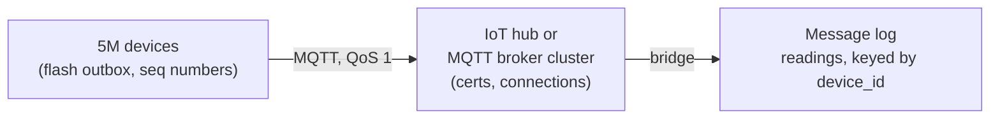
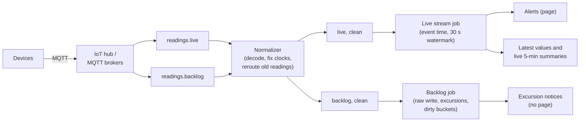
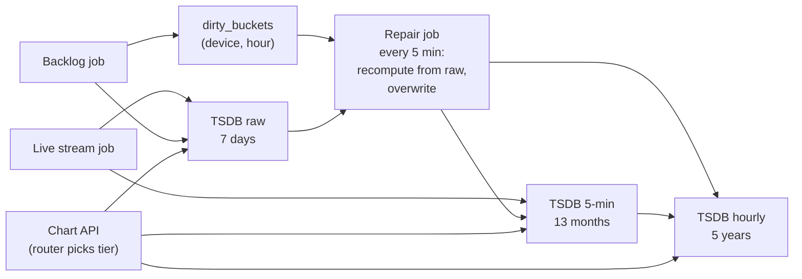
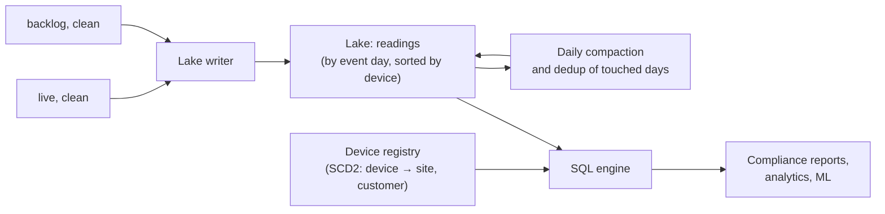
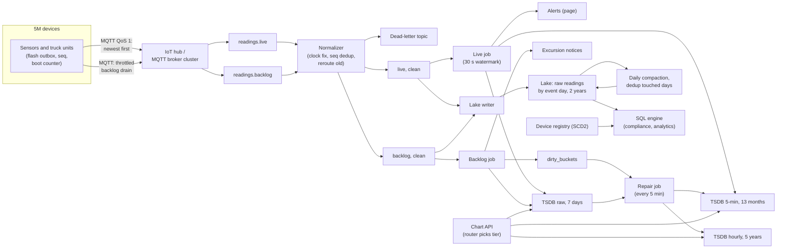

# Design an IoT Sensor Data Pipeline

This last breakdown follows the same seven steps as every other ([The Delivery Framework](../01-the-framework/02-delivery-framework.md)). An IoT prompt looks like a volume problem: millions of devices, half a million readings a second. The volume is the easy part. The interview turns on two facts: **a large slice of the data arrives hours after it happened, as a matter of routine**, and **the data is a time series nobody can afford to keep at full resolution forever.**

## Understanding the Problem

The prompt:

> "We sell temperature and condition sensors for cold storage: freezers in warehouses, cold rooms in pharmacies, and refrigerated trucks. About 5 million devices are deployed. Design the data pipeline that ingests their readings, powers customer dashboards and alerts, and keeps history for analysis and compliance."

A **reading** is one measurement a device takes at one moment: `device 7f3a, 2026-11-03T08:14:10Z, temp=-18.4, humidity=41, battery=87, door=closed`. Each device takes one every 10 seconds.

Three kinds of user want different things from the same readings:

- **Operations staff** watch live dashboards and need an alert within a minute when a freezer warms up. They care about *now*.
- **Customers and auditors** ask "prove this vaccine shipment stayed between 2 and 8°C last March". They care about *what happened when*, exactly, years later.
- **Analysts** want months of fleet history ("which compressor model fails after a door is left open?"). They care about *everything*, in bulk.

The central tension comes from the devices. A warehouse freezer is on wifi and almost always connected. A truck loses coverage on a mountain road, keeps recording into local memory, and uploads six hours of readings when it reaches a town. So a fifth of truck readings arrive late, many of them hours late, out of order and in bursts, and the pipeline must treat that as normal. Then 43 billion readings a day must live somewhere fast enough for dashboards. You will end up **downsampling** (storing lower-resolution summaries of older data, such as one row per device per hour) into retention tiers, and the hard part is keeping those summaries correct when raw data shows up late.

## Requirements

*About 6 minutes.* Ask about connectivity, lateness, resolution and retention:

> **You:** "How long can a device be offline, and what does it do meanwhile?"
> **Interviewer:** "Truck units buffer up to 72 hours on flash. The small battery sensors in cold rooms hold about 4 hours."
> **You:** "When a truck uploads six hours of old readings, must those reach the dashboards and alerts too?"
> **Interviewer:** "They must reach history and compliance reports. Nobody wants a page at 14:00 about a door open at 08:00, but the customer must be told there was an excursion."
> **You:** "How far back do people chart at full resolution?"
> **Interviewer:** "A week, for incidents. Beyond that, trends. But compliance needs raw readings for 2 years."

The second answer splits the problem in two: a live path about the present, and a history path that must be complete.

### Functional requirements

1. **Ingest** readings from 5 million devices over wifi and cellular, including readings buffered offline for up to 72 hours.
2. **Live view and alerts:** latest readings and last-hour charts; threshold alerts ("temperature above -15°C for 5 minutes") and "device silent" alerts.
3. **History:** charts for any device or group over any range up to 5 years, and compliance reports from raw readings up to 2 years back, including **excursions** (periods out of the allowed range) recorded while offline.
4. **Analytics:** SQL over raw history.

**Below the line (out of scope):** provisioning and firmware updates, commands to devices, ML models, the dashboard UI, billing.

### Non-functional requirements

- **Scale:** 5 million devices, one reading every 10 seconds: 500,000 readings a second on average.
- **Freshness:** a connected device's reading is on the live dashboard within 30 seconds of reaching us (p95, meaning 95% of readings meet it); alerts within 60 seconds.
- **Completeness:** every reading uploaded within 7 days lands in history exactly once; summaries reflect late uploads within an hour.
- **Query latency:** one device over any range under 1 second; 2,000 devices over 90 days under 3 seconds.
- **Retention:** raw 2 years, 5-minute summaries 13 months, hourly summaries 5 years.

> [!TIP]
> Ask "what does a device do while offline, and for how long?" early. The buffer limit (72 hours here) becomes your lateness bound, your message log retention floor, and how long you keep raw data in the fast store.

## Sources & Volume

*About 4 minutes.* One source matters: the devices. A small second one is the **device registry**: which device belongs to which customer, site and truck, with model and firmware. History must be joined to it as of the reading's time.

The numbers, using [Key DE Numbers](../02-core-concepts/10-key-de-numbers.md):

1. **Readings.** "5 million devices every 10 seconds: 500,000 readings a second, 43 billion a day."
2. **Messages.** "Battery devices wake once a minute and send 6 readings per message: about 83,000 messages a second."
3. **Bytes.** "An IoT reading is 50 to 200 bytes; with JSON field names call it 200. That's 100 MB/s, about 8.6 TB a day."
4. **Peak.** "The daily curve is flat. The real peak is a **reconnect storm**: an outage ends and hundreds of thousands of trucks reconnect at once with hours of backlog. Size normal peak at 3x, 300 MB/s, and treat storms separately." Deep dive 1 does that math.
5. **Lateness.** "4 million fixed sensors have p99 lateness of seconds. Assume 20% of the 1 million truck units' readings arrive more than 10 minutes late, with a tail to 72 hours. 1 million × 0.1 readings a second × 20% is about **20,000 late readings a second**, all day." Late data here is a steady stream, not an exception.
6. **Compressed.** "Sensor values change slowly, and sorted by device and time neighbouring rows are nearly identical, so columnar storage gets near 10x: about 20 bytes a reading, roughly 860 GB a day." That is deliberately pessimistic. Time-series databases compress each series by storing the change from the previous value, often reaching 1 to 2 bytes per numeric value, so 4 metrics might take 5 to 10 bytes. Plan on 20 and be pleasantly surprised.

Two places a reading can live. A **time-series database** (TSDB) is a store built for timestamped measurements: it keeps each **series** (one metric of one device) sorted by time on fast disk, compresses it well, and answers "this series, this range" in milliseconds. A lake on object storage is cheap but takes seconds to minutes per query.

| Keep raw 10-second readings in | 7 days | 13 months | 5 years |
|---|---|---|---|
| TSDB on SSD (~20 B/reading, 2 replicas, ~$80/TB-month) | ~12 TB, ~$1k/month disk | ~680 TB, ~$54k/month disk | ~3.1 PB, ~$250k/month disk |
| Lake on object storage (~20 B/reading, ~$23/TB-month) | ~6 TB, ~$140/month | ~340 TB, ~$8k/month | ~1.6 PB, ~$36k/month (less with an archive tier) |

Even at 8 bytes a reading the 5-year TSDB column is still about $100k a month. Raw in the fast store is affordable for a week and absurd for five years. Cost is only half of it: a chart is about 1,000 pixels wide, and a year of 2,000 freezers at 10-second resolution is 6 billion points. **Downsampling is a query-speed requirement first and a cost saving second.**

> "Ingest at 100 to 300 MB/s is an ordinary message log. The design is decided by 20,000 late readings a second, and by 43 billion readings a day that must become small summaries without those late readings making them wrong."

## High-Level Design

*About 13 minutes.* The data flow first:

1. Devices record readings locally and upload them when connected.
2. A device connection layer authenticates devices and forwards messages into a message log.
3. A stream job serves the live path: latest values, live summaries, alerts.
4. A time-series store holds raw readings for a week and summaries for years.
5. A lake on object storage keeps every raw reading for 2 years.

"Does that match how you picture it?" Then build it one requirement at a time.

### 1. Getting readings off 5 million devices

Devices are worse network clients than phones: tiny CPUs, batteries that must last years, cellular data billed per megabyte, and connections that drop for hours.

#### Bad Solution: Devices produce straight to Kafka

Kafka is built for thousands of well-behaved clients in a data center, not 5 million intermittent ones on cellular links. Their reconnects load the brokers, the protocol is heavy for a microcontroller, and 5 million field devices would hold credentials to your core message log: one stolen truck unit could write to any partition.

#### Good Solution: Devices POST batches over HTTPS to an ingestion gateway

Devices buffer readings and send a batch every minute to stateless HTTPS servers that validate them and write to the message log. It falls short here: every upload sets up a new TLS connection, costing battery and data 1,440 times a day, and there is no open channel to tell a device "slow down" except in the next response.

#### Great Solution: MQTT through an IoT hub or broker cluster, bridged into the message log

**MQTT** is a lightweight publish/subscribe protocol for constrained devices on unreliable networks. A device holds one long-lived connection to a broker, publishes small messages to topics such as `devices/7f3a/readings`, and can receive messages on the same connection. Its delivery levels are QoS 0 (at most once), QoS 1 (at least once: the device resends until the broker acknowledges) and QoS 2 (exactly once, but only between device and broker). Use QoS 1 and deduplicate later (deep dive 3).

The connection layer is a **managed IoT hub** (AWS IoT Core, Azure IoT Hub) or a self-run MQTT broker cluster (EMQX, HiveMQ). It does three jobs Kafka should not: hold millions of mostly idle connections, authenticate each device by its own certificate, and route messages. A **bridge** (a broker rule or connector) forwards them into the message log (Kafka, or a managed equivalent such as MSK, Confluent Cloud, Event Hubs, Kinesis). HTTPS and CoAP (a compact protocol for very constrained devices) remain for devices that can't hold a connection.

Three rules belong here:

- **The device ID comes from the certificate, never the payload**, so no device can report for another.
- **The device keeps a local outbox:** every reading goes to flash with a per-device **sequence number** (1, 2, 3...) and is deleted only after the broker acknowledges it. [Music Streaming Analytics](01-music-streaming-analytics.md) builds the same outbox for offline plays. The IoT twist is a small, fixed buffer: when a 4-hour sensor fills, firmware summarizes its oldest minutes (min, max, count) instead of dropping them, and flags it, so the gap reads as lower resolution, not missing.
- **The gateway stamps `received_ts`** on every message, so lateness is measurable.

Key the message log by `device_id`: each device's readings stay in order on one partition, and its state lives on one worker. Devices report at similar rates, so there is no hot key.

### 2. Live dashboards and alerts while truck readings arrive hours late

The live path must answer "what is happening now?" within 30 seconds while 20,000 readings a second describe the past.

#### Bad Solution: Bucket and alert by arrival time

Grouping by the minute readings arrive (**processing time**) means a truck reconnecting at 14:00 dumps six hours into one minute: the chart shows a cliff, averages are meaningless, and the door open at 08:00 pages the night shift at 14:00.

#### Good Solution: One event-time stream with a watermark, late readings to a side output

Group by **event time** (when the device took the reading) with a **watermark**: the stream processor's running estimate of event-time progress, here the largest event time seen minus 30 seconds. Readings behind it go to a side output. [Late-Arriving Data](../02-core-concepts/08-late-arriving-data.md) covers the mechanism; [Flink](../04-technology-deep-dives/08-flink.md) covers the wiring.

It suits the 4 million connected sensors but falls short twice:

- **Every truck backlog is "late" by definition.** The side output is 20,000 readings a second that need a real path, and truck summaries have holes until something repairs them.
- **Bad clocks push the watermark ahead.** Flink's Kafka source builds a watermark per partition (the largest event time seen there, minus the delay), and downstream operators use the minimum across partitions. One device 3 hours fast pushes only its own partition's watermark ahead, and the minimum protects you. But if 0.1% of 5 million devices have bad clocks, that is 5,000 spread over 128 partitions: about 40 in every partition, so every partition's watermark jumps, the minimum jumps with them, and every honest reading becomes "late".

> [!NOTE]
> The classic stall is the opposite: an idle partition holds the minimum back, which is what Flink's idle-source setting fixes ([Surge Pricing](../05-breakdowns-core/10-surge-pricing.md) covers when to use it). With 5 million devices hashed over 128 partitions, none goes idle. Your risk is the watermark running ahead.

#### Great Solution: Two lanes, live and backlog, with clocks checked before the watermark

- **Live lane.** On reconnect, devices publish current readings first, then drain backlog on a separate MQTT topic; the bridge maps them to `readings.live` and `readings.backlog`. A small **normalizer** job checks each message before any watermark sees it: decodes it, corrects or flags the clock (deep dive 2), and moves any "live" reading more than 2 minutes older than `received_ts` to the backlog lane. The live job then runs event time with a 30-second watermark, and with bad clocks filtered out it behaves.
- **Backlog lane.** No watermark, no windows. The backlog job writes raw readings idempotently (keyed by device and sequence number), checks them against alert rules to produce **excursion events** ("door open 08:02 to 08:41, recorded offline"), and records **dirty buckets**: the (device, hour) summaries they touch, to be recomputed (section 3).

Threshold alerts run on the live lane and page; excursions from the backlog notify the customer and go into compliance reports, but never page. "Device silent" alerts are the one place processing time is right: you are detecting the *absence* of readings, and no event time arrives to tell you. Suppress them when the pipeline's own consumer lag is high, so a stalled job doesn't report 5 million silent devices.

Say it plainly: "Live means 'about now'. Anything older is history: complete and correct, never pretending to be live."

### 3. Storing years of readings: raw, downsampled, and correct

#### Bad Solution: Keep every raw reading in the time-series store forever

About 3 PB of SSD, roughly $250k a month in disk alone, and year-long charts still read billions of points. Even 13 months is about $54k a month in disk.

#### Good Solution: Raw for a week, plus downsampling jobs on a schedule

Keep raw 7 days in the TSDB. An hourly batch job summarizes the hour just ended into 5-minute and 1-hour rows; retention rules drop old data.

Storage collapses and charts are fast. But **the 08:00 job runs at 09:05, and the truck's 08:00 readings arrive at 14:00.** The summary is already written without them and nothing revisits it. The compliance chart shows a gap, or an average that missed the excursion.

> [!NOTE]
> Built-in TSDB downsampling treats late rows differently. Insert-triggered aggregation (a ClickHouse materialized view into an aggregating table) folds them in as they arrive. Scheduled refreshes look back only as far as you configure (TimescaleDB continuous-aggregate policies), and downsampling tasks are often written to read just the most recent window (InfluxDB examples use the last hour). Details vary by product and version, so check which you have before trusting it with 72-hour lateness.

#### Great Solution: Summaries that are recomputed when late data touches them, and a router that picks the resolution

**Tiers, set by the requirements:**

| Tier | Resolution | Kept | Where | Used for |
|---|---|---|---|---|
| Raw | 10 s | 7 days | TSDB, SSD | Incident zoom, live charts, recompute source |
| 5-minute | 5 min | 13 months | TSDB | Charts from a week to a year |
| Hourly | 1 h | 5 years | TSDB | Multi-year trends, fleet charts |
| Raw archive | 10 s | 2 years | Lake (Parquet on object storage) | Compliance, analytics, rebuilding tiers |

Raw stays 7 days because the device buffer is 72 hours: every late reading still finds its neighbours in the fast store when its summaries are recomputed.

**Store mergeable parts, not averages.** Each summary row holds `min`, `max`, `sum`, `count` and `last` per metric. These are **mergeable aggregates**: values you can combine from smaller buckets into larger ones without the raw data. Twelve 5-minute rows make one hourly row exactly. An `avg` column is not mergeable: the average of averages is wrong when buckets have different counts, as they do for a truck offline half the hour. And keep `max`: an hourly average hides the 4-minute spike to 12°C the auditor is asking about.

**Recompute dirty buckets from raw.** The live job writes 5-minute summaries for connected devices as windows close. A repair job runs every 5 minutes, reads `dirty_buckets`, recomputes those device-hours' 5-minute and hourly rows from raw readings in the TSDB, and **overwrites** them. Recompute-and-overwrite is idempotent: run it twice, same rows, whichever lane wrote the readings. At about 6 million dirty device-hours a day (1 million trucks, a few gaps each) that is roughly 70 recomputes a second of a few hundred readings each: one modest job. A store that folds late rows in on insert does this work for sums, counts, min and max if duplicates are removed first; you still need the recompute for time-weighted values (deep dive 4) and for fixing summary bugs.

**A query router picks the tier.** The chart API asks for about 1,000 points and takes the coarsest tier that gives them: last 6 hours from raw (2,160 points per device), last week from 5-minute rows (2,016), longer from hourly. The 2,000-freezer, 90-day chart reads 4.3 million hourly rows instead of 1.6 billion raw readings. Compliance reports always read raw: the TSDB for the last week, the lake beyond.

The trade-off: "After a week you see 5-minute min and max, not every reading. In exchange, a five-year chart costs the same as a one-day chart, and raw readings are still in the lake for anyone who must prove a single value."

### 4. Two years of raw history for compliance and analytics

A **lake writer** consumes both clean lanes and appends to an Iceberg or Delta Lake table (a **table format**: files plus metadata, so writes are atomic and any SQL engine can read them). Trino, Spark or a cloud warehouse serves analysts and compliance.

Partition by **event day** and sort by `device_id`, `event_ts`. A one-truck, one-week compliance query reads seven partitions and a few row groups in each. Partitioning by arrival day would silently break every date-range query. The price: late readings add small files to old partitions, so daily compaction rewrites every partition that received files yesterday, about four with a 72-hour buffer. Lifecycle rules move partitions older than 90 days to an archive storage tier.

## Data Model

*About 5 minutes.* From the consumers back.

### The reading (topics, TSDB raw, lake)

| Field | Type | Notes |
|---|---|---|
| `device_id` | string | From the device certificate, set by the hub. |
| `seq` | bigint | Per-device sequence number set on the device. With `device_id`, the dedup key. |
| `event_ts` | timestamp | When the reading was taken, after clock correction. |
| `device_ts_raw` | timestamp | The device clock as sent, so a correction can be redone. |
| `received_ts` | timestamp | Gateway clock. `received_ts - event_ts` is the lateness. |
| `clock_quality` | string | `synced`, `corrected`, `suspect`. |
| `lane` | string | `live` or `backlog`. |
| `temp_c`, `humidity`, `battery_pct`, `door_open` | typed columns | Typed per model, not a free-form map, so they compress well. |
| `firmware` | string | Lets you blame a bad release. |

The **grain** (what one row represents) is one reading of one device. TSDB raw and lake share the schema, so a summary recomputed from either matches.

### Summaries

`readings_5m` and `readings_1h`: grain is one device and one bucket. Columns: `device_id`, `bucket_start`, `min`, `max`, `sum`, `count`, `last` per metric, plus `computed_at`. Primary key (`device_id`, `bucket_start`), so repair overwrites are upserts. An `expected_count` (30 per 5-minute bucket) lets a chart shade a bucket with 12 of 30 readings as partial instead of drawing a confident line through a gap.

### Series cardinality

**Series cardinality** is the number of distinct series a TSDB tracks: here 5 million devices × 4 metrics = 20 million. Many TSDBs index series by tags and struggle as cardinality grows. Tags are stable identifiers only (`device_id`, `model`, `customer_id`); a per-trip value such as a shipment ID is joined from the registry at query time.

### Topics and registry

- `readings.live` and `readings.backlog`, keyed by `device_id`. 300 MB/s peak at about 10 MB/s per partition needs at least 30; take 128 for parallelism and headroom ([Partitioning](../02-core-concepts/01-partitioning.md)).
- Retention 4 days, past the 72-hour device buffer: 8.6 TB/day ÷ 3 (lz4) × 4 days × 3 replicas ≈ 35 TB, plus the clean topics.
- The device registry is an **SCD Type 2** dimension (each past version kept with valid-from and valid-to dates): a sensor moved from truck 12 to truck 40 in June reports June under truck 40 and May under truck 12.

## Pipeline Design

*About 5 minutes.*

| Path | Mode | Why |
|---|---|---|
| Devices → hub → message log | Continuous | Device buffers are small. |
| Normalizer, live job | Streaming (Flink, or Spark Structured Streaming) | 30-second freshness, 60-second alerts. |
| Backlog job | Streaming, no windows | Raw writes and excursions; may lag minutes harmlessly. |
| Repair job | Micro-batch, every 5 minutes | Each dirty device-hour recomputed once, not per reading. |
| Lake writer | Micro-batch, 5-minute commits | Bigger files. |
| Lake compaction and dedup | Batch, daily, every touched partition | Late readings grow old partitions. |
| Tier retention | TSDB retention policies, lifecycle rules | No jobs to babysit. |

A **micro-batch** is a small batch run every few minutes, each picking up where the last stopped ([Micro-Batch vs Streaming](../03-architecture-patterns/08-micro-batch-vs-streaming.md)).

**Idempotency, store by store.** Delivery is at least once from the device on:

- TSDB raw: upsert on (`device_id`, `seq`).
- Summaries: live writes and repairs both upsert on (`device_id`, `bucket_start`), and repairs recompute from raw, so redelivery cannot change them.
- Lake: the writer ties file commits to consumer offsets (Flink's Iceberg sink commits on checkpoint), and compaction drops duplicate (`device_id`, `seq`). A duplicate has the same `event_ts`, so it always lands in the same day partition, and partition-local dedup is exact.

**Failure behavior.**

- **Hub or message log down:** devices keep buffering. Fixed sensors hold 4 hours: that is the outage you survive without loss.
- **Live job down:** live dashboards go stale and say so; silent-device alerts are suppressed. On recovery, alerts on readings by then more than 2 minutes old become notices, so a recovering job doesn't page about the past.
- **Bug in summaries:** rebuild the tiers from the lake. Raw exists for only 2 years, so older hourly rows can't be rebuilt; say so, and tag rows with the logic version that made them.
- **Unparseable messages:** a **dead-letter queue** (a side topic for records that cannot be processed, with the reason), counted per firmware version.

## Potential Deep Dives

*About 12 minutes.* If the interviewer doesn't pick, lead with the first: it breaks first in production. [Deep Dives](../01-the-framework/08-deep-dives.md) covers running them.

### 1. "A regional cellular outage ends after 6 hours. 300,000 trucks reconnect in the same minute. What happens?"

Math first. Each truck has 6 × 360 = 2,160 buffered readings. 300,000 × 2,160 × 200 bytes ≈ 130 GB. Sent within 5 minutes, that is about 430 MB/s on top of the normal 100 MB/s, plus 300,000 TLS handshakes in seconds, which are CPU-heavy for brokers.

#### Bad Solution: Devices reconnect immediately and upload at full speed

The brokers reject connections under handshake load, rejected devices retry on the same fixed timer, and the herd returns in lockstep. Once through, live readings queue behind six hours of backlog, so dashboards go stale exactly when operations needs to know whether the cargo is safe.

#### Good Solution: Backoff with jitter, and autoscaling

Firmware retries with **exponential backoff with jitter** (each wait roughly doubles, plus a random amount, so devices spread out). Brokers scale out; the message log absorbs the burst. Connections succeed within minutes, but backlog still shares the path with current readings.

#### Great Solution: Live first, backlog throttled in its own lane

- **Newest first.** On reconnect the device sends its current reading on the live topic, then drains backlog oldest-first. Operations sees every truck's present state within seconds.
- **Throttled drain.** Say 2 readings a second: 2,160 readings take about 18 minutes per truck, and 300,000 trucks add about 600,000 readings a second, roughly 120 MB/s, inside the 300 MB/s peak the log is sized for. The platform can change the cap over the open MQTT connection depending on backlog lag.
- **Separate lanes all the way down.** The backlog topic has its own consumers. It can fall 30 minutes behind in a storm and no live dashboard notices; summaries still land within the hour the requirements allow. The 4-day log retention covers a backlog consumer that is down for a day.

Same idea as per-service quotas in [Log Aggregation](../05-breakdowns-core/01-log-aggregation.md), except the burst is old data, so the fix is separating old from new.

### 2. "Some devices' clocks are wrong. One reports readings from 2031, another from 1970. What breaks, and what do you do?"

Future timestamps drag watermarks forward, past ones misfile readings into the wrong day, and a compliance report on a wrong clock is worthless. Cheap sensors often lack a battery-backed clock and restart at 1970 after a power cut.

#### Bad Solution: Trust the device timestamp

Charts show readings in 1970 and 2031.

#### Good Solution: Use the server's `received_ts` as event time

[Surge Pricing](../05-breakdowns-core/10-surge-pricing.md) makes server time the pipeline clock, because there a stale location is worthless anyway. Here it is fatal: a six-hour backlog gets its upload time, the 08:00 excursion lands at 14:00, and the compliance report is fiction. Server time only works for readings that arrive within seconds.

#### Great Solution: Correct device time from a known offset, and flag what you can't fix

- **Stamp relative time the device can trust:** a boot counter (incremented on restart) and milliseconds since boot, alongside the wall clock.
- **Measure the offset at upload:** each upload carries the device's current clock, and the gateway compares it with `received_ts`. Readings from the same boot get `event_ts = device_ts_raw + offset`; readings from a device that booted at 1970 are placed by milliseconds since boot, counted back from upload. GPS-equipped trucks can use GPS time.
- **Bound and flag:** a corrected `event_ts` after `received_ts`, or older than the buffer allows, is impossible. Keep it in the lake with `clock_quality = 'suspect'`, out of the watermark and summaries, and count it. Keep `device_ts_raw` so a bad correction rule can be redone.

Monitor suspect clocks per firmware version: a release that breaks clock code shows up as one firmware jumping from 0.1% to 30%.

### 3. "MQTT QoS 1 and backlog retries both resend readings. How do you make sure a reading is counted once?"

Summaries store `sum` and `count`. A duplicate doesn't change `min` or `max`, but it skews the average and inflates `count`, which then wrongly says a bucket is complete.

#### Bad Solution: Use QoS 2

It costs an extra round trip per message on a battery device, and its guarantee ends at the broker: the bridge, log and consumers can still repeat. You pay more and still need dedup.

#### Good Solution: Windowed dedup on (`device_id`, `seq`) in the stream job

Remember keys for an hour ([Deduplication at Scale](../02-core-concepts/09-deduplication-at-scale.md)). At 500,000 readings a second that is 1.8 billion keys, about 90 GB of state. A backlog resent after a failed upload can arrive later than that, and a 72-hour window would be over 6 TB.

#### Great Solution: Per-device sequence ranges, so state grows with devices, not readings

Because devices number their own readings, the normalizer keeps per device only the ranges it has received: "1 to 48,210, plus 51,000 to 51,340". A reading in a received range is a duplicate. Usually that is one range; a reconnected truck has two or three until the backlog fills the hole and they merge. A few 16-byte ranges for 5 million devices is under 1 GB, whether the duplicate comes a second or three days later.

The ranges also measure completeness: a hole open past 72 hours is readings that will never arrive.

### 4. "Product wants hourly p95 temperature, and a door sensor only reports when the door opens or closes. Are your summaries still right?"

**Percentiles are not mergeable.** Twelve 5-minute p95s don't make an hourly p95. Store a quantile **sketch** (a small, fixed-size structure that answers one question approximately; for percentiles, a t-digest or KLL sketch of a few hundred bytes) per bucket and merge those. At 1.44 billion 5-minute rows a day, 300 bytes each is about 430 GB a day, so add it only for metrics someone asked for.

**Averages of irregular samples lie.** A door sensor reports "opened 08:02, closed 08:41, opened 08:50, closed 08:51". The mean of four rows says nothing about how long the door was open. You need a **time-weighted average**: each value weighted by how long it held, so the 08:00 hour shows the door open 40 of 60 minutes. That needs the value carried in from before the bucket, which is why rows keep `last`. And a late "closed" event changes every bucket until the next known value, so for change-only sensors one dirty bucket dirties the ones after it.

## Monitoring & SLAs

*About 4 minutes.* [Monitoring and SLAs](../01-the-framework/09-monitoring-and-slas.md) covers presenting them; [Monitoring and Alerting](../02-core-concepts/06-monitoring-and-alerting.md) covers alert design.

| SLA | Target | Measured by |
|---|---|---|
| **Live freshness** | 95% of live readings queryable within 30 s of `received_ts`; alerts within 60 s | Canary devices per region sending known readings |
| **Completeness** | 99.9% of recorded readings in the lake within 7 days, exactly once | Sequence-range holes older than 72 hours; duplicates found by compaction |
| **Summary correctness** | Dirty buckets recomputed within 1 hour; zero mismatches in a nightly sample | Oldest dirty bucket age; nightly recompute of 10,000 random device-days from the lake |

Behind them:

- **Lateness distribution** (`received_ts - event_ts`) by device type. Truck p99 jumping from 2 hours to 9 means a carrier problem.
- **Backlog lag separately from live lag.** In a storm backlog lag rises and live stays flat: the design working.
- **Suspect-clock and dead-letter rates per firmware version.**
- **Silent devices per region and carrier**, so a network outage isn't mistaken for a pipeline bug.
- **Series cardinality.** A doubling means someone put a per-trip value in a tag.

## Final Design

Follow one truck. At 08:00 truck 40 loses signal; its sensor keeps recording to flash, and at 08:02 the door is left open for 39 minutes. At 14:00 it reaches a town, connects after a random 40-second backoff, and its current reading is on the dashboard within seconds. The 2,160-reading backlog drains over the next 18 minutes. The normalizer finds the clock offset small (2 seconds) and the sequence ranges all new. The backlog job writes raw readings, finds the 08:02 to 08:41 excursion, notifies the customer without paging anyone, and marks six device-hours dirty. By about 14:25 the repair job has rewritten them. The lake writer commits the readings into the 3 November partition, and tonight's compaction rewrites it. In March an auditor's report reads them from the archive, excursion flagged "recorded offline".

## What's Expected at Each Level

### Mid-level

You produce a working pipeline: devices to a connection layer to a message log, a stream job for live data and alerts, a TSDB, and object storage for history. You do the volume math and know years of raw readings in the fast store are too expensive. You aggregate by event time, though the interviewer may have to push you to see that trucks make late data a steady stream. Bar: the Good options in the high-level design, summary tiers with retention, and a freshness SLA.

### Senior

You drive, and the lateness numbers steer the design. You turn "don't page about 08:00 at 14:00" into live and backlog lanes, and explain unprompted why one watermark fails with millions of independent clocks, including future clocks. You keep summaries correct by recomputing dirty buckets from raw, store mergeable aggregates, and size the raw window from the device buffer. You handle the reconnect storm with jitter, newest-first and throttling, and monitor backlog lag separately from live lag.

### Staff+

You treat device and pipeline as one system with a contract: sequence numbers, boot counters, newest-first and throttle settings are firmware requirements, and some devices stay on old firmware for years. You cost the cellular data plan, not just the cloud bill: binary encoding and batching save real money across 5 million devices. You weigh a managed hub's per-message pricing and quotas against running brokers and anticipate what auditors ask about clock corrections. And you say when it is too much: for 50,000 always-connected sensors, one TSDB with built-in downsampling is the right answer.

## Related Lessons

- Framework: [The Delivery Framework](../01-the-framework/02-delivery-framework.md), [Requirements Gathering](../01-the-framework/03-requirements-gathering.md), [Sources and Volume](../01-the-framework/04-sources-and-volume.md), [Deep Dives](../01-the-framework/08-deep-dives.md), [Monitoring and SLAs](../01-the-framework/09-monitoring-and-slas.md)
- Concepts: [Late-Arriving Data](../02-core-concepts/08-late-arriving-data.md) (watermarks, side outputs, batch correction), [Deduplication at Scale](../02-core-concepts/09-deduplication-at-scale.md) (windowed dedup and its state), [Partitioning](../02-core-concepts/01-partitioning.md), [Key DE Numbers](../02-core-concepts/10-key-de-numbers.md), [Monitoring and Alerting](../02-core-concepts/06-monitoring-and-alerting.md), [Cost Optimization](../02-core-concepts/05-cost-optimization.md)
- Patterns: [Micro-Batch vs Streaming](../03-architecture-patterns/08-micro-batch-vs-streaming.md)
- Technology: [Flink](../04-technology-deep-dives/08-flink.md) (watermark strategies, event-time timers, Iceberg sink), [Kafka](../04-technology-deep-dives/02-kafka.md), [Iceberg](../04-technology-deep-dives/07-iceberg.md)
- Related breakdowns: [Music Streaming Analytics](01-music-streaming-analytics.md) (device outbox and offline uploads), [Surge Pricing](../05-breakdowns-core/10-surge-pricing.md) (server time as the pipeline clock, idle partitions), [Log Aggregation](../05-breakdowns-core/01-log-aggregation.md) (hot, warm and cold tiers), [Real-Time Dashboard](../05-breakdowns-core/04-real-time-dashboard.md)
- Previous breakdown: [Data Mesh Platform](09-data-mesh-platform.md). Next: [Module 6 Quiz](11-quiz.md)
